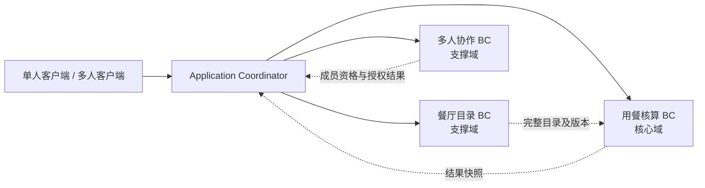
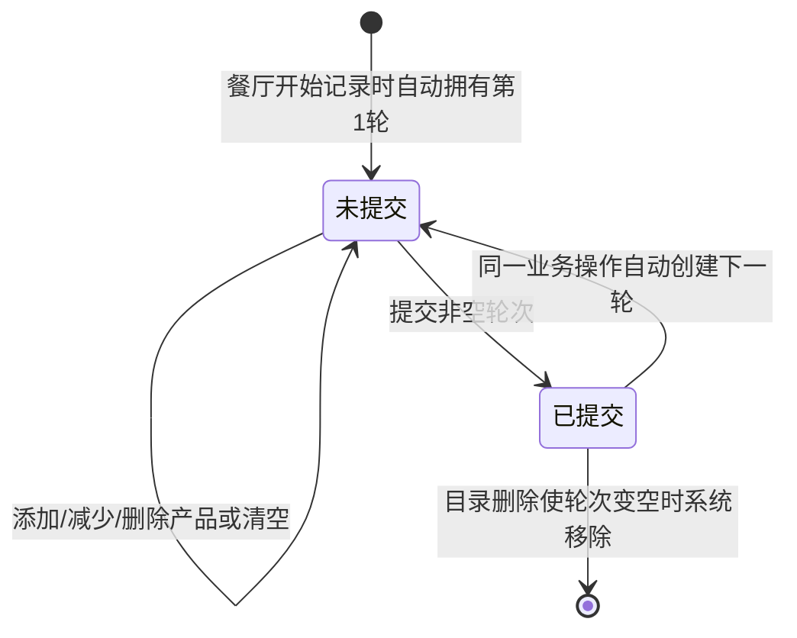

# 自助餐省钱神器 — DDD 战略设计说明书（最终校准版）

> **状态**：已校准业务基线（BR-89 + 后续 M14–M23 等明确业务决定）  
> **校准日期**：2026-10-31  
> **范围**：业务边界、统一语言、限界上下文、生命周期、业务不变量、跨上下文一致性要求  
> **不包含**：具体类、存储表、API 路径、事件总线或框架选型（参见配套战术设计文档）  
> **覆盖原则**：后续明确决策覆盖旧战略基线中的相反表述，所有废止规则在第 12 节列明。

## 1. 业务愿景与范围

本产品帮助用户在自助餐用餐过程中记录食物数量及估算价值，结合一次用餐活动统一的**门票总金额**计算已吃回的金额、盈亏和回本情况；支持在一次用餐活动中比较多家餐厅，最终选择一家餐厅生成正式结果。既支持本地单人用餐，也支持多人房间协同记录。

**核心价值**：实时核算、按轮次记录、跨餐厅比较、多人协作、个人小票和历史留存。

**范围约束**：不设计注册登录体系；客户端使用持久化匿名身份识别多人协作成员；不提供匿名身份主动切换或身份恢复。单人未完成活动、个人小票及个人历史保存在本地，无云端恢复承诺。

## 2. 统一语言

| 术语 | 含义 |
|---|---|
| 用餐活动（Dining Activity） | 一次独立的核算过程，具有统一门票总金额、候选餐厅、各餐厅轮次及最终结果 |
| 候选餐厅 | 当前活动中用于记录、比较消费的餐厅；仅一间被选为最终餐厅 |
| 轮次（Round） | 某餐厅的一组消费产品及数量，状态为未提交或已提交 |
| 提交轮次 | 锁定该轮次的用户编辑，并自动进入下一未提交轮次；不改变其是否计入实时核算 |
| 清空轮次 | 移除当前未提交轮次的全部产品，不删除轮次自身 |
| 门票总金额（ticketPriceMinor） | 当前用餐活动**合计支付的门票金额**，仅有一份；不是每人单价，且必须大于零 |
| 核算结果 | 按餐厅产品数量与有效价格计算的估算价值、盈亏和回本情况；不按用餐人数乘门票 |
| 最终餐厅 | 完成用餐时显式指定、用于生成正式结果的唯一餐厅 |
| 小票 | 某用户主动保存的一份不可变核算快照；每人保留一份，后存覆盖前存；可在用餐过程中保存 |
| 历史记录 | 已完成用餐的不可变结果，按用户在本地保存，可有多条 |
| 房间（Room） | 多人协作会话；每个房间恰好关联一次用餐活动 |
| 房间创建者 | 创建房间并在创建时提供私人餐厅的匿名身份，不等于永久房主 |
| 当前房主 | 当前拥有提交轮次、完成/放弃用餐及转让房主权限的在线成员 |
| 私人餐厅原件 | 用户本地维护的餐厅目录 |
| 房间私人餐厅副本 | 房间创建时由创建者提供、服务器临时保存的私人餐厅数据 |
| 目录版本 | 可用于一致性核算与快照生成的完整有效餐厅目录状态；要求读取一致，但结果不必保存整个目录 |

## 3. 子域与限界上下文

### 3.1 用餐核算（Dining Accounting）——核心域

**职责**：用餐活动生命周期；统一门票总金额（大于零）；候选餐厅的轮次及产品数量；实时核算；轮次提交与自动创建；选择最终餐厅；完成/放弃用餐；生成一致且不可变的最终结果与小票数据快照（仅记录本次消费所需信息）。

**不负责**：房间成员、房主、在线状态、匿名身份认证、餐厅目录的编辑及所有权、客户端历史列表管理。

**关键边界**：同一核算领域模型服务单人和多人模式。核算命令处理业务行为，但不包含 `Room`、`Host`、`RoomMember` 等协作概念；调用方在进入核算行为前完成授权。

### 3.2 餐厅目录（Restaurant Catalog）——支撑域

**职责**：餐厅、分类、产品、有效价格、餐厅稳定标识和目录版本；公共目录管理；本地私人目录管理；发布可供核算使用的完整目录状态。

**不负责**：轮次、用餐金额、房间成员权限、正式用餐历史。

**来源差异**：公共目录由平台提供、可动态新增/修改/删除；私人目录由用户在本地维护。两者在核算侧遵循相同的价格和产品有效性规则。

### 3.3 多人协作（Dining Collaboration）——支撑域

**职责**：房间生命周期、房间码、成员参与及在线状态、当前房主、主动转让与自动交接、成员操作授权、房间临时私人餐厅副本及其同步资格、房间与用餐活动的关联、完成时的结果领取资格。

**不负责**：轮次的核算公式、产品目录原件的业务编辑、个人本地历史的长期保存。

### 3.4 应用层协调（Application Coordinator）

跨上下文流程由应用层协调：创建房间并关联用餐活动、权限验证后提交轮次、目录变更影响活动、完成时基于一致目录版本冻结本次消费结果、向符合资格的成员提供快照等。

**Application Coordinator 不是第四个限界上下文**，也不是一个承载业务不变量的“万能领域模型”。各上下文保有自身规则与决策权。

## 4. 上下文映射与依赖原则

- **餐厅目录 → 用餐核算**：目录提供产品身份、价格及版本；核算只消费目录信息，不反向管理目录。目录更新对活动的影响由协调层组织，由核算侧执行自己的业务约束。
- **多人协作 → 用餐核算**：协作侧验证当前成员与房主权限，协调层调用核算用例；核算侧不直接感知房间。
- **用餐核算 → 客户端本地存储**：核算产出不可变快照；小票与历史由各客户端独立保存，不能把本地保存成功误当作服务端房间生命周期的一部分。
- **私人目录 → 房间副本**：由创建者提供的本地目录同步至多人协作管理的临时副本；副本不是所有成员共同编辑的目录原件。

这里的箭头表达**业务信息流和协调关系**，不预先规定代码模块的直接编译依赖、同步调用或事件实现。

## 5. 用餐核算的业务规则

### 5.1 活动与餐厅

1. 每次用餐活动只有一个**统一的门票总金额**，必须大于零。所有候选餐厅共用该金额进行核算；它不是每人单价，**不乘以成员数量**。
2. 一次活动可记录多家餐厅，各餐厅分别拥有自己的轮次与核算数据。
3. 不同成员可以独立查看不同餐厅；查看选择属于个人会话状态，不是房间全局选中餐厅。
4. 结束用餐必须**显式指定一个有效的最终餐厅**，单人和多人模式完全一致；不能推断为最后查看的餐厅。
5. 最终结果只保留最终餐厅的消费核算，其他候选餐厅的临时消费数据不进入正式历史。
6. 允许最终餐厅没有任何食物消费；此时食物估值为零，盈亏等于负票价。
7. 最终餐厅失效或已删除时，拒绝完成命令，需重新选择有效餐厅；允许主动放弃活动且不生成正式结果。
8. 单人可在完成前修改门票总金额；多人只有**当前房主**可在用餐结束前修改房间门票总金额。完成后的冻结结果不可改写。
9. 成功结束后再次执行结束命令，抛出已结束业务错误，不把已有结果当作本次命令成功返回；用户可另行查询已完成结果。

### 5.2 轮次生命周期

上述图中“已提交 → 未提交”表示**旧轮次保留为已提交，同时产生新轮次**，并非旧轮次状态回退。

1. 每家餐厅同一时间**最多一个未提交轮次**；不同餐厅可各自有一个。
2. 轮次由系统自动创建：餐厅开始记录时出现第 1 轮；提交非空轮次成功后，原子地创建下一未提交轮次。**不提供手动创建轮次功能**。
3. 未提交轮次可以为空，但空轮次不能手动提交；结束用餐时忽略空的未提交轮次。
4. **已提交与未提交轮次均参与实时核算和中途小票快照**。提交仅锁定用户编辑权限，不是“计入金额”的开关。
5. 所有具备协作编辑权限的在线成员均可修改未提交轮次的产品数量、删除其中的产品或清空全部产品；清空后轮次本身仍存在。
6. 用户**不能直接删除整个轮次**，也不能修改或清空已提交轮次。
7. 目录删除某产品时，该产品从进行中的相应轮次中移除，包括已提交轮次；如果已提交轮次因此变空，系统删除该轮次；未提交轮次变空则保留。
8. 轮次展示编号始终连续，但**稳定轮次 ID 不变**；删除轮次引发的重新编号不能改变轮次业务身份。
9. 已提交轮次即使因为其他轮次消失而被重新编号，仍保持锁定。
10. 结束用餐时，最终餐厅中非空的未提交轮次自动视为提交并纳入结果；空轮次忽略；不再生成新轮次。

### 5.3 数量与核算

- 产品的消费数量不得为负。
- 并发增加按服务端确定的生效顺序累计。**不提供请求 ID 去重或重复请求特殊处理**；同一添加命令若多次到达并分别成功，则数量多次累加。
- 减少数量时若当前数量不足，整次减少操作拒绝，不自动截断到零。
- 删除未提交轮次的产品条目后，后续添加可以重新建立该条目；以实际生效顺序为准。
- 核算基于当前有效目录价格与当前有效消费数量；估算消费价值为各产品有效单价与数量乘积之和，盈亏为估算消费价值减**统一门票总金额**，回本状态由两者比较确定。门票总金额大于零，因此回本率可正常计算。
- 价格调整会影响进行中的核算，**包括已提交轮次**；已保存快照不追溯更新。

## 6. 餐厅目录与价格变化

1. 单人模式可同时选择公共餐厅和本地私人餐厅；私人目录无需上传服务器。
2. 单人用餐过程中允许修改本地私人目录，变更立即反映在进行中的核算。
3. 公共目录新增的餐厅在进行中的多人房间也可使用；公共餐厅集合不随房间创建而冻结。
4. 多人房间的**私人餐厅身份集合**在创建时由创建者选定并固定；其他成员和后继房主均不能追加私人餐厅。
5. 房间私人餐厅副本的产品、分类及价格可由原创建者通过其本地目录同步更新；其他成员（包括房主）不可直接编辑副本。
6. 原创建者退出房间后停止同步；副本继续供房间使用。原创建者重新加入仍在进行中的房间后，同步本地最新状态（包含删除），不得用过期版本覆盖新版本。
7. 删除目录中的产品会从所有进行中的对应轮次移除；删除餐厅会移除其在进行中活动里的相关数据。已经保存的小票与完成历史不变。
8. 餐厅使用稳定身份区分，**名称不要求唯一**；公共与私人同名餐厅不能混淆。具体标识编码方式留待战术设计。
9. 小票及最终结果生成时，必须使用同一餐厅目录的**完整一致版本**，不得混用不同版本的价格或产品状态；**只需在结果中固定此次实际消费的菜品名称、数量、单价和必要的餐厅信息，无须保存完整目录副本**。

**一致性边界**：目录变更与核算更新可以存在传播过程，但一旦对外形成正式快照，就必须对应一个可解释、完整的目录状态。目录上下文不能越过边界直接篡改核算领域对象。

## 7. 单人模式

1. 单人模式不创建虚拟房间；直接使用用餐核算领域能力。
2. 本地同一时间最多一个**进行中的单人用餐活动**。开始新活动前须完成或放弃已有活动。
3. 进行中的单人活动及轮次数据自动保存在本地；关闭应用、崩溃或重启不等于完成或放弃，重新打开可继续。
4. 单人用户可执行编辑、清空、提交轮次、完成及放弃活动等操作，不需要房主角色。
5. 单人模式的轮次、目录更新、最终餐厅选择、快照规则与多人模式相同。
6. 单人活动可以与一个多人房间同时存在；两者消费记录互不覆盖。若引用同一公共目录，目录变化仍可分别影响两个进行中的活动。
6. 完成活动产生本地历史；放弃活动不产生历史。清除本地数据后，不提供恢复承诺。
7. 单人模式的门票金额也是整次活动合计金额，必须大于零，不按用餐人数量计算。

## 8. 多人协作

### 8.1 房间与活动

1. 创建房间即开始一场用餐活动，不存在独立的等待大厅。
2. 一个房间只关联一场用餐活动；完成或放弃后不能在原房间重新开始。
3. 房间创建者初始成为房主；房间创建者与当前房主是不同的身份概念。
4. 只有当前房主可以提交轮次、完成/放弃用餐、**修改房间门票总金额**及主动转让房主身份。
5. 所有在线成员均可编辑、删除产品及清空当前未提交轮次；不能直接修改已提交轮次。
6. 房间成员可以各自选择查看的餐厅，互不强制切换；同一餐厅的数据仍共享。

### 8.2 成员与房主

1. 同一匿名身份同一时间最多参与**一个进行中的多人房间**；这不限制本地单人活动。
2. 主动退出进行中房间后，可通过房间码重新加入；重新加入按**本次加入时间**重新排序。
3. 房主退出或被服务端确认离线时，自动转交给当前在线成员中本次加入最早者。
4. 房间无人在线时暂时没有房主；第一个成功重新加入者成为房主。
5. 房主可主动将身份转给任意其他在线成员，原房主继续留在房间并成为普通成员；可以反复转让，也可以转回原房主。
6. 主动转让不改变成员加入顺序；房间创建者不具有永久房主特权。
7. 只要房间存在在线成员，就必须恰有一名房主；并发转让、退出、提交等操作按服务端实际生效顺序判定。
8. 不支持主动切换匿名身份；清除匿名凭据后，生成的新身份不能继承原成员权限或结果资格。

### 8.3 房间终态与回收

1. **进行中 → 已完成**：房主显式指定最终餐厅，生成冻结结果；房间转为只读。
2. **进行中 → 已放弃**：房主放弃活动，不生成正式结果；房间进入终态。
3. 完成与放弃并发时，服务端先生效的终态操作成功，另一操作拒绝；终态不可再次改变。**重复执行完成命令抛业务异常**，不额外实现请求级幂等去重。
4. 已放弃房间不允许任何人重新加入；当前成员可以看到放弃状态并离开。
5. 已完成房间仅允许**完成时具备资格的成员**重新加入，查看同一最终结果及补存本地历史/小票，直到房间销毁。
6. 成员资格以完成操作生效时服务端**已确认的在线状态**为准。完成前已退出者不具备资格；如果实际断线尚未被服务端确认，仍按服务端当时状态判断。
7. 最终结果中的用餐人名单**只记录完成时仍在房间且被服务端确认为在线的成员**，不包含此前退出的成员；此名单不参与门票金额计算。
8. 无人在线的房间保留 10 分钟；之后可以销毁。重新加入与销毁竞争时，按服务端实际操作生效顺序决定，不仅按定时器触发时间推断。
9. 销毁未完成房间时丢弃其临时活动与私人餐厅副本；房间销毁不删除各客户端已经保存的个人历史或小票。

## 9. 小票、历史与结果归属

### 9.1 小票

- 小票是**个人**保存的不可变快照，而非全房间共用的一张可变单据；多人模式**统一计算整个房间**的消费结果，不对商品按成员归属。
- 每个用户保留一份小票；再次保存覆盖其自己的旧小票，不影响其他成员。
- 用餐进行中可按个人当前选择的餐厅保存小票，包含该餐厅**已提交和未提交**的有效轮次。
- 已完成房间的合格成员在房间仍存在时，可以根据冻结的最终结果重新保存或覆盖个人小票。
- 快照数据由一致的目录状态生成，只固定本次消费涉及的餐厅名称、成员信息、轮次、菜品名称/数量/单价、门票总金额和计算结果等必要信息；不需持久化完整餐厅目录。随后保存在客户端本地；房间销毁后不能再从房间生成新小票，但已保存的小票保留。
- 保存快照与放弃活动竞争时，若快照生成先生效，后续本地写入可以继续完成；若放弃先生效，则拒绝新快照生成。

### 9.2 历史

- 只有**完成**用餐才生成正式结果；放弃不生成历史。
- 同一多人房间的所有合格成员可领取**相同的整房最终核算结果**，但各自在本地独立保存历史。用餐人名单只含完成时在房间的合格成员。
- 本地历史可保存多条、查看与单独删除；不进行云端同步。
- 如果合格成员未能及时保存，仍可在已完成房间存在期间重新加入并补存，按稳定用餐活动 ID 去重，避免重复历史。
- 完成前已经退出的成员不具备补存资格，即使曾参与编辑。
- 单人和多人使用相同的**结果快照语义**，但结果来源、保存资格与访问路径不同。

### 9.3 结果快照的最小完备信息

正式完成结果（DiningResult）与进行中小票快照均不复制全量餐厅目录，仅冻结可以独立解释本次消费的业务信息：

- 最终或当前小票所选餐厅的**名称及稳定标识**（标识仅用于溯源，不作为查看时再查价的依据）。
- 一次用餐的**门票总金额**，不属于某个用餐人。
- 多人正式结果中**完成时仍在房间且服务端确认在线的成员名单**；成员不关联具体菜品。
- 本次餐厅的轮次顺序、轮次稳定 ID、轮次状态与各轮菜品的名称、消费数量、有效单价和小计。
- 估算菜品总价值、票价与盈亏、完成时间及币种等独立展示所需数据。

最终结果只涉及**显式选择的最终餐厅**；小票在活动进行中也可按当前查看的候选餐厅保存，其后价格调整不会追溯修改已经保存的小票。已完成房间的最终结果及资格名单一旦冻结即不可变。针对已结束状态的再次完成请求抛业务异常，另行查询结果不改变已结束的事实。

---

## 10. 关键跨上下文业务流程

### 10.1 创建多人房间

1. 协作上下文建立房间及初始房主身份。
2. 创建者在创建时选定私人餐厅身份集合；必要时上传完整私人目录副本。
3. 应用层协调创建与房间关联的用餐活动，确定**大于零的统一门票总金额**及可用目录来源。
4. 整个业务流程对外不能暴露“有房间但没有可用关联活动”的不一致完成状态；具体事务/补偿方式留待技术设计。

### 10.2 编辑及提交轮次

1. 多人请求先由协作上下文验证在线成员及操作权限。
2. 用餐核算上下文验证轮次状态、产品有效性、数量约束。
3. 编辑未提交轮次时更新实时结果；提交时验证非空，锁定旧轮次并原子创建下一轮。
4. 对并发修改按服务端生效顺序实施版本与数量检查，避免负数量；**不对重复网络请求做特殊去重处理**，分别成功的重复请求分别生效。

### 10.3 目录更新

1. 目录上下文产生完整有效的新版本；私人副本更新还需检查提供者当前在房间内及版本新旧。
2. 协调层将目录变化作用于相关进行中活动。
3. 核算上下文重算价格、移除失效产品或餐厅，执行空已提交轮次删除及编号重排规则。
4. 已保存快照与已完成活动不被反向修改。

### 10.4 完成用餐

1. 单人模式由本地用户发起；多人模式先验证当前房主资格。
2. 命令显式携带 `finalRestaurantId`，检查活动仍在进行且最终餐厅有效。
3. 将最终餐厅非空未提交轮次纳入完成结果，忽略空轮次。
4. 使用一致的有效目录版本计算并冻结**整次活动的门票总金额**、本次消费相关菜品名称、数量、单价、各轮次和核算结果；不保存完整目录。
5. 多人模式同时固定完成时合格成员集合（也即最终结果的用餐人名单），并将房间设为只读；其他餐厅临时核算不进入最终结果。
6. 客户端独立保存个人历史；未及时保存者可在房间存续期间按资格补存。

## 11. 关键业务不变量与一致性矩阵

| 编号 | 不变量/约束 | 负责边界 |
|---|---|---|
| I-01 | 用餐核算不依赖房间、房主或成员概念 | 用餐核算 / 架构边界 |
| I-02 | 每家餐厅最多一个未提交轮次 | 用餐核算 |
| I-03 | 提交非空轮次与创建下一轮原子生效 | 用餐核算 |
| I-04 | 已提交轮次不可由用户编辑，但有效目录变化可影响其核算内容 | 用餐核算 + 目录协调 |
| I-05 | 已提交和未提交轮次均计入实时核算 | 用餐核算 |
| I-06 | 产品数量不为负；分别成功的重复请求分别产生业务变化，不做请求级去重 | 用餐核算 |
| I-07 | 完成用餐必须有一个显式指定且有效的最终餐厅 | 用餐核算 |
| I-08 | 小票和最终结果使用完整一致的目录版本 | 目录 + 核算协调 |
| I-09 | 完成后的结果及已保存小票不可变 | 用餐核算 / 本地保存 |
| I-10 | 有在线成员时恰有一名房主 | 多人协作 |
| I-11 | 只有当前房主能提交轮次、完成或放弃多人用餐 | 多人协作授权 |
| I-12 | 同一匿名身份最多参与一个进行中的多人房间 | 多人协作 |
| I-13 | 同一本地环境最多一个进行中的单人活动 | 单人应用业务规则 |
| I-14 | 房间私人餐厅集合创建时固定，只有原提供者在房间内可同步已有副本 | 多人协作 + 目录 |
| I-15 | 已完成房间的结果资格以完成时服务端确认在线状态为准 | 多人协作 |
| I-16 | 房间完成/放弃互斥且不可逆；重复结束命令抛业务异常 | 多人协作 + 核算协调 |
| I-17 | 统一门票总金额必须大于零，且不按成员数量相乘 | 用餐核算 |
| I-18 | 多人门票总金额仅当前房主可在完成前修改 | 多人协作授权 + 用餐核算 |
| I-19 | 最终结果仅记录完成时服务端确认在线且在房间的成员 | 多人协作 + 用餐结果 |
| I-20 | 中途小票和最终结果仅固定本次消费数据，目录价格与名称来自同一有效版本 | 目录 + 用餐核算 |

**并发判定原则**：成员权限变化、房间终态变化、编辑请求、目录变更、快照生成等涉及竞态时，以服务端明确的业务生效顺序及相应版本边界为准；不得仅凭客户端发起时间或页面状态判断。跨上下文需要定义可观察的成功/失败结果；**不要求请求级去重和相同响应重放**，但终态不可重复发生。战略设计不指定锁、事务或消息中间件。

## 12. 决策冲突清理与最终解释

| 曾出现的歧义 | 本文采用的最终规则 |
|---|---|
| “只有已提交轮次计入金额” | **废止**：已提交、未提交均计入实时核算与中途小票（BR-58） |
| “用户可删除整个未提交轮次” | **修正**：用户实际意图是清空轮次产品；轮次本身不删除（BR-65/66 修订） |
| “用户手动创建下一轮” | **废止**：提交成功自动创建下一轮（BR-67/68） |
| “空已提交轮次是否保留” | 因目录删除而变空的已提交轮次自动移除；空未提交轮次保留（BR-61/64） |
| “删除后轮次编号与身份” | 展示编号连续重排，稳定轮次 ID 不变（BR-62/63） |
| “最终餐厅由当前选择推断” | **废止**：完成命令显式指定最终餐厅（BR-52/87） |
| “房间创建者永远是房主” | **废止**：房主可主动多次转让、自动交接，创建者身份独立（BR-78～80） |
| “房间私人餐厅任何人可改” | **废止**：只有原创建者在房间内可通过本地原件同步（BR-81～83） |
| “单人模式是否需单独核算模型” | **否**：单人和多人复用同一用餐核算领域模型（AD-01） |
| “网络重复请求须去重” | **废止**：不引入请求 ID 去重；分别成功的重复命令分别生效（后续 M22） |
| “结束时非空未提交轮次禁止结束” | **废止**：自动视为提交并计入结果，不创建新轮次（BR-89 基线 §5.2） |
| “最终餐厅零食物消费不能结束” | **废止**：允许零食物消费正常完成；但**门票总金额不得为零** |
| “门票是每个成员的单价” | **废止**：票价是整次用餐总金额，只保存一次，不按人数乘（M15/M20） |
| “完成结果保存完整 CatalogSnapshot” | **废止**：要求计算输入来自一致目录版本，但只保存实际消费所需名称、价格、数量和汇总（M14） |
| “结束结果包含曾经参与的所有成员” | **废止**：只含完成时仍在房间且服务端确认在线的成员（M16） |
| “已结束命令重试返回原成功结果” | **废止**：重复结束抛业务异常，通过独立查询领取已完成结果（M17） |

## 13. 战略设计阶段的非目标与后续工作

以下内容不应在本阶段提前锁定：

- 具体聚合根边界、实体和值对象的类结构、仓储接口及异常类型。
- TypeScript/Node.js/UniApp 的包结构、UseCase、Repository、Adapter 等战术实现。
- 数据库选型、表结构、版本号编码、并发锁、事件总线、WebSocket 或轮询方案。
- 页面导航、按钮、弹窗、确认交互及视觉设计。
- 客户端本地持久化格式与服务端临时数据回收的具体调度实现。

**进入战术设计前需要验证**：上述不变量是否能分别由清晰的领域事务边界维护；跨上下文协调是否具有明确的失败语义；本地与服务端状态在断线、重试及房间销毁时是否能够实现已确认的业务承诺。

### 13.1 待技术层实现、非新增业务决策的约束

- 目录删除与进行中消费数据的清理允许存在**传播窗口**，但在计算正式结果前必须完成校验与清理，不得将缺失商品价格按零计算。已完成结果不再回写。
- 单人/多人都需要确保一项完成操作中，成员资格、门票总额、轮次、商品名称与单价来自可解释且一致的业务状态。
- 对“已提交自动产生下一轮”与“完成时自动视为提交”的不同语义，必须由业务实现明确区分：**完成操作不再创建新轮次**。
- 房间无人在线 10 分钟后的回收是“允许回收”，不是到点即无条件覆盖重新加入操作；以服务端实际生效顺序为准。

## 14. 最终架构结论

1. **三个限界上下文**：用餐核算（核心域）、餐厅目录（支撑域）、多人协作（支撑域）。
2. **应用层协调跨上下文用例**，不创造第四个协调领域。
3. **单人与多人复用用餐核算领域模型**，协作权限与房间生命周期隔离在多人协作边界；多人仍以整房为单位核算。
4. **目录持续变化、结果快照不可变**：进行中实时核算反映有效目录，正式小票和完成结果基于一致目录版本冻结本次消费必要字段，**不存完整 CatalogSnapshot**。
5. **轮次由系统自动推进**：提交只锁定编辑，不决定是否计入核算；用户清空产品但不直接删除轮次。
6. **个人数据本地保存**：历史、小票和单人进行中活动不依赖云端账户；多人房间只承担存续期间的共享与补存能力。
7. **整次活动统一门票总金额**：票价必须大于零；多人仅当前房主可修改；成员数量不改变票价。
8. **重复请求分别按业务处理**：不实施请求级幂等去重；终态不可重复变更，重复结束抛业务异常。

---

*本文件以已确认的最终业务意图为准；早期被后续决策覆盖的表述不再生效。*
