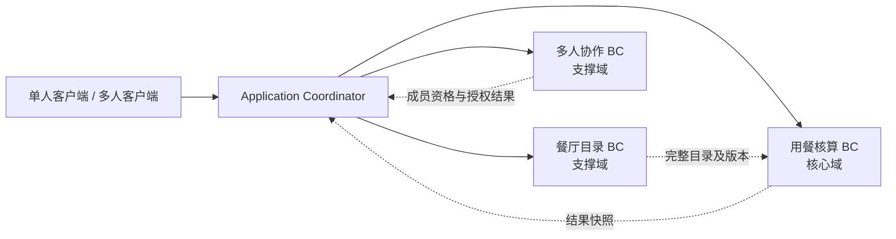
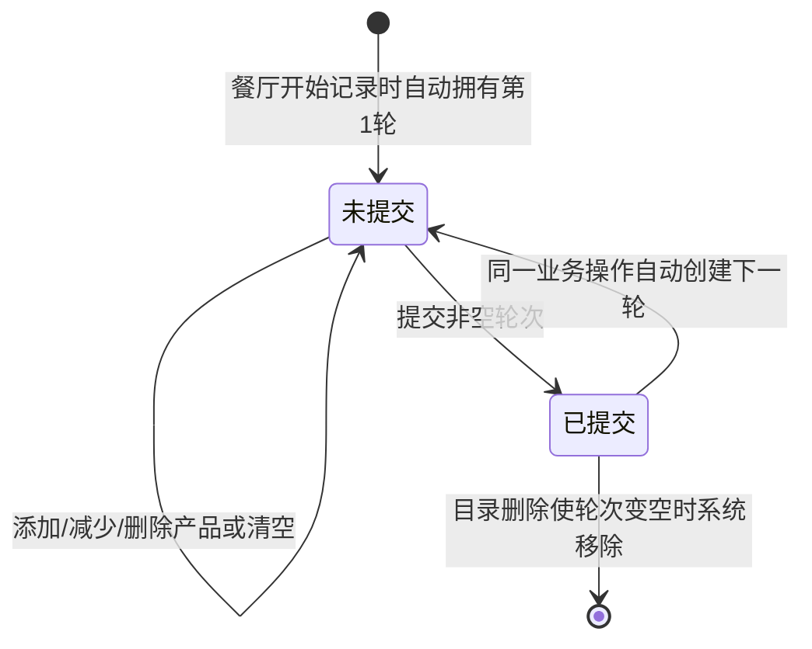
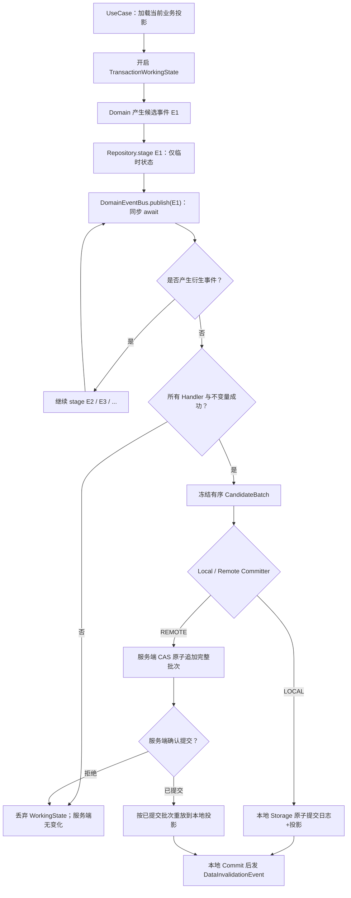
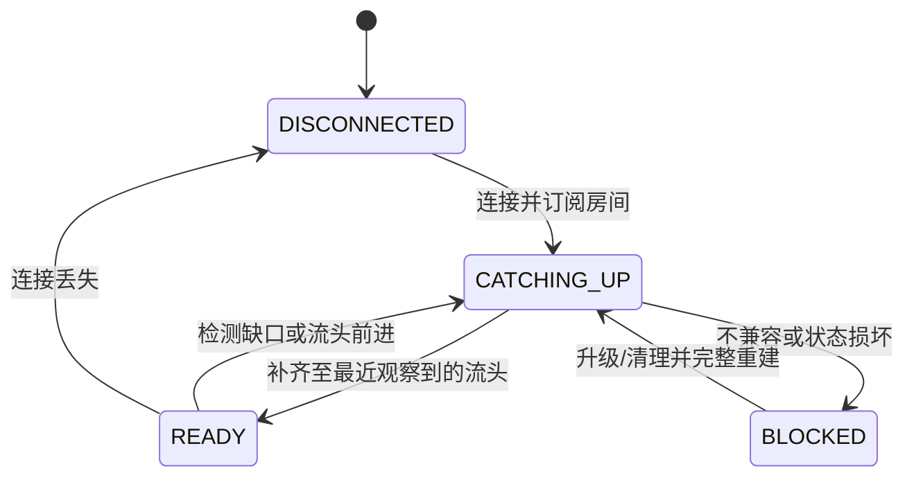

# 自助餐省钱神器：DDD 战略设计与战术设计统一说明书

> **版本**：2026-11-01 · 单模块 / 大前端 / 客户端 Storage / 房间原子事件批次版  
> **文档状态**：统一实施设计（业务基线保留；若遇与纯中继信任边界不兼容的要求，显式标明风险/待决，禁止暗改业务规则）  
> **适用范围**：UniApp（含微信小程序）、Vue 3、TypeScript；Node.js、TypeScript、SQLite、Prisma；客户端统一 Storage。  
> **原始依据**：《自助餐省钱神器 DDD 战略设计（2026-10-31）》、《DDD
> 战术设计（2026-10-31）》及《房间事件流架构重构说明书（2026-11-01）》，并根据本轮明确的候选事件闭包与原子批次提交方案调整。  
> **用途**：编码、重构、架构测试、场景验收和后续业务决策的统一基线。文中 TypeScript/SQL 为接口与机制示意，不是可直接上线的实现。

## 阅读指南和决策优先级

- 第一部分给出业务战略： **保留原有业务目标、聚合边界之外的概念规则及已校准业务行为**。
- 第二部分给出新架构的战术设计：单模块、客户端 Domain、统一 Storage 事务、完整候选领域事件收集、服务端不透明房间事件流、完整回放。
- 第三部分给出测试与迁移：边界测试、事务故障测试、微信小程序兼容性以及待决风险。
- **优先级**：本轮已确认的“纯事件中继、客户端信任、普通 Storage、全事件闭包一次提交” > 2026-11-01 事件流重构草案 >
  2026-10-31 战术实现细节；已确认战略业务规则原则上不随技术优化改变。若两者不能同时严格满足，必须记录无法保证的部分，不能假装已解决。
- **事件的版本号证明顺序，不证明合法性。** 服务端只对事件协议、容量与 CAS
  做判断；产品选择信任客户端做房主等领域规则检查。任何合法格式且版本匹配但业务非法的事件，纯中继原则上仍可能被接受。
- 文中“事务”须区分 **客户端准备事务**、 **服务端房间日志原子追加事务**、 **客户端 Storage 投影提交事务**；它们并非一个跨设备
  ACID 事务。

---

# 第一部分：DDD 战略设计（业务基线）

> 本部分优先保持原始已校准的业务规则。涉及“服务端确认在线”“严格访问资格”等既有承诺，在纯中继设计下仅保留为
> **产品希望实现的规则**，其可信执行能力在“架构冲突与待决事项”节公开说明。为使描述符合本轮架构，以下将原来的部分“服务端业务状态”措辞改为“客户端房间投影状态”；这属于实现解释调整，不表示真实在线可被证明。

## 1. 业务愿景与范围

本产品帮助用户在自助餐用餐过程中记录食物数量及估算价值，结合一次用餐活动统一的 **门票总金额**
计算已吃回的金额、盈亏和回本情况；支持在一次用餐活动中比较多家餐厅，最终选择一家餐厅生成正式结果。既支持本地单人用餐，也支持多人房间协同记录。

**核心价值**：实时核算、按轮次记录、跨餐厅比较、多人协作、个人小票和历史留存。

**范围约束**：不设计注册登录体系；客户端使用持久化匿名身份识别多人协作成员；不提供匿名身份主动切换或身份恢复。单人未完成活动、个人小票及个人历史保存在本地，无云端恢复承诺。

## 2. 统一语言

| 术语                           | 含义                                                                                   |
|--------------------------------|----------------------------------------------------------------------------------------|
| 用餐活动（Dining Activity）    | 一次独立的核算过程，具有统一门票总金额、候选餐厅、各餐厅轮次及最终结果                 |
| 候选餐厅                       | 当前活动中用于记录、比较消费的餐厅；仅一间被选为最终餐厅                               |
| 轮次（Round）                  | 某餐厅的一组消费产品及数量，状态为未提交或已提交                                       |
| 提交轮次                       | 锁定该轮次的用户编辑，并自动进入下一未提交轮次；不改变其是否计入实时核算               |
| 清空轮次                       | 移除当前未提交轮次的全部产品，不删除轮次自身                                           |
| 门票总金额（ticketPriceMinor） | 当前用餐活动**合计支付的门票金额**，仅有一份；不是每人单价，且必须大于零               |
| 核算结果                       | 按餐厅产品数量与有效价格计算的估算价值、盈亏和回本情况；不按用餐人数乘门票             |
| 最终餐厅                       | 完成用餐时显式指定、用于生成正式结果的唯一餐厅                                         |
| 小票                           | 某用户主动保存的一份不可变核算快照；每人保留一份，后存覆盖前存；可在用餐过程中保存     |
| 历史记录                       | 已完成用餐的不可变结果，按用户在本地保存，可有多条                                     |
| 房间（Room）                   | 多人协作会话；每个房间恰好关联一次用餐活动                                             |
| 房间创建者                     | 创建房间并在创建时提供私人餐厅的匿名身份，不等于永久房主                               |
| 当前房主                       | 当前拥有提交轮次、完成/放弃用餐及转让房主权限的在线成员                                |
| 私人餐厅原件                   | 用户本地维护的餐厅目录                                                                 |
| 房间私人餐厅副本               | 房间创建时由创建者提供、房间事件链中保存必要目录事实、客户端重放形成的私人餐厅副本     |
| 目录版本                       | 可用于一致性核算与快照生成的完整有效餐厅目录状态；要求读取一致，但结果不必保存整个目录 |

## 3. 子域与限界上下文

### 3.1 用餐核算（Dining Accounting）——核心域

**职责**：用餐活动生命周期；统一门票总金额（大于零）；候选餐厅的轮次及产品数量；实时核算；轮次提交与自动创建；选择最终餐厅；完成/放弃用餐；生成一致且不可变的最终结果与小票数据快照（仅记录本次消费所需信息）。

**不负责**：房间成员、房主、在线状态、匿名身份认证、餐厅目录的编辑及所有权、客户端历史列表管理。

**关键边界**：同一核算领域模型服务单人和多人模式。核算命令处理业务行为，但不包含 `Room`、`Host`、`RoomMember`
等协作概念；调用方在进入核算行为前完成授权。

### 3.2 餐厅目录（Restaurant Catalog）——支撑域

**职责**：餐厅、分类、产品、有效价格、餐厅稳定标识和目录版本；公共目录管理；本地私人目录管理；发布可供核算使用的完整目录状态。

**不负责**：轮次、用餐金额、房间成员权限、正式用餐历史。

**来源差异**：公共目录由平台提供、可动态新增/修改/删除；私人目录由用户在本地维护。两者在核算侧遵循相同的价格和产品有效性规则。

### 3.3 多人协作（Dining Collaboration）——支撑域

**职责**：房间生命周期、房间码、成员参与及在线状态、当前房主、主动转让与自动交接、成员操作授权、房间私人餐厅副本事件及其客户端同步资格、房间与用餐活动的关联、完成时的结果领取资格。

**不负责**：轮次的核算公式、产品目录原件的业务编辑、个人本地历史的长期保存。

### 3.4 应用层协调（Application Coordinator）

跨上下文流程由应用层协调：创建房间并关联用餐活动、权限验证后提交轮次、目录变更影响活动、完成时基于一致目录版本冻结本次消费结果、向符合资格的成员提供快照等。

**Application Coordinator 不是第四个限界上下文**，也不是一个承载业务不变量的“万能领域模型”。各上下文保有自身规则与决策权。

## 4. 上下文映射与依赖原则



- **餐厅目录 → 用餐核算**：目录提供产品身份、价格及版本；核算只消费目录信息，不反向管理目录。目录更新对活动的影响由协调层组织，由核算侧执行自己的业务约束。
- **多人协作 → 用餐核算**：协作侧验证当前成员与房主权限，协调层调用核算用例；核算侧不直接感知房间。
- **用餐核算 → 客户端本地存储**：核算产出不可变快照；小票与历史由各客户端独立保存，不能把本地保存成功误当作服务端房间生命周期的一部分。
- **私人目录 → 房间副本**：由创建者提供的本地目录同步至多人协作管理的临时副本；副本不是所有成员共同编辑的目录原件。

这里的箭头表达 **业务信息流和协调关系**，不预先规定代码模块的直接编译依赖、同步调用或事件实现。

## 5. 用餐核算的业务规则

### 5.1 活动与餐厅

1. 每次用餐活动只有一个 **统一的门票总金额**，必须大于零。所有候选餐厅共用该金额进行核算；它不是每人单价，
   **不乘以成员数量**。
2. 一次活动可记录多家餐厅，各餐厅分别拥有自己的轮次与核算数据。
3. 不同成员可以独立查看不同餐厅；查看选择属于个人会话状态，不是房间全局选中餐厅。
4. 结束用餐必须 **显式指定一个有效的最终餐厅**，单人和多人模式完全一致；不能推断为最后查看的餐厅。
5. 最终结果只保留最终餐厅的消费核算，其他候选餐厅的临时消费数据不进入正式历史。
6. 允许最终餐厅没有任何食物消费；此时食物估值为零，盈亏等于负票价。
7. 最终餐厅失效或已删除时，拒绝完成命令，需重新选择有效餐厅；允许主动放弃活动且不生成正式结果。
8. 单人可在完成前修改门票总金额；多人只有 **当前房主**可在用餐结束前修改房间门票总金额。完成后的冻结结果不可改写。
9. 成功结束后再次执行结束命令，抛出已结束业务错误，不把已有结果当作本次命令成功返回；用户可另行查询已完成结果。

### 5.2 轮次生命周期



上述图中“已提交 → 未提交”表示 **旧轮次保留为已提交，同时产生新轮次**，并非旧轮次状态回退。

1. 每家餐厅同一时间 **最多一个未提交轮次**；不同餐厅可各自有一个。
2. 轮次由系统自动创建：餐厅开始记录时出现第 1 轮；提交非空轮次成功后，原子地创建下一未提交轮次。 **不提供手动创建轮次功能**。
3. 未提交轮次可以为空，但空轮次不能手动提交；结束用餐时忽略空的未提交轮次。
4. **已提交与未提交轮次均参与实时核算和中途小票快照**。提交仅锁定用户编辑权限，不是“计入金额”的开关。
5. 所有具备协作编辑权限的在线成员均可修改未提交轮次的产品数量、删除其中的产品或清空全部产品；清空后轮次本身仍存在。
6. 用户 **不能直接删除整个轮次**，也不能修改或清空已提交轮次。
7. 目录删除某产品时，该产品从进行中的相应轮次中移除，包括已提交轮次；如果已提交轮次因此变空，系统删除该轮次；未提交轮次变空则保留。
8. 轮次展示编号始终连续，但 **稳定轮次 ID 不变**；删除轮次引发的重新编号不能改变轮次业务身份。
9. 已提交轮次即使因为其他轮次消失而被重新编号，仍保持锁定。
10. 结束用餐时，最终餐厅中非空的未提交轮次自动视为提交并纳入结果；空轮次忽略；不再生成新轮次。

### 5.3 数量与核算

- 产品的消费数量不得为负。
- 并发增加按服务端房间事件流的成功提交顺序累计。 **不提供请求 ID 去重或重复请求特殊处理**；同一添加命令若多次到达并分别成功，则数量多次累加。
- 减少数量时若当前数量不足，整次减少操作拒绝，不自动截断到零。
- 删除未提交轮次的产品条目后，后续添加可以重新建立该条目；以实际生效顺序为准。
- 核算基于当前有效目录价格与当前有效消费数量；估算消费价值为各产品有效单价与数量乘积之和，盈亏为估算消费价值减
  **统一门票总金额**，回本状态由两者比较确定。门票总金额大于零，因此回本率可正常计算。
- 价格调整会影响进行中的核算， **包括已提交轮次**；已保存快照不追溯更新。

## 6. 餐厅目录与价格变化

1. 单人模式可同时选择公共餐厅和本地私人餐厅；私人目录无需上传服务器。
2. 单人用餐过程中允许修改本地私人目录，变更立即反映在进行中的核算。
3. 公共目录新增的餐厅在进行中的多人房间也可使用；公共餐厅集合不随房间创建而冻结。
4. 多人房间的 **私人餐厅身份集合**在创建时由创建者选定并固定；其他成员和后继房主均不能追加私人餐厅。
5. 房间私人餐厅副本的产品、分类及价格可由原创建者通过其本地目录同步更新；其他成员（包括房主）不可直接编辑副本。
6. 原创建者退出房间后停止同步；副本继续供房间使用。原创建者重新加入仍在进行中的房间后，同步本地最新状态（包含删除），不得用过期版本覆盖新版本。
7. 删除目录中的产品会从所有进行中的对应轮次移除；删除餐厅会移除其在进行中活动里的相关数据。已经保存的小票与完成历史不变。
8. 餐厅使用稳定身份区分， **名称不要求唯一**；公共与私人同名餐厅不能混淆。具体标识编码方式留待战术设计。
9. 小票及最终结果生成时，必须使用同一餐厅目录的 **完整一致版本**，不得混用不同版本的价格或产品状态；
   **只需在结果中固定此次实际消费的菜品名称、数量、单价和必要的餐厅信息，无须保存完整目录副本**。

**一致性边界**：目录变更与核算更新可以存在传播过程，但一旦对外形成正式快照，就必须对应一个可解释、完整的目录状态。目录上下文不能越过边界直接篡改核算领域对象。

## 7. 单人模式

1. 单人模式不创建虚拟房间；直接使用用餐核算领域能力。
2. 本地同一时间最多一个 **进行中的单人用餐活动**。开始新活动前须完成或放弃已有活动。
3. 进行中的单人活动及轮次数据自动保存在本地；关闭应用、崩溃或重启不等于完成或放弃，重新打开可继续。
4. 单人用户可执行编辑、清空、提交轮次、完成及放弃活动等操作，不需要房主角色。
5. 单人模式的轮次、目录更新、最终餐厅选择、快照规则与多人模式相同。
6. 单人活动可以与一个多人房间同时存在；两者消费记录互不覆盖。若引用同一公共目录，目录变化仍可分别影响两个进行中的活动。
6. 完成活动产生本地历史；放弃活动不产生历史。清除本地数据后，不提供恢复承诺。
7. 单人模式的门票金额也是整次活动合计金额，必须大于零，不按用餐人数量计算。

## 8. 多人协作

### 8.1 房间与活动

1. 创建房间即开始一场用餐活动，不存在独立的等待大厅。
2. 一个房间只关联一场用餐活动；完成或放弃后不能在原房间重新开始。
3. 房间创建者初始成为房主；房间创建者与当前房主是不同的身份概念。
4. 只有当前房主可以提交轮次、完成/放弃用餐、 **修改房间门票总金额**及主动转让房主身份。
5. 所有在线成员均可编辑、删除产品及清空当前未提交轮次；不能直接修改已提交轮次。
6. 房间成员可以各自选择查看的餐厅，互不强制切换；同一餐厅的数据仍共享。

### 8.2 成员与房主

1. 同一匿名身份同一时间最多参与 **一个进行中的多人房间**；这不限制本地单人活动。
2. 主动退出进行中房间后，可通过房间码重新加入；重新加入按 **本次加入时间**重新排序。
3. 房主退出或按房间协作的离线事件/连接观察确认离线时，自动转交给当前在线成员中本次加入最早者。
4. 房间无人在线时暂时没有房主；第一个成功重新加入者成为房主。
5. 房主可主动将身份转给任意其他在线成员，原房主继续留在房间并成为普通成员；可以反复转让，也可以转回原房主。
6. 主动转让不改变成员加入顺序；房间创建者不具有永久房主特权。
7. 只要房间存在在线成员，就必须恰有一名房主；并发转让、退出、提交等操作按房间事件流的成功提交顺序（流回收另见待决）判定。
8. 不支持主动切换匿名身份；清除匿名凭据后，生成的新身份不能继承原成员权限或结果资格。

### 8.3 房间终态与回收

1. **进行中 → 已完成**：房主显式指定最终餐厅，生成冻结结果；房间转为只读。
2. **进行中 → 已放弃**：房主放弃活动，不生成正式结果；房间进入终态。
3. 完成与放弃并发时，房间事件流中先成功提交的终态操作成功，另一操作拒绝；终态不可再次改变。 **重复执行完成命令抛业务异常**
   ，不额外实现请求级幂等去重。
4. 已放弃房间不允许任何人重新加入；当前成员可以看到放弃状态并离开。
5. 已完成房间仅允许 **完成时具备资格的成员**重新加入，查看同一最终结果及补存本地历史/小票，直到房间销毁。
6. 成员资格按完成批次依据的房间成员与在线状态投影判定（纯中继无法独立证明其真实在线）。完成前已退出者不具备资格；如果实际断线尚未转化为房间投影中的离线事实，正常客户端仍可能将该成员视为在线；这一局限无法由纯中继独立修正。
7. 最终结果中的用餐人名单 **只记录完成批次依据的房间投影中仍在房间且在线的成员**，不包含此前退出的成员；此名单不参与门票金额计算。
8. 无人在线的房间保留 10 分钟；之后可以销毁。重新加入与销毁竞争时，按房间事件流的成功提交顺序（流回收/重入另见生命周期待决）决定，不仅按定时器触发时间推断。
9. 销毁未完成房间时丢弃其临时活动与私人餐厅副本；房间销毁不删除各客户端已经保存的个人历史或小票。

## 9. 小票、历史与结果归属

### 9.1 小票

- 小票是 **个人**保存的不可变快照，而非全房间共用的一张可变单据；多人模式 **统一计算整个房间**的消费结果，不对商品按成员归属。
- 每个用户保留一份小票；再次保存覆盖其自己的旧小票，不影响其他成员。
- 用餐进行中可按个人当前选择的餐厅保存小票，包含该餐厅 **已提交和未提交**的有效轮次。
- 已完成房间的合格成员在房间仍存在时，可以根据冻结的最终结果重新保存或覆盖个人小票。
- 快照数据由一致的目录状态生成，只固定本次消费涉及的餐厅名称、成员信息、轮次、菜品名称/数量/单价、门票总金额和计算结果等必要信息；不需持久化完整餐厅目录。随后保存在客户端本地；房间销毁后不能再从房间生成新小票，但已保存的小票保留。
- 保存快照与放弃活动竞争时，若快照生成先生效，后续本地写入可以继续完成；若放弃先生效，则拒绝新快照生成。

### 9.2 历史

- 只有 **完成**用餐才生成正式结果；放弃不生成历史。
- 同一多人房间的所有合格成员可领取 **相同的整房最终核算结果**，但各自在本地独立保存历史。用餐人名单只含完成时在房间的合格成员。
- 本地历史可保存多条、查看与单独删除；不进行云端同步。
- 如果合格成员未能及时保存，仍可在已完成房间存在期间重新加入并补存，按稳定用餐活动 ID 去重，避免重复历史。
- 完成前已经退出的成员不具备补存资格，即使曾参与编辑。
- 单人和多人使用相同的 **结果快照语义**，但结果来源、保存资格与访问路径不同。

### 9.3 结果快照的最小完备信息

正式完成结果（DiningResult）与进行中小票快照均不复制全量餐厅目录，仅冻结可以独立解释本次消费的业务信息：

- 最终或当前小票所选餐厅的 **名称及稳定标识**（标识仅用于溯源，不作为查看时再查价的依据）。
- 一次用餐的 **门票总金额**，不属于某个用餐人。
- 多人正式结果中 **完成事件采用的房间投影中仍在房间且在线的成员名单**；成员不关联具体菜品。
- 本次餐厅的轮次顺序、轮次稳定 ID、轮次状态与各轮菜品的名称、消费数量、有效单价和小计。
- 估算菜品总价值、票价与盈亏、完成时间及币种等独立展示所需数据。

最终结果只涉及 **显式选择的最终餐厅**
；小票在活动进行中也可按当前查看的候选餐厅保存，其后价格调整不会追溯修改已经保存的小票。已完成房间的最终结果及资格名单一旦冻结即不可变。针对已结束状态的再次完成请求抛业务异常，另行查询结果不改变已结束的事实。

---

## 10. 关键跨上下文业务流程

### 10.1 创建多人房间

1. 协作上下文建立房间及初始房主身份。
2. 创建者在创建时选定私人餐厅身份集合；必要时上传完整私人目录副本。
3. 应用层协调创建与房间关联的用餐活动，确定 **大于零的统一门票总金额**及可用目录来源。
4. 整个业务流程对外不能暴露“有房间但没有可用关联活动”的不一致完成状态；具体事务/补偿方式留待技术设计。

### 10.2 编辑及提交轮次

1. 多人请求先由协作上下文验证在线成员及操作权限。
2. 用餐核算上下文验证轮次状态、产品有效性、数量约束。
3. 编辑未提交轮次时更新实时结果；提交时验证非空，锁定旧轮次并原子创建下一轮。
4. 对并发修改按服务端房间流成功提交顺序，由客户端基于重建投影实施版本与数量检查，避免负数量；
   **不对重复网络请求做特殊去重处理**，分别成功的重复请求分别生效。

### 10.3 目录更新

1. 目录上下文产生完整有效的新版本；私人副本更新还需检查提供者当前在房间内及版本新旧。
2. 协调层将目录变化作用于相关进行中活动。
3. 核算上下文重算价格、移除失效产品或餐厅，执行空已提交轮次删除及编号重排规则。
4. 已保存快照与已完成活动不被反向修改。

### 10.4 完成用餐

1. 单人模式由本地用户发起；多人模式先验证当前房主资格。
2. 命令显式携带 `finalRestaurantId`，检查活动仍在进行且最终餐厅有效。
3. 将最终餐厅非空未提交轮次纳入完成结果，忽略空轮次。
4. 使用一致的有效目录版本计算并冻结 **整次活动的门票总金额**、本次消费相关菜品名称、数量、单价、各轮次和核算结果；不保存完整目录。
5. 多人模式同时固定完成时合格成员集合（也即最终结果的用餐人名单），并将房间设为只读；其他餐厅临时核算不进入最终结果。
6. 客户端独立保存个人历史；未及时保存者可在房间存续期间按资格补存。

## 11. 关键业务不变量与一致性矩阵

| 编号 | 不变量/约束                                                                | 负责边界                |
|------|----------------------------------------------------------------------------|-------------------------|
| I-01 | 用餐核算不依赖房间、房主或成员概念                                         | 用餐核算 / 架构边界     |
| I-02 | 每家餐厅最多一个未提交轮次                                                 | 用餐核算                |
| I-03 | 提交非空轮次与创建下一轮原子生效                                           | 用餐核算                |
| I-04 | 已提交轮次不可由用户编辑，但有效目录变化可影响其核算内容                   | 用餐核算 + 目录协调     |
| I-05 | 已提交和未提交轮次均计入实时核算                                           | 用餐核算                |
| I-06 | 产品数量不为负；分别成功的重复请求分别产生业务变化，不做请求级去重         | 用餐核算                |
| I-07 | 完成用餐必须有一个显式指定且有效的最终餐厅                                 | 用餐核算                |
| I-08 | 小票和最终结果使用完整一致的目录版本                                       | 目录 + 核算协调         |
| I-09 | 完成后的结果及已保存小票不可变                                             | 用餐核算 / 本地保存     |
| I-10 | 有在线成员时恰有一名房主                                                   | 多人协作                |
| I-11 | 只有当前房主能提交轮次、完成或放弃多人用餐                                 | 多人协作授权            |
| I-12 | 同一匿名身份最多参与一个进行中的多人房间                                   | 多人协作                |
| I-13 | 同一本地环境最多一个进行中的单人活动                                       | 单人应用业务规则        |
| I-14 | 房间私人餐厅集合创建时固定，只有原提供者在房间内可同步已有副本             | 多人协作 + 目录         |
| I-15 | 已完成房间的结果资格以完成时房间投影在线状态（不由服务端做业务核验）为准   | 多人协作                |
| I-16 | 房间完成/放弃互斥且不可逆；重复结束命令抛业务异常                          | 多人协作 + 核算协调     |
| I-17 | 统一门票总金额必须大于零，且不按成员数量相乘                               | 用餐核算                |
| I-18 | 多人门票总金额仅当前房主可在完成前修改                                     | 多人协作授权 + 用餐核算 |
| I-19 | 最终结果仅记录完成批次使用的房间投影中仍在房间且在线的成员（真实性弱保证） | 多人协作 + 用餐结果     |
| I-20 | 中途小票和最终结果仅固定本次消费数据，目录价格与名称来自同一有效版本       | 目录 + 用餐核算         |

**并发判定原则**
：成员权限变化、房间终态变化、编辑请求、目录变更、快照生成等涉及竞态时，以房间事件流顺序和客户端重建的业务状态为准（不具备服务端业务真实性保证）；不得仅凭客户端发起时间或页面状态判断。跨上下文需要定义可观察的成功/失败结果；
**不要求请求级去重和相同响应重放**，但终态不可重复发生。战略设计不指定锁、事务或消息中间件。

## 12. 决策冲突清理与最终解释

| 曾出现的歧义                       | 本文采用的最终规则                                                                        |
|------------------------------------|-------------------------------------------------------------------------------------------|
| “只有已提交轮次计入金额”           | **废止**：已提交、未提交均计入实时核算与中途小票（BR-58）                                 |
| “用户可删除整个未提交轮次”         | **修正**：用户实际意图是清空轮次产品；轮次本身不删除（BR-65/66 修订）                     |
| “用户手动创建下一轮”               | **废止**：提交成功自动创建下一轮（BR-67/68）                                              |
| “空已提交轮次是否保留”             | 因目录删除而变空的已提交轮次自动移除；空未提交轮次保留（BR-61/64）                        |
| “删除后轮次编号与身份”             | 展示编号连续重排，稳定轮次 ID 不变（BR-62/63）                                            |
| “最终餐厅由当前选择推断”           | **废止**：完成命令显式指定最终餐厅（BR-52/87）                                            |
| “房间创建者永远是房主”             | **废止**：房主可主动多次转让、自动交接，创建者身份独立（BR-78～80）                       |
| “房间私人餐厅任何人可改”           | **废止**：只有原创建者在房间内可通过本地原件同步（BR-81～83）                             |
| “单人模式是否需单独核算模型”       | **否**：单人和多人复用同一用餐核算领域模型（AD-01）                                       |
| “网络重复请求须去重”               | **废止**：不引入请求 ID 去重；分别成功的重复命令分别生效（后续 M22）                      |
| “结束时非空未提交轮次禁止结束”     | **废止**：自动视为提交并计入结果，不创建新轮次（BR-89 基线 §5.2）                         |
| “最终餐厅零食物消费不能结束”       | **废止**：允许零食物消费正常完成；但**门票总金额不得为零**                                |
| “门票是每个成员的单价”             | **废止**：票价是整次用餐总金额，只保存一次，不按人数乘（M15/M20）                         |
| “完成结果保存完整 CatalogSnapshot” | **废止**：要求计算输入来自一致目录版本，但只保存实际消费所需名称、价格、数量和汇总（M14） |
| “结束结果包含曾经参与的所有成员”   | **废止**：只含完成事件采用的房间投影中仍在房间且在线的成员（M16）                         |
| “已结束命令重试返回原成功结果”     | **废止**：重复结束抛业务异常，通过独立查询领取已完成结果（M17）                           |

## 13. 战略规则与本轮信任模型的关系

战略设计描述的是期望的业务行为；新的部署架构规定可验证的技术保证。必须区分：

| 业务要求                                   | 客户端遵守规则时                       | 被修改/恶意客户端时                  | 服务端是否具备可信验证     |
|--------------------------------------------|----------------------------------------|--------------------------------------|----------------------------|
| 房主才可提交轮次、结束、放弃、改票价、转让 | Application 校验 Room 投影后生成事件   | 可伪造相应业务事件                   | 否                         |
| 消费数量非负、轮次状态合法                 | Domain 生成合法事件批次                | 可直接构造非法业务 payload           | 否                         |
| 完成结果成员只含完成时在线成员             | 基于同一个已同步 Room 投影生成冻结事件 | 可伪造在线状态或最终 diners          | 否                         |
| 离线时自动交接房主                         | 收到离线信号后客户端生成房主交接批次   | 事件漏发/客户端都离线时不保证产生    | 否                         |
| 结束或放弃后禁止编辑                       | 合规客户端 Domain 拒绝                 | 仍可追加格式正确、版本匹配的非法事件 | 否                         |
| 房间事件顺序唯一、批次不可分割             | 服务端 CAS 与数据库事务保证            | 无法绕过 CAS 的版本线性顺序          | **是（技术性质）**         |
| 新成员重建相同业务投影                     | 全链可读、事件确定且投影正确时成立     | 恶意事件可能造成相同的非法状态       | **仅提供日志，不验证业务** |
| 房间访问与结果领取资格                     | 合规客户端按投影筛选 UI 与操作         | 如果无可信访问控制则可绕过客户端     | 否                         |

**不可隐藏的架构取舍**
：以“权限全部前端、服务端无条件信任业务事件”为新约束后，原战略中对服务端在线确认、严格重入资格、终态阻止非法追加的强保证不再成立。它们可作为合规客户端行为和产品规则保留，但不能作为防篡改安全承诺；后续如要恢复强保证，必须改变信任边界，不能通过版本号推导出权限证明。

### 13.1 在线和离线事件的边界

- `MemberLeft` 是主动退出的领域事实，可由客户端产生并进入事件流。
- 客户端异常退出并不必然产生 `MemberDisconnected`。服务器连接断开是网络事实，服务端可以提供通用连接通知，但按本轮约束不运行
  Collaboration Domain，也不自动产生业务领域事件。
- 如果在线人数、房主自动交接、完成资格完全依赖事件回放，就必须定义离线事实写入日志的发起者、时间、竞争规则与重连恢复。当前
  **没有可证明可信且无遗漏的方案**，列为明确待决，而不是默认“广播断线通知即可解决”。
- 成员显示名和匿名 UUID 只是业务标识，不构成强身份认证。可被伪造的身份不可用于安全级的访问控制保证。

### 13.2 结果与房间终态

- `DiningEnded` 或 `DiningAbandoned` 进入事件流后，正常客户端均重建为只读；重复完成指令仍抛 `ALREADY_ENDED`。
- 服务器不能靠不透明 payload 自行知道“业务已结束”，因此不能仅凭流版本阻止恶意客户端继续追加另一条 `DiningEnded`
  。此风险是主动接受的设计边界。
- 已完成房间的结果和资格名单仍是不可变的 Domain 事实，合规客户端不得用新事件改写它。
- 服务器对房间流的删除和保留策略是 **基础设施生命周期**，不能等同于从领域事件中自动推断业务已结束。原定空房间 10
  分钟可销毁的业务要求继续保留，但可信计时、清理竞态以及可重放保障的具体实现仍需单独决定。

---

# 第二部分：DDD 战术设计（统一事件批次版）

## 14. 新战术架构的基本约束

### 14.1 运行位置与技术栈

| 项目             | 目标方案                                                                                              |
|------------------|-------------------------------------------------------------------------------------------------------|
| 业务 Domain      | 客户端 UniApp / TypeScript 中运行                                                                     |
| 业务 Application | 客户端运行；单人与多人使用同一公开用例                                                                |
| 单人存储         | 客户端普通 Storage + 事务工作区；不创建虚拟房间                                                       |
| 多人本地存储     | 同一个 Storage Adapter；按 `roomId` 隔离投影与同步游标                                                |
| 多人权威日志     | Node.js + TypeScript + SQLite + Prisma，按房间连续追加事件                                            |
| 后端业务校验     | 无；仅校验序列化协议、资源限制、流存在和 `expectedVersion` CAS                                        |
| 事件类别         | `DomainEvent` 与 `DataInvalidationEvent`；“已提交事件”是 DomainEvent 的持久化封装，不另设业务事件类别 |
| 客户端 UI        | UniApp + Vue 3；Page/Store 集中管理，可用 Pinia Setup Store、TanStack Query Core                      |
| 依赖注入         | 一个客户端 Composition Root / 一个服务端启动入口；可用轻量 DI，不强制大型容器                         |
| 项目物理组织     | 单根 `package.json`，取消多个 `contracts/core` 独立 npm 包                                            |
| 架构约束         | `dependency-cruiser` / ESLint 静态依赖检查 + Vitest 单元、集成、协议与故障测试                        |

**不采用**：服务端 Accounting/Catalog/Collaboration Domain、服务端业务 Interactor、服务端业务状态投影、跨设备 ACID 事务、原先
Prisma 业务 Repository、服务端 DomainEventHandler、服务端异步目录清理工作者。

### 14.2 主要设计原则

1. 业务操作必须先在客户端 **生成完整候选事件闭包**：某事件在准备阶段触发 Handler 产生其他事件，则所有事件必须一并收集且全部成功，才能提交。
2. 准备期间的 Repository **只在事务工作状态中应用**事件，绝不对权威多人本地投影或服务端逐事件提交。
3. 一个操作对应一个完整 **EventBatch**。服务端接受/拒绝整个批次，内部每条事件分配连续版本。
4. 一个房间仅有一条权威流，跨聚合、跨 BC 的事件都能进入该流。 **流版本是同步/并发边界，不是 DDD 聚合边界**。
5. 多人客户端仅根据服务端 **CommittedBatch** 写入自身投影。远程提交成功而本地失败，靠权威日志重放，不要求服务器回滚。
6. 单人使用同样的候选准备与投影器，只是 `EventCommitter` 使用本地日志和工作区原子提交。
7. `DomainEventBus` 在 **准备阶段**可以生成派生候选事件；在 **回放阶段**只能执行确定性本地投影相关处理，绝不再次生成需提交到服务器的新候选事件。
8. `DataInvalidationEvent` 只在投影实际提交成功后发布；通知失败不回滚业务提交。
9. 事件必须能确定性重放；所有外部事实在生成时冻结，不能回放时重新随机取 ID、现在时间或现价。
10. 不执行请求级幂等去重；未知结果的请求不盲目重试。`batchId` 主要用于批次边界与追踪， **不是默认的幂等键**。

### 14.3 从旧方案迁移的关键变化

| 旧战术约束                                          | 新战术约束                                                                    |
|-----------------------------------------------------|-------------------------------------------------------------------------------|
| 多个 `packages/*/contracts` / `core`                | 一个源码项目，按 BC + 逻辑层目录组织，依赖测试守边界                          |
| 多人 HTTP 远程 Port.In → 服务端运行 Interactor      | 多人本地运行同一 Interactor → RemoteEventCommitter → 服务端 Room Stream       |
| Repository.apply 一次调用立即服务端持久化/发事件    | `stage` 在 Working State 内产生闭包；收集完成后统一 `commit(batch)`           |
| DomainEvent 强事务 Handler 在服务端 Prisma 事务执行 | 仅在客户端候选准备事务中执行；回放阶段禁生成新权威事件                        |
| 客户端 SQLite / 原生 SQL 事务                       | 普通 Storage 的事务封装，明确逻辑原子与崩溃安全限制                           |
| WebSocket 仅广播 DataInvalidationEvent              | WebSocket 主要通知或传递 CommittedBatch；本地应用后再发 DataInvalidationEvent |
| 服务端异步业务清理任务                              | 客户端协调生成清理领域事件；可使用显式待清理业务状态与后续批次                |
| 服务端判定成员、房主、结果资格                      | 客户端 Domain/Application 按同步房间投影判定；无安全真实性保证                |

## 15. 单模块文件结构和代码依赖

```text
buffet/
├── package.json                       # 唯一 npm 模块定义
├── tsconfig.json
├── tsconfig.server.json               # 构建入口，不是独立 npm 模块
├── vite.config.ts
├── src/                               # UniApp 客户端
│   ├── contexts/
│   │   ├── accounting/
│   │   │   ├── domain/                # DiningActivity / RestaurantConsumption / Round / Money
│   │   │   ├── application/
│   │   │   │   ├── port/in/           # 用例接口、Request/Response、只读 DTO
│   │   │   │   ├── port/out/          # Repository、Catalog 查询等抽象
│   │   │   │   └── use-case/          # Interactor
│   │   │   └── adapter/
│   │   │       └── persistence/       # 事件应用映射器
│   │   ├── catalog/
│   │   │   ├── domain/
│   │   │   ├── application/
│   │   │   └── adapter/
│   │   └── collaboration/
│   │       ├── domain/
│   │       ├── application/
│   │       └── adapter/
│   ├── coordination/application/      # 无 Domain；跨上下文 Interactor
│   ├── kernel/
│   │   ├── domain/                    # Event、Aggregate、业务错误基类
│   │   ├── application/               # UseCase、TransactionRunner、UnitOfWork
│   │   └── event-protocol/            # 客户端内公开事件序列化契约适配
│   ├── infrastructure/
│   │   ├── storage/                   # Uni Storage Adapter、Working State、Recovery
│   │   ├── event-store/               # LocalCommitter、RemoteCommitter
│   │   ├── event-sync/                # RoomEventSynchronizer、Cursor、Catch-up
│   │   ├── projection/                # CommittedBatchProjector
│   │   ├── event-bus/                 # DomainEventBus、DataInvalidationEventBus
│   │   └── dependency-injection/
│   ├── composition/
│   ├── pages/
│   └── stores/
├── server/
│   └── src/
│       ├── event-store/              # SQLite/Prisma CAS + 事件历史
│       ├── transport/                # HTTP/WebSocket
│       ├── stream-lifecycle/         # 流自身创建/删除，非业务状态
│       └── main.ts
├── protocol/                          # 只允许传输信封、DTO，不导入业务 Domain
└── tests/
    ├── architecture/
    ├── domain/
    ├── application/
    ├── event-prepare/
    ├── event-store/
    ├── event-sync/
    ├── storage/
    └── platform/
```

限制：一个 TypeScript 文件原则上一个顶层 class/interface；强内聚类型允许嵌套 `namespace` 或内部类型。Port.In DTO 必须是完全映射/只读
DTO， **不泄漏可变 Domain 对象**。Port.Out 允许内部 Mapper 进行双向映射，但类型依赖必须符合所属层级。Pages、Stores 独立放置，可调用多个
BC 的公开 Port.In，不直接修改业务 Storage。

### 15.1 编译依赖方向

- `Domain → 同 BC Domain + kernel/domain`；不得访问 Storage、网络、Vue、Pinia、Node/Prisma。
- `Application → 自身 Domain + 自身 Port.Out + 自身公开 Port.In + kernel/application`；跨 BC 必须经公开 Port.In/DTO，由
  Coordination 统一编排。
- `Adapter/Infrastructure → Application Port.Out、Domain Mapper、基础框架`；反向依赖禁止。
- `Coordination → 各 BC 公开 Port.In/DTO`，不直接访问其他 BC Domain 私有聚合或适配器。
- `protocol → 纯 TS 信封类型`；`server → protocol + server/*`，不得导入 `src/contexts/*`。
- `Composition → 可以装配所有层`，但不写业务规则；UI 依赖公开 Port.In，不依赖 Repository.apply。

### 15.2 架构测试标准

- 静态检查直接导入和动态 `import()`：禁止 Domain 反向依赖，禁止跨 BC 内部 Domain 或 Adapter 调用，禁止服务端业务 Domain
  依赖，禁止跨层循环。
- 类型检查、代码检查和架构检查必须成为每次 PR 的硬门槛；多包物理隔离不再承担这一职责。
- 对通过隐式全局服务定位器、绝对路径别名绕过分层的代码也应实施路径规则与代码评审。

## 16. 聚合、实体、值对象和不变量

### 16.1 Accounting 聚合

| 对象                    | 类型         | 主要业务职责                                                |
|-------------------------|--------------|-------------------------------------------------------------|
| `DiningActivity`        | 聚合根       | 活动状态、统一票价、候选餐厅、最终餐厅、冻结 `DiningResult` |
| `RestaurantConsumption` | 独立聚合根   | 一家餐厅的轮次、数量、版本和目录清理                        |
| `Round`                 | 内部实体     | 稳定 `roundId`、展示顺序、ACTIVE/SUBMITTED                  |
| `ConsumptionItem`       | 值对象       | `productId + quantity`；不含成员归属与永久价格              |
| `Money`                 | 值对象       | 整数最小货币单位、币种、安全整数运算                        |
| `DiningResult`          | 不可变值对象 | 只保存最终消费的最小完备快照                                |
| `ConsumptionCalculator` | 领域服务     | 利用一致目录版本的价格视图计算明细、总额和盈亏              |

`DiningActivity` 与 `RestaurantConsumption` **保持独立聚合根**，因为业务不变量不同；跨聚合一致性由 Application
准备同一候选事件批次、EventStore 原子提交以及本地投影原子应用承担。没有理由因为一个 Room Stream 就合并所有聚合。

### 16.2 Catalog 聚合

- `Restaurant` 是唯一聚合根；`Category`、`Product` 属于该聚合内部实体。
- `RestaurantType=PUBLIC | PRIVATE | ROOM_COPY`；ID 必须稳定，不依赖重名餐厅名称。
- 删除分类级联删除商品；完整私人目录同步需要保留原件与房间副本 ID 映射，不能因快照重建误认所有商品均被删除。
- 目录查询可以返回带 `restaurantVersion` 的完整一致价格视图，但不能因为完成用餐就持久化全量目录快照。
- 运行中价格取有效目录版本，变价影响已提交轮次的实时核算；已保存的结果快照不可变。

### 16.3 Collaboration 聚合

- `DiningRoom` 聚合根，`RoomMember` 内部实体；`RoomStatus=ACTIVE | ENDED | ABANDONED`。
- 记录创建者、当前房主、成员、加入顺序、最近业务已知在线状态、完成资格集合、活动 ID、空房时间等领域字段。
- 这些字段在 **客户端投影**中重建；服务器不持有业务态的 `DiningRoom` 表或校验该聚合。
- 客户端用 Decorator 或 Application 协调前置校验“当前房主/在线成员/房间关联”，不能将 `Room` 概念倒灌进 Accounting Domain。
- `RoomMember` 在线状态和断线自动交接是否可可靠重建，需要明确权威离线事实来源；这属于战略要求与部署信任边界之间的现存冲突。

### 16.4 版本的三种含义

| 版本                | 来源                               | 用途                                    |
|---------------------|------------------------------------|-----------------------------------------|
| `roomStreamVersion` | 服务端按房间追加逐条递增           | 多人总顺序、CAS、缺口检测、恢复         |
| `aggregateVersion`  | 投影器按相应聚合成功事件的规则递增 | 业务领域演化/局部缓存失效；不是房间版本 |
| `schemaVersion`     | 事件定义显式声明                   | Upcast、兼容与序列化演化                |

同一批次包含三个事件时房间版本增长三次，但只修改一个聚合的事件不应无故增加其他聚合版本。聚合内版本适用于 Domain
预期检查，跨设备最终写并发以房间流 `expectedVersion` 为准。

### 16.5 领域方法返回事件，不改变自身

```typescript
export abstract class DomainEvent {}

export class ProductQuantityIncreased extends DomainEvent {
  constructor(
    public readonly consumptionId: string,
    public readonly roundId: string,
    public readonly productId: string,
    public readonly delta: number
  ) { super(); }
}

export class QuantityIncreaseRejected extends DomainEvent {
  constructor(public readonly reason: string) { super(); }
}

// RestaurantConsumption 聚合内示意
public increaseProduct(input: IncreaseInput):
  ProductQuantityIncreased | QuantityIncreaseRejected {
  if (this.status !== "ACTIVE")
    return new QuantityIncreaseRejected("CONSUMPTION_NOT_ACTIVE");
  if (!Number.isSafeInteger(input.delta) || input.delta <= 0)
    return new QuantityIncreaseRejected("INVALID_DELTA");
  return new ProductQuantityIncreased(this.id, input.roundId,
    input.productId, input.delta);
}
```

- 失败事件保留为 Domain 方法的类型化失败结果，但不写入提交批次，不向服务端发送，也不用于驱动投影。
- Application 将失败事件转为 `BusinessRuleError` 等异常；成功的 Request/Response 不使用 `SUCCESS/REJECTED` 判别联合。
- 若一个事件会影响多个聚合，应明确目标稳定 ID、事实值和所需业务规则；不能只记录“调用某命令”而要求回放再次执行业务决策。

## 17. UseCase、Request/Response 与跨上下文协调

### 17.1 Port.In 与错误

```typescript
export interface UseCase<R extends UseCase.Request, S extends UseCase.Response> {
  execute(request: R): Promise<S>;
}
export namespace UseCase {
  export abstract class Request {}
  export abstract class Response {}
}

export interface ChangeTicketPriceUseCase extends UseCase<
  ChangeTicketPriceUseCase.Request,
  ChangeTicketPriceUseCase.Response
> {}
export namespace ChangeTicketPriceUseCase {
  export class Request extends UseCase.Request {
    constructor(
      public readonly activityId: string,
      public readonly ticketPriceMinor: number
    ) {
      super();
      if (!activityId.trim()) throw new InvalidRequestError("activityId");
      if (!Number.isSafeInteger(ticketPriceMinor) || ticketPriceMinor <= 0)
        throw new InvalidRequestError("ticketPriceMinor");
    }
  }
  export class Response extends UseCase.Response {
    constructor(public readonly activityId: string) { super(); }
  }
}
```

- 一个公开 UseCase 一个 `.ts` 文件；接口与同名 namespace 只在高度相关时放一起。
- Request 使用显式构造参数并校验边界；Response 只返回成功数据。客户端异常类型区分 `InvalidRequestError`、
  `BusinessRuleError`、`AuthorizationError`、`NotFoundError`、`ConcurrencyConflictError`、`SyncPendingError`、
  `StorageRecoveryError` 等。
- `SyncPendingError` 是 **远程权威日志已成功、但本地尚未同步完毕**的技术状态，不代表业务命令被撤销；
  `UnknownCommitOutcomeError` 是远程结果不确定，不能假定成功或失败。
- 对外输出仅为 DTO，不能让 Page/Store 通过 Domain 实例修改模型。
- 业务授权由客户端透明 `HostOnlyDecorator` 或协作用例在候选准备阶段读取当前 Room 聚合判定，不访问服务端业务鉴权。

### 17.2 Application Coordination（无 Domain）

- 创建房间与 DiningActivity、创建消费记录和初始化私人目录副本属于同一多事件批次。
- 提交轮次由 Accounting 产出 `RoundSubmitted + RoundCreated`，两者不得分拆提交。
- 目录删除由 Catalog 生成事实，协调器负责产生必要的 Accounting 清理事件，或者产生可恢复的 `ReconciliationPending` 与后续修复批次。
- 结束用餐由 Collaboration 校验成员/房主，Accounting 验证 Activity 与 Consumption，Catalog 提供相同有效版本的价格，最终一并冻结
  Round、DiningResult 与 Room 终态。
- 协调器只调用各 BC 公开 Port.In/DTO；不接管聚合不变量，也不直接调用其他 BC 的私有 Mapper。

```text
EndMultiplayerDiningUseCase (Coordination)
  -> 校验客户端房主/关联关系/在线投影
  -> 查询有效 Catalog 版本、Consumption、Activity
  -> 校验无未处理目录清理及过期商品
  -> 生成 FinalizeConsumptionForEnding 事件
  -> 生成 DiningEnded(DiningResult)
  -> 生成 RoomEnded(eligibleMembers)
  -> 全部置于同一 CandidateBatch，原子提交
```

## 18. 完整候选事件闭包：Prepare → Commit → Project

### 18.1 三阶段生命周期



候选准备的完整定义：从 UseCase 初始命令开始，所有通过 Repository.stage、事务内同步 DomainEventHandler 与协调调用产生的
**成功业务事实事件**，均包含在同一个有序、不可变的 `CandidateBatch` 中。直到事件生成队列耗尽、全部业务校验成功，才允许把批次交给提交器。失败事件不是可提交事实。

### 18.2 `WorkingState` 和读己之写

客户端事务暂存区至少包含：

| 内容                                 | 用途                                                          |
|--------------------------------------|---------------------------------------------------------------|
| `baseStreamVersion`                  | 产生候选事件时所基于的多人房间游标/流头                       |
| `workingAggregates`                  | 按作用域/聚合 ID 暂存的修改后快照；后续事件能读取最新暂存状态 |
| `candidateEvents[]`                  | 按最终业务发生顺序收集完整事件闭包                            |
| `invalidations`                      | 聚合粒度的潜在失效集合；失败时丢弃                            |
| `activity/room/catalog` 一致版本视图 | 生成最终结果所依据的全部业务事实，防止跨版本混用              |
| `phase`                              | `PREPARE` / `PROJECT_COMMITTED`，严格限制 Handler 行为        |
| `affectedKeys`                       | 准备本地持久化新版本需要改写的逻辑 key 集合                   |

Repository 在 PREPARE 内的 `getById` 必须首先读取工作区修改后的聚合，而不是重新从旧 Storage 读取。事件 E1 修改 R (v5→v6)
，E2 基于 R (v6) 决策，绝不能使用旧 v5 的 expectedVersion。可在每次 `stage` 后通过 Mapper/reconstitute 重建最新聚合。

### 18.3 事件队列与递归约束

- `stage(E1)` 投影 E1 到工作状态，并 **同步 await** `DomainEventBus.publish(E1)`；Handler 继续调用其他 UseCase 或
  `stage(E2)`，共用同一个 WorkingState。
- 禁止未 await 的异步 Handler、并行无序写入、事务内不可回滚的外部网络或文件副作用。
- 必须检测 A→B→A 的无限事件循环；设置事务事件数量/嵌套深度上限并报错。
- 准备阶段所有事件被收集后，禁止继续向数组追加；冻结后的事件序列和事实数据必须不可变。
- 如果 `stage(E3)` 或其 Handler 失败，E1/E2/E3 的工作区修改和失效集合一并丢弃；服务端 **尚未收到**该操作。

### 18.4 领域事件总线的两个执行阶段

只保留两种业务定义的事件类别：`DomainEvent` 和 `DataInvalidationEvent`。为实现确定性重放，可为同一个 `DomainEventBus` 定义两个
**执行阶段**（阶段不是第三种事件）：

| 阶段                | 执行时机                   | 允许 Handler 做什么                                   | 不允许做什么                                                         |
|---------------------|----------------------------|-------------------------------------------------------|----------------------------------------------------------------------|
| `PREPARE`           | 本地候选事件准备事务内     | 根据暂存聚合读取、产生/暂存其他候选事实、记录失效意图 | 写权威存储、发外部业务网络请求、不可回滚副作用                       |
| `PROJECT_COMMITTED` | 已提交批次在本地投影事务内 | 确定性地更新派生本地投影/索引、收集失效，`await` 完成 | 再生成新的远程候选事件、重新运行原命令、发送本应在本批次中的衍生事件 |

对必须联动更新的领域状态， **应由 PREPARE 生成显式派生事件**，让回放只投影日志中的确定事实，而不是重新运行业务规则决定“是否再产生
E2”。可把同一个订阅器的纯投影逻辑复用在两个阶段，但不能让有“生成事件”副作用的 Handler 在重放时再次执行。

例如 `RestaurantProductDeleted → ConsumptionItemsReconciled`
：准备阶段检查工作区并显式生成后者；回放阶段两个事件按顺序应用。对于延迟对账，先生成可持久重放的待对账事实，后续清理是一个
**独立的新批次**，其结果必须再次经过版本 CAS。

### 18.5 统一 Repository/Transaction 接口（概念示意）

```typescript
export interface TransactionRunner {
  run<T>(work: (tx: TransactionContext) => Promise<T>): Promise<T>;
}

export interface TransactionContext {
  readonly phase: "PREPARE" | "PROJECT_COMMITTED";
  stage(event: DomainEvent): Promise<void>;  // 仅 PREPARE 可调用
  findAggregate<T>(key: string): Promise<T>;
  addInvalidation(event: DataInvalidationEvent): void;
}

export interface EventCommitter {
  commit(batch: CandidateBatch): Promise<CommittedBatch>;
}

export interface DomainRepository<T> {
  findById(id: string, tx: TransactionContext): Promise<T>;
  stage(event: DomainEvent, tx: TransactionContext): Promise<T>;
}

export interface CommittedBatchProjector {
  apply(batch: CommittedBatch): Promise<void>;
}
```

以上接口不强制每个 Repository 的名字都叫 `stage`，但必须清晰区分 **候选准备**与 **已提交投影**。原来的
`Repository.apply()` 可以作为业务 API 保留，但内部需明确阶段，否则容易误把 PREPARE 的临时写入当作已持久化。

### 18.6 提交器的单人/多人分支

```typescript
// 单人：无虚拟 Room，使用本地 Activity 对应的 LOCAL stream/scope
class LocalEventCommitter implements EventCommitter {
  async commit(batch: CandidateBatch): Promise<CommittedBatch> {
    return this.localUnitOfWork.commitPreparedBatch(batch);
  }
}

// 多人：只提交不可变候选批次，拿到服务器签发版本的已提交批次
class RemoteEventCommitter implements EventCommitter {
  async commit(batch: CandidateBatch): Promise<CommittedBatch> {
    if (!batch.roomId) throw new Error("REMOTE scope required");
    return this.api.append({
      roomId: batch.roomId,
      expectedVersion: batch.expectedVersion,
      events: batch.events.map(e => this.codec.serialize(e))
    });
  }
}
```

上述两段是 **结构示意**；实际 `LocalEventCommitter` 可以在单个 Storage 发布点同时保存投影和本地事件链，避免先提交本地日志再失败投影。
`RemoteEventCommitter` 只有在完整批次收到服务器确认后才允许本地投影。

### 18.7 原子批次边界的例子

```text
命令：SubmitRound
  E1 RoundSubmitted(roundId="r1")
  E2 RoundCreated(roundId="r2")

命令：EndDining
  E1 ConsumptionFinalized(restaurantId, roundIds, catalogVersion)
  E2 DiningEnded(activityId, finalRestaurantId, immutableResult)
  E3 RoomEnded(roomId, eligibleMemberIds)

命令：DeleteRestaurantProduct（同批次清理型）
  E1 RestaurantProductDeleted(productId)
  E2 ConsumptionItemsReconciled(consumptionId=A, removedItemIds=[...])
  E3 ConsumptionItemsReconciled(consumptionId=B, removedItemIds=[...])
```

批次可包含一个或多个聚合的事件；完整性由发起的客户端在 PREPARE 负责。服务器 CAS 只保证这一批完整地进入事件链，不额外证明事件列表“应该包含哪些领域事件”。

## 19. 事件信封、批次协议与版本规则

### 19.1 事件编码

```typescript
export interface SerializedDomainEvent {
  readonly type: string;          // 稳定事件名称；不依赖运行时 class.name
  readonly schemaVersion: number; // 可明确 upcast 的事件结构版本
  readonly payload: unknown;      // 完整、确定性的事实快照
}

export interface CandidateBatch {
  readonly scopeId: string;          // LOCAL activityId 或 REMOTE roomId
  readonly roomId: string | null;     // 单人模式为 null，不构造虚拟房间
  readonly expectedVersion: number;  // 当前作用域流版本：单人为本地版本，多人为房间版本
  readonly events: readonly SerializedDomainEvent[];
}

export interface CommittedEvent extends SerializedDomainEvent {
  readonly scopeId: string;
  readonly roomId: string | null;
  readonly version: number;        // REMOTE 服务端、LOCAL 本地分配，作用域内连续
  readonly batchId: string;        // REMOTE 服务端、LOCAL 本地生成批次边界
  readonly batchIndex: number;     // 0-based
  readonly batchSize: number;
}

export interface CommittedBatch {
  readonly scopeId: string;
  readonly roomId: string | null;
  readonly batchId: string;
  readonly previousVersion: number;
  readonly fromVersion: number;
  readonly toVersion: number;
  readonly events: readonly CommittedEvent[];
}
```

`scopeId` 使单人活动与多人房间使用相同的客户端接口；单人的 `roomId=null`，不构造业务上的虚拟 Room。服务器只处理 `roomId`
非空的远程批次。`batchId` 表示事件来自同一次原子写入，用于回放、故障排查和批次边界；本项目 **不以 batchId
默认实现提交请求级去重**。如果由服务端生成，应在事务内确定并与该批次事件一起持久化。如果未来要支持网络请求幂等，需要重新确认
`clientOperationId` 等独立设计，不能假装已经存在。

上述 `CandidateBatch`/`CommittedBatch` 表示客户端的统一抽象；服务器 HTTP DTO 只能使用 `roomId: string`，且由服务器生成已提交事件的权威
`version/batchId`，不能信任客户端自己标注的已提交版本。

### 19.2 房间流不变量

1. 空流版本为 `0`；每条已提交事件版本从 `1` 连续递增， **按房间隔离**。
2. `stream.version == 最新事件 version`，空流除外；同一房间 `(roomId,version)` 唯一。
3. 一个 batch 占据连续版本 `[expectedVersion + 1, expectedVersion + N]`；`N>=1`。
4. 单个 batch 的写入和流头版本推进必须在同一个服务器数据库事务内完成。
5. `batchIndex=0...N-1`、`batchSize=N`，客户端只接收完整且顺序一致的批次。
6. 不允许回写或删除事件链中间条目；版本没有洞，不能在失败时使用“回退服务器版本”补偿已提交数据。
7. 旧客户端不认识某事件类型或 schemaVersion， **暂停同步，不能跳过推进游标**。
8. 完整事件链保留期内，新设备可从版本 `0` 按批次完整回放重建当前业务状态。
9. Stream Version ≠ Aggregate Version ≠ Schema Version；不可互相代替。
10. CAS 排序只能提供一致的提交顺序，不能证明负数、房主身份、终态是否合法；这些事实由受信任的客户端业务模型判断。

### 19.3 事件事实的确定性

每个事件必须冻结回放所需的业务事实，例如：稳定 `activityId/roundId/productId`、修改数量、提交前后状态所需数据、操作发生时确定的
UTC 时间、价格目录版本、冻结的结果明细。 **不得在 `EventProjector` 中调用 `Date.now()`、`crypto.randomUUID()`
或查询“当前商品价格”来重新发明历史事实。**

- 数量增加事件可以表达 `delta`，但作用于哪个轮次/产品以及其存在性必须由 PREPARE 保证、回放时能确定性验证；简单回放不可重新决定“是否允许增加”。
- 领域错误事件是类型化失败，不属于事实日志；不对其分配房间版本。
- `schemaVersion` 升级使用确定性 `Upcaster`，旧语义保持不变；无法兼容时要求升级客户端。
- 事件中不应包含敏感的隐藏口令、访问令牌或用户不需要共享的私人数据；否则完整房间回放会将其广播给新加入者。

### 19.4 HTTP / WebSocket 协议

```text
POST /rooms/:roomId/events
  body: { expectedVersion, events:[...] }
  200: CommittedBatch
  409: VERSION_CONFLICT { currentVersion }
  400: BAD_EVENT_ENVELOPE / SIZE_LIMIT / SCHEMA_FORMAT_INVALID
  404: STREAM_NOT_FOUND

GET /rooms/:roomId/events?afterVersion=0&limitBatches=20
  200: { batches:[CommittedBatch...], latestVersion, hasMore }

GET /rooms/:roomId/head
  200: { roomId, version }

WS subscribe(roomId)
  -> subscribed(roomId)
  -> roomBatchesCommitted(roomId, batches[])
```

建议历史 API **按完整批次分页**，不要按单事件截断批次；服务端可以在响应大小上限内减少返回批次数。如果分段返回单事件，客户端也必须等
batch 全部到齐后才一次应用并提交游标。`subscribed` 只确认订阅关系建立，不证明已经追赶到最新日志。

### 19.5 并发 CAS 行为

示例：A、B 均基于 V10 准备候选事件。

- A 提交 `[E11, E12, E13]`，CAS 成功，服务端事务分配 V11、V12、V13。
- B 的 `expectedVersion=10` 与新的流头 `13` 不符，服务器 **拒绝 B 整批**，它的任何事件均不进入日志。
- B 先追赶完整 A 批次，读取新聚合，再用 B 的 **原始业务命令**重新执行 Domain 和 Handler，生成一批新的候选事件；不得把旧事件简单改成
  `expectedVersion=13`。
- 如果 B 的原命令已不合法（如减少数量不足），抛业务异常；若合法，提交新的完整候选批次。

## 20. 普通 Storage 的本地事务与恢复

### 20.1 技术定位与明确限制

客户端使用 `uni.getStorage` / `uni.setStorage`（按目标平台适配同步/异步包装）的通用 Storage 能力， **不再使用 SQLite**
。本地事务层可以实现：

- **内存工作区的 all-or-nothing**：PREPARE 失败时丢弃所有暂存变更。
- **应用级的统一发布点**：一次批次的多逻辑 key 修改经一个版本清单对外可见，而非让 UI 观察半完成更新。
- **单应用实例内串行写**：同一 scope 的 `TransactionRunner` 使用互斥队列避免竞态。
- **崩溃后保守恢复**：重启只承认校验完整且被当前提交头确认的版本；发现损坏则使用旧可信版本或多人从事件链重建。

**不承诺**：普通 Storage 提供文件系统级 WAL、跨 key ACID、跨设备事务、任意断电下的严格耐久、无限容量。具体保证取决于微信小程序和
App 运行时实际 Storage 原子语义；需要进行真机故障测试。不能把“函数调用 resolve”直接等价为“闪存已经安全持久化”。

### 20.2 推荐的 Copy-on-Write + Commit Manifest

建议逻辑数据按作用域管理：

```text
app:head                   # 唯一可见提交指针 / generation
app:manifest:<generation>  # 本代逻辑键索引、父代、校验和
app:data:<generation>:...  # 本次变更对象，写入不可变新 key
app:backup-head            # 恢复用的上一可信 head（仅备份用途）
```

准备及提交步骤：

1. 从 `app:head` 及其 manifest 加载最新可信逻辑状态，构造 WorkingState； **所有相关 Repository 都通过同一事务视图读写**。
2. 将工作区变更序列化到新 generation 的数据 key；`setStorage` 写入后重新读取、校验容量、哈希/长度和 schema。
3. 写入完整 manifest 并校验 manifest 与所指数据均存在，且其父 generation 是当前可信 head。
4. 在 **单个发布点**更新 `app:head` 指向新 manifest。对外查询只从当前 head 解析；禁止直接读取临时新 key。
5. 提交成功后才发布对应 DataInvalidationEvent。后台清理更早的、已不可达的 generation；不要在新 head 被确认前删除旧版本。
6. 重启时先验证 head→manifest→数据引用的完整性；若不完整，检查旧可信版本；不能把 **仅仅写好但未被 head 引用的准备数据**
   当作已提交。

上述方案利用一个 head key 近似应用级原子可见性；但如果底层对单 key 更新也不具备崩溃原子保证，则无法提供严格 ACID。若无法恢复可信
head，必须进入 `RECOVERY_REQUIRED`， **多人模式可以从服务端完整流重建**，单人模式则可能只能通过备份或报告本地数据损坏恢复。

### 20.3 事务范围与空间开销

- 单个活动或房间的投影可以存多个逻辑 key，但 `head/manifest` 是一致发布边界；不能将多个独立 `setStorage` 当作一个原子事务。
- 全量快照每次复制过大时，优先 Copy-on-Write 仅写变更键，并让 manifest 指向旧代未变更键；不要因持久化形式重新合并 DDD 聚合。
- `app:head` 作为整个本地应用发布点，能够覆盖本次操作所需的 `Activity/Consumption/Catalog/Room/Cursor`。如果改成每房间独立
  head，那么跨房间/全局本地私人目录的跨 scope 修改不能再被宣称为一个本地原子事务，必须明确拆分或增加上层总提交点。
- 需要控制快照增长、Storage 可用容量、单 key 大小、JSON 编解码成本和垃圾回收；微信小程序支持与限制必须通过平台专项测试确认。

### 20.4 事件应用与游标共提交

多人客户端投影的关键不变量： **完整已提交批次的业务状态变化与 `lastAppliedRoomVersion` 必须在同一个
manifest/发布点中提交**。

```typescript
async function projectCommittedBatch(batch: CommittedBatch): Promise<void> {
  if (!batch.roomId) throw new Error("Remote room batch required");
  await storageTransactions.run(async tx => {
    const cursor = await tx.getCursor(batch.roomId);
    if (batch.toVersion <= cursor) return; // 整批已应用
    if (batch.previousVersion !== cursor)
      throw new EventGapError(batch.roomId, cursor, batch.fromVersion);
    if (!isCompleteContiguousBatch(batch))
      throw new InvalidEventBatchError();

    for (const event of batch.events) {
      await eventProjector.applyCommitted(event, tx);
      await domainEventBus.publishCommittedLocally(event, tx);
    }
    await tx.setCursor(batch.roomId, batch.toVersion);
    // 事务返回后由 runner 完成 COW 发布和失效通知
  });
}
```

这是行为伪代码，`publishCommittedLocally` 仅订阅 **确定性的本地投影 Handler**，不能再次产生需要远程提交的事件；具体事件反序列化与
Upcast 先于投影器执行。应按 batch 一次应用、一次推进游标，不对每条事件单独提交。

- `cursor >= batch.toVersion` → 整批重复，直接忽略。
- `cursor == batch.previousVersion` → 可应用完整新批次。
- `cursor` 落在某批次内部 → 说明本地数据已损坏/旧版本错误地半批次提交，进入重建，不可静默跳过。
- `cursor < batch.previousVersion` → 发生缺口，先抓取并应用缺失批次。
- 未识别事件 / schemaVersion → 本地整批失败，游标不前进，标记 `BLOCKED`。

### 20.5 单人模式持久化

单人无需服务器，也无需虚拟多人房间，但可复用 EventBatch、WorkingState、EventProjector 的机制：

```text
LOCAL(activityId) 的候选批次准备
 -> LocalEventCommitter 赋本地顺序/提交标识
 -> 在同一 Storage 新 generation 保存本地事件批次 + 投影 + 本地游标
 -> 切换 app:head
 -> 提交后发布数据失效事件
```

本地事件链是 **技术实现选项**而非新增的 Room
领域聚合；可选择保留本地完整事件链以帮助恢复/诊断，或者在快照保留可靠的前提下仅记录最新已提交投影。为了“整体架构基本一样”，本版推荐保留本地轻量事件链，但不要求永久保留全部单人历史操作。

### 20.6 本地锁与事务传播

- `StorageTransactionRunner.run()` 对同一个 app 发布头必须串行；嵌套用例复用 `TransactionContext`，不得自行中途 Commit。
- 通过参数显式传递 `tx` 或使用运行平台安全的上下文管理器； **不能照搬服务端 Node `AsyncLocalStorage`** 到 UniApp 微信小程序环境。
- `run()` 内不允许异步任务脱离上下文；Handler 的 Promise 必须全部 await。跨一次业务操作复用同一工作区，不应由不同
  Repository 私自创建多套快照。
- 多人 PREPARE 时应锁住该房间的写队列，直至远程 Append 结果被处理；同时收到其他提交事件，应先同步到一致游标后才能产生新批次。
- 一次事务涉及私人原件与房间副本时要明确本地两个 scope 的原子边界和网络提交顺序，不能假定跨端原子同步。

### 20.7 Storage 数据建议

| 数据                                | 存储位置                  | 生命周期                                       |
|-------------------------------------|---------------------------|------------------------------------------------|
| 匿名身份与本地配置                  | 本机 Storage              | 清除存储则无法恢复既有匿名权限                 |
| 私人 Restaurant 原件                | 本机 Storage              | 用户可维护；不自动云端备份                     |
| 进行中单人 Activity/Consumption     | 本机 Storage              | 仅一个 ACTIVE；重启可恢复可信快照              |
| 多人 Room/Activity/Consumption 投影 | 本机 Storage，按 `roomId` | 从服务器流回放；可删除后重新重建               |
| `lastAppliedRoomVersion`            | 与多人投影同一提交清单    | 作为本地同步游标，不能单独更新                 |
| 本地事件批次                        | 本机 Storage              | 单人本地历史/恢复（可按策略压缩）              |
| SavedReceipt                        | 本机 Storage              | 每名本地用户一份，后存覆盖前存                 |
| DiningHistory                       | 本机 Storage              | 多条，按 `(scope,activityId)` 去重，可分别删除 |

## 21. 服务端：纯房间事件中继与 SQLite 原子批次提交

### 21.1 职责边界

服务器仅维护房间流元数据、权威事件链、事件索引、网络连接与广播。 **不运行领域模型，不调用客户端应用用例，不根据事件 payload
判定房主、票价、轮次或结束状态。**

| 服务端必须做                                      | 服务端明确不做                              |
|---------------------------------------------------|---------------------------------------------|
| 创建/定位房间流标识与房间码映射（基础设施元数据） | 维护 DiningRoom 业务聚合                    |
| 检查请求信封与 JSON 可序列化性、大小限制          | 验证 Domain 事件的业务合法性                |
| 校验 `expectedVersion == stream.version`          | 重新执行 Domain 业务命令                    |
| 在单个 SQLite 事务追加整个批次并分配版本          | 执行 Catalog/Consumption 业务清理           |
| 提供完整批次历史分页与流头查询                    | 根据 DiningEnded payload 自行推断强终态权限 |
| 事务提交后 WS 通知/广播该房间批次                 | 根据客户端本地回滚删除已提交事件            |
| 基础流存储故障恢复、容量限制                      | 承诺基于版本的房主身份真实性                |

对业务事件的“合法检查”严格限定为：信封结构、非空数组、事件类型字符串格式、支持的协议 envelope version、payload 尺寸及可 JSON
序列化、房间存在、`expectedVersion` 相等、批次长度/大小在上限内。事件 `schemaVersion` 可以只做格式范围检查；服务器不需要理解该版本的领域语义。

**显式的安全含义**：本版按用户要求不做业务层/成员级授权。若连基础读取保护也不做，那么知道房间定位信息者可能读取完整日志、推送事件；这是数据保密性与业务篡改风险，而不是单纯
UI 异常。

### 21.2 服务器表结构（Prisma 示例）

```prisma
model RoomStream {
  roomId   String      @id
  version  Int         @default(0)
  batches RoomBatch[]
}

model RoomBatch {
  batchId         String   @id
  roomId          String
  previousVersion Int
  fromVersion     Int
  toVersion       Int
  eventCount      Int
  createdAt       DateTime @default(now())
  stream          RoomStream @relation(fields: [roomId], references: [roomId])
  events          RoomEvent[]

  @@index([roomId, fromVersion])
  @@unique([roomId, fromVersion])
}

model RoomEvent {
  roomId        String
  version       Int
  batchId       String
  batchIndex    Int
  type          String
  schemaVersion Int
  payload       Json
  batch         RoomBatch @relation(fields: [batchId], references: [batchId])

  @@id([roomId, version])
  @@unique([batchId, batchIndex])
  @@index([roomId, batchId])
}
```

示例需按实际 Prisma 版本和数据库迁移能力确认关系、字段类型与索引；`RoomEvent.roomId` 与 `RoomBatch.roomId`
的一致性由服务端事务写入与数据库约束/验证保证。`roomId`、事件类型等为技术信封属性，不属于业务聚合解释。

### 21.3 单次 `appendBatch` 原子算法

```text
BEGIN SQLITE TRANSACTION
  1. 读取或条件更新 RoomStream(roomId, version=expectedVersion)
     不匹配则 409，整个事务不写入。
  2. 检查 events.length=N（非空且未超限）
  3. 为 batch 生成唯一 batchId，范围 expectedVersion+1 ... +N
  4. INSERT RoomBatch
  5. INSERT N 条 RoomEvent，batchIndex 0...N-1
  6. 将 RoomStream.version 更新为 expectedVersion+N
  7. 检查版本与插入条数一致
COMMIT
  8. 返回 CommittedBatch
  9. 尽力广播 batch，失败不撤销服务器事务
```

推荐将步骤 1 和 6 合并为一次 `UPDATE ... WHERE roomId=? AND version=?` 的原子 CAS，影响行数必须为
1，再在同一事务内插入完整批次；外部观察不到半批。SQLite 写锁忙碌与 CAS 不匹配是不同错误，不能把所有技术错误误报为版本冲突。

**一个重要区别**：如果插入第 3 条事件失败且 SQLite 事务未提交，则前两条同样回滚；如果整个批次已经
Commit，随后客户端失败或广播失败，则所有事件都必须保持在日志中，不可以执行“服务器撤销这批”的反向删除。

### 21.4 服务端日志保留与断线广播

- WS 只是提交提示，可以发送完整 CommittedBatch 或 `roomId/latestVersion`，客户端始终能通过 HTTP 追赶。
- 服务端事务 Commit 后、广播前崩溃不丢日志；客户端重连或周期性触发 catch-up 补齐。
- 要保证方案 A 的 **任意新客户端从零回放**，目标房间存在期间需要保留从 `version=1` 开始的完整事件链。不能随意裁剪中间事件。
- 房间流清理是一个独立基础设施生命周期动作。原战略“无人在线 10 分钟允许回收”需要确定谁可靠判断无人在线、清理与重连如何排序，不能仅凭某条不透明
  `RoomEnded` 自动决定。
- 初期不引入 Outbox、Kafka、Redis、服务端业务投影或日志压缩；待实际吞吐量和恢复需求证明必要再引入。

## 22. 房间同步、完整事件回放与故障恢复

### 22.1 同步状态机



`READY` 只表示本地已追赶到某次观察到的服务器 head，并非与未来时刻的服务器永远相等；每次 Append 仍需 CAS。

### 22.2 首次加入步骤（既定完整回放方案 A）

1. 客户端按房间码定位对应 `roomId`，建立 WebSocket 并先订阅房间流，等待 `subscribed`；此处订阅不等于业务权限已经验证。
2. 本机若有完整、可信的该房间投影，则读取其 `lastAppliedVersion`；否则创建 **隔离的重建工作区**并从 `0` 开始。
3. 查询房间 head，按完整批次分页 `GET /events?afterVersion=cursor`；所有批次顺序、版本和结构必须完整校验。
4. 按 batch 顺序用同一个 `CommittedBatchProjector` 将事实投影到本地 Storage，状态和 cursor 同一发布点提交。
5. 当捕获事件批次时服务端有新写入，继续读取缺失区间直到追赶到最近观察到的 head；WS 通知只作为“可能有新数据”的触发。
6. 切换本地房间投影为 `READY`，重新从 Room/Accounting/Catalog 的 Repository `reconstitute()`；之后才接受新的多人写命令。
7. 若在重建时旧的 UI 仍访问一个已存在房间投影，必须保持旧投影隔离，不得显示半重建状态；成功后切换对应可见 head。

**回放不是重新执行历史 Command**。回放只解释已经发生、由事件批次描述清楚的确定性领域事实。

### 22.3 日常收到事件

- 收到 `batch.toVersion <= cursor`：整批重复，忽略。
- 收到 `batch.previousVersion == cursor`：完整应用后推进到 `batch.toVersion`。
- 收到未来批次，`batch.previousVersion > cursor`：先 GET 补齐缺口；不得跳过或只应用最后一个事件。
- 批次版本与 `cursor` 出现非边界重叠：标记本地不可信并重建；不能默默“跳过 batch 前半段”。
- 服务器已提交、Storage 发布失败：显示“已提交，正在恢复同步”，保留旧可信版本，稍后重新应用 **同一已提交批次**。
- 未知事件类型/未来 schema：`BLOCKED`，游标不前进，提示升级，而不是忽略事件。

### 22.4 版本冲突后重新计算

```text
原始 Request (保存用户意图)
  -> 基于本地 cursor=v 生成完整 CandidateBatch
  -> Server 409 VERSION_CONFLICT
  -> 丢弃 CandidateBatch / WorkingState
  -> GET 完整批次补齐到新 head
  -> 重建受影响聚合
  -> 对原始 Request 再次运行 Domain + PREPARE 事件闭包
  -> 若业务仍合法且重试预算允许，再 Append 新 CandidateBatch
```

一次已知的 CAS 拒绝表示本次候选 **未被追加**，可安全重新执行业务决策；但在网络超时/断开而未收到提交结果时，不能采用同样的盲重试。使用指数退避和有限重试次数只是资源保护建议，不改变业务规则。

### 22.5 提交结果未知

网络请求发送成功但响应丢失时，服务端可能：

- 根本未接收；
- 收到但在 CAS 前失败；
- 已原子 Commit；
- 已提交并向其他客户端广播。

客户端先进入 `UNKNOWN`/`SYNC_PENDING`，向服务端读取完整日志与流头，再尝试根据事件事实和批次元数据识别结果。
**由于本版不提供请求级幂等键，不能保证对所有业务操作都能唯一识别原请求是否成功**
。如果不能判断，应展示“提交结果待确认”，不自动重复执行可能造成重复累加的非幂等命令。

`batchId` 仅由服务端返回并不必然能解决响应丢失识别问题；若发送端在提交之前没有可查询的稳定 operationId，仍可能无法证明某个批次来自该次请求。

### 22.6 从损坏投影恢复

- 本地 Commit Manifest 损坏：先尝试旧的可信 generation；如果已提交事实可能丢失，则重新查询流头并补齐。
- 本地业务状态和 cursor 不一致：不要对破坏性状态逐条猜测修复，优先隔离该房间投影并从完整房间事件链重建。
- 私人餐厅原件、小票与个人历史 **不属于房间可重建投影**，必须谨慎保留，不能因重建房间而清空全部 Storage。
- 如果服务器房间事件链已销毁或被裁剪，则无法从零恢复该房间；只能依赖用户已保存的本地个人数据。

## 23. 多人远程提交与本地事务分离

### 23.1 事务边界

| 边界             | 开始                | 成功点                  | 可回滚范围                                      |
|------------------|---------------------|-------------------------|-------------------------------------------------|
| 客户端 `PREPARE` | UseCase 开始        | 形成完整 CandidateBatch | 丢弃 WorkingState + 候选事件；无远程影响        |
| 服务器 `APPEND`  | CAS SQLite 事务开始 | 服务端数据库 Commit     | Commit 前整个批次；Commit 后不能删除补偿        |
| 客户端 `PROJECT` | 收到 CommittedBatch | Storage 提交头切换成功  | 本地工作状态及该次 Storage 发布；不能回滚服务器 |

**不允许将多个 Repository 每次 `stage` 的网络发送当作同一个事务。** 一次操作的所有 E1/E2/E3 在客户端确认完整前都不发送至服务器。

### 23.2 本地失败与服务器结果矩阵

| 失败位置                           | 服务端日志             | 本地事务                           | 正确行动                    |
|------------------------------------|------------------------|------------------------------------|-----------------------------|
| E3 准备阶段 Handler 抛异常         | 未改变                 | 丢弃 E1/E2/E3 WorkingState         | 抛业务/技术异常             |
| PREPARE 完整，但服务器 CAS 拒绝    | 未追加本批             | 丢弃暂存候选批次                   | 同步、重新决策              |
| Server SQL 插入第 N 个事件失败     | 整批事务回滚           | 本地不投影                         | 报服务器错误/恢复           |
| Server 已 Commit，本地投影 E2 失败 | 整批保留               | 本地 E1/E2/E3 和 cursor 一并不发布 | 重新回放同一 CommittedBatch |
| Server 已 Commit，客户端掉电       | 整批保留               | 重启验证可信 head/cursor           | 从日志补齐                  |
| Server 已 Commit，WS 广播失败      | 整批保留               | 其他客户端可能落后                 | GET 历史补齐                |
| 未知远程响应                       | 可能已提交也可能未提交 | 禁止直接将候选事务当成功           | 先对账；不盲目重复发送      |

### 23.3 用户可见状态

- `PENDING`：候选事件还在准备或等待服务器响应；UI 可以展示忙碌，不写入权威本地投影。
- `COMMITTED`：服务端与本地（若多人）都已确认并应用；UseCase 可返回成功 Response。
- `SYNC_PENDING`：服务器明确已提交，但本地投影没有完成；是技术恢复中，不是业务拒绝。
- `UNKNOWN`：网络提交结果无法确认；必须对账，禁用当前依赖最新状态的业务写入。
- `REJECTED`：明确的 CAS 拒绝或本地业务失败；远程没有接受本批次。

保持“UseCase 正常返回只代表成功”原则；`SYNC_PENDING`/`UNKNOWN` 可以采用明确的异常类或独立应用状态展示，但绝不能把远程成功却本地失败包装成“本次业务没有发生”。

## 24. 关键业务流程的事件化落地

### 24.1 创建房间

**业务目标**：创建房间即创建一次 DiningActivity；房主为创建者；房间创建时固定私人餐厅身份集合；不存在“只有 Room 而无
Activity”的可见中间状态。

候选事件（示意）：

```text
RoomCreated(roomId, creatorId, initialHostId, initialMember)
DiningActivityStarted(activityId, ticketPriceMinor>0)
RoomActivityLinked(roomId, activityId)
RoomPrivateCatalogsInitialized(roomId, sourceMappings, catalogs)
```

四项事实必须在一个批次内，后端只会原子追加四条或零条。Room 私人目录副本的 **初始内容和稳定映射**
必须足以被新成员从完整事件流重建，而不能只让新成员查询创建者设备上的普通 Storage。

### 24.2 修改消费商品

1. Application 确认关联 Activity 与 Room 在客户端投影中 ACTIVE，当前用户是可编辑成员。
2. Catalog 确认餐厅有效、产品有效；Accounting Domain 确认 Round 为 ACTIVE、数量结果非负。
3. Domain 产生 `ConsumptionItemAdded/QuantityIncreased/QuantityDecreased/ConsumptionItemRemoved` 等精确事实。
4. PREPARE 中暂存新的 Consumption 聚合；相关 DomainEventHandler 可以继续形成其他候选事实。
5. 收集完整批次；多人提交至 Room Stream，单人本地 Commit；各自按 CommittedBatch 投影。
6. Commit 后发布 `ConsumptionInvalidated`。不依赖成员人数计算总价，商品估值取有效 Catalog 价格版本。

重复到达且 **分别成功提交**的加量命令都增加数量；没有请求级去重。服务器拒绝的候选事件不算一次成功提交。网络结果未知时不能自动重新发送。

### 24.3 提交轮次

- 手动提交时 Round 必须非空，且是当前唯一 ACTIVE Round。
- 一次操作产生 `RoundSubmitted` + `RoundCreated(newRoundId)`；稳定新 ID 在准备时确定。
- 两条事件必须同一批次，服务器不允许只接受第一条。
- 已提交 Round 仍参与正在进行的核算；新 ACTIVE Round 可以为空。
- 用户不能直接删除整个 Round，只允许清空其中产品。回放不得重新随机生成下一个 Round ID。

### 24.4 餐厅改价与当前核算

- Catalog 聚合价格更新对应 `RestaurantCatalogUpdated`（或精确单项改价事件），产生新的稳定 `restaurantVersion`。
- 正在进行中的 Consumption 不因为 **单纯价格变化**自动提升其自身 `aggregateVersion`；Query 的依赖 key 同时包含
  Consumption 与 Restaurant 版本。
- 计算时用同一版目录名称与单价读取全部有效轮次，包括 ACTIVE 与 SUBMITTED；已保存小票和最终历史保持原冻结值。
- 如果房间事件链没有包含该目录版本所需事实，新成员即使完整回放消费事件，也无法得到相同核算结果。必须为房间引用的公共目录提供确定的版本化数据来源，并在回放时可访问/重建；这一点不可由流版本独自解决。

### 24.5 商品删除后的消费清理（保留 M11B 的传播窗口）

原方案的服务器后台清理任务已移除。新方案可支持两种 **实现策略**，但不能让业务规则消失：

- **优先同批清理（简单场景）**：PREPARE 时加载房间所有受影响的进行中消费聚合，同时产生目录删除和清理事件；一个批次原子提交。已提交空
  Round 删除、未提交空 Round 保留、展示序号连续重排，ID 不变。此策略可避免跨批传播窗口。
- **需要传播窗口时（延续 M11B）**：第一批写入目录删除事实及可重放的 `CatalogReconciliationPending`；之后由客户端对账协调器产生
  `ConsumptionItemsReconciled` 等另一批业务事件。待清理状态必须存在于房间事件链可重建的投影中，不能只存某一客户端内存；在所有相关
  Consumption 清理完成前，禁止生成错误的正式 DiningResult。

无论哪一种：

- 只清理进行中活动，已保存小票和历史不追溯改变。
- 对已删除商品不得按 0 元静默计价；需要等待有效目录/清理状态一致。
- 如果负责后续对账的客户端全部离线， **后端不会替它们执行 Domain**，传播窗口可能持续到有客户端重新运行协调器。这是新的可用性取舍。
- 对同一商品重复对账、目标消费中已无商品时应 `NoChange`，不再生成新的消费事实事件；这是业务状态幂等，不等于网络请求幂等去重。
- 删除整个餐厅要让进行中活动的候选目录/消费失效，已完成结果不可重写；应产生明确的跨 BC 事件事实。

### 24.6 私人餐厅房间副本更新

- 创建时记录 PRIVATE→ROOM_COPY 映射，固定私人餐厅集合；副本事件存于房间流。
- 只有创建者当前仍符合房间投影中的同步资格时，其客户端才产生房间副本更新候选批次；后继房主也不能因成为房主就更改来源原件。
- 创建者退出后不再主动同步；重入进行中房间后按本地最新有效原件产生完整副本差异/替换事件，保留稳定产品映射，明确删除的产品。
- 本地 PRIVATE 原件更新与 REMOTE 房间副本追加 **不是跨设备原子事务**。必须接受原件已改而房间副本尚未改的传播窗口，失败后通过比对版本/内容再同步。
- 多人服务端不会替客户端自动判定创建者身份真实或目录权限；这是前端信任边界。

### 24.7 结束用餐与不可变 DiningResult

`EndMultiplayerDiningUseCase` 通过客户端协作投影检查是否为当前房主；`finalRestaurantId` 必填，餐厅有效，活动
ACTIVE、门票总额 > 0、待清理任务已完成、目录版本一致。

准备时冻结：

- 完成时选定的唯一餐厅 ID/名称和稳定目录版本；其他候选餐厅不进入正式结果。
- 非空 ACTIVE Round 自动视为提交（不新建下一轮），空 ACTIVE Round 忽略；零食物消费允许完成。
- 轮次 ID、顺序、菜品 ID/名称、有效单价、数量、小计、总额、整次活动门票总额、币种、完成时间。
- 多人 `diners` 与结果领取资格：来自 **本次完成批次依据的房间在线成员投影**；不声称由不透明服务器重新认证。

必须产生完整的跨聚合事实批次，例如：

```text
ConsumptionFinalized(finalRoundIds)
DiningEnded(activityId, finalRestaurantId, DiningResult)
RoomEnded(roomId, eligibleMemberIds)
```

若失败则整个候选准备丢弃或整个服务端批次被拒；不能只结束 Activity 而没有 RoomEnded。旧房间完成后的第二次 `EndDining`
由正常客户端 Domain 抛 `ALREADY_ENDED`，通过单独 Query 查询固定结果；恶意提交在当前信任模型下无法由服务器拒绝。

`DiningResult` 核算：

```text
foodTotalMinor = Σ(逐 Round / Item 的有效 unitPriceMinor × quantity)
netValueMinor  = foodTotalMinor - ticketPriceMinor
paybackRatio   = foodTotalMinor / ticketPriceMinor
```

门票是 **整次活动总额**，不按人数乘；没有消费时 `foodTotalMinor=0`，`netValueMinor=-ticketPriceMinor`
；小票和完成结果仅存本次消费的最小完备信息，不存全目录 `CatalogSnapshot`。

### 24.8 完成、放弃、成员退出的并发

- 所有合规客户端都先按流头版本判断业务状态。两个相互冲突的操作只有一个候选批次可先通过 CAS；失败方同步后重新执行
  Domain，按已结束/成员已退出的新状态拒绝另一操作。
- 领域 `ACTIVE→ENDED/ABANDONED` 不可逆；但 **仅靠服务器 CAS**无法杜绝版本更新后恶意客户端继续伪造修改事实。
- 房主离线/退出后的房主重新选举依赖已提交 Room 事件事实。连接断开通知若未转成可信可重放事件，其他设备回放无法保证严格一致的“实际在线”含义。
- 结果中的 `diners` 和合格成员名单应在一次 `RoomEnded` 与 `DiningEnded` 同批次中冻结；该事实不依赖之后的人名修改或断线变化。

### 24.9 个人小票与历史

| 操作               | 数据来源                                         | 写入位置                | 规则                                   |
|--------------------|--------------------------------------------------|-------------------------|----------------------------------------|
| 进行中保存小票     | 当前选中候选餐厅、当前所有有效轮次与一致目录版本 | 当前用户 Storage        | 不中止活动，后存覆盖前存               |
| 完成后保存小票     | 已冻结的 `DiningResult`                          | 当前用户 Storage        | 后存覆盖前存，不改其他成员             |
| 保存正式历史       | 仅完成状态的 `DiningResult`                      | 当前用户 Storage        | 可多条，按 `(source,activityId)` 去重  |
| 主动放弃           | 无完成结果                                       | 房间事件流/单人本地投影 | 不新增正式历史；已有中途小票可保留     |
| 已完成房间结果补领 | 房间事件链可重放的固定结果                       | 资格合规用户的 Storage  | 仅房间存在期间；服务器无强身份资格验证 |

`SavedReceipt` 结构建议：`receiptId, ownerId, source(LOCAL|REMOTE), activityId, roomId|null, snapshot, savedAt`。
`ReceiptSnapshot` 与 `DiningResult` 可共享明细值对象，但中途小票只有 `capturedAt`，不可伪造 `completedAt` 或结束状态。

## 25. UI / Query / 依赖注入 / 缓存失效

### 25.1 用餐目标路由

```typescript
export type DiningTarget =
  | { readonly kind: "LOCAL"; readonly scopeId: string }
  | { readonly kind: "REMOTE"; readonly scopeId: string };
```

同一 Page/Store 可基于 `DiningTarget` 选择本地活动或多人房间；Accounting Domain 不引入 `Room`、`Host` 概念。不同 scope 的
Query Key、存储键、同步游标和失效通知必须隔离。单人活动与一个多人房间可同时存在。

### 25.2 Query 与失效

- `GetConsumptionForPricing` 输出全部 Round / Item 数量、消费版本；`GetRestaurantPriceSnapshot` 输出一致目录版本和价格；
  `CalculateConsumptionResult` 调用 Accounting 纯计算；`GetDiningResult` 协调两个查询。
- Query 保留 Round 结构，不能仅将商品按 ID 全局合并而失去轮次信息。
- `DataInvalidationEvent` 按聚合根聚合并包含 `target/aggregateId/aggregateVersion`，在 Storage Commit
  后发布；同一事务修改同一聚合多次可保留最高失效版本。
- Pinia Setup Store 可组合 TanStack Query Core 的 `QueryObserver` 与 `shallowRef`；`Page` 只发出用户动作，`Store`
  不直接应用领域事件到 Storage。
- WebSocket 告知服务端有新 CommittedBatch；本地同步器真正应用批次并提交 Storage 后，才通知 Store 重新 Query。
  **不能收到服务器消息就直接认定本地业务投影已更新。**
- 查询缓存只是展示优化，不是权威状态。断线恢复后必须依据真实 Room Stream 版本对账。

### 25.3 Composition Root

客户端启动时注册 DomainEventBus、DataInvalidationBus、StorageTransactionRunner、聚合 Repository
Mapper、LocalEventCommitter、RemoteEventCommitter、CommittedBatchProjector、RoomEventSynchronizer、各 BC UseCase；按实际
DiningTarget 选择提交策略。

- Handler 注册一次，不在每次页面打开/HTTP 请求时重复注册。
- `PREPARE` Handler 注册为可产生衍生候选的业务处理器；`PROJECT_COMMITTED` 注册为仅本地确定性投影处理器，必要时共享只读映射函数。
- UI 依赖 Port.In、Adapter 实现 Port.Out、Domain 不依赖容器；任何跨 Context 用例由 Coordination 编排。
- Node 服务端只装配 `Prisma RoomEventStore + HTTP/WS Transport`，不注册领域事件业务处理器。

## 26. 错误类型、业务反馈与版本语义

| 错误/状态                      | 来源                           | 是否已进入服务器权威日志 | 应用行为                         |
|--------------------------------|--------------------------------|--------------------------|----------------------------------|
| `InvalidRequestError`          | Request 输入无效               | 否                       | 直接提示                         |
| `BusinessRuleError`            | Domain 失败事件                | 否                       | 丢弃 PREPARE，提示业务失败       |
| `AuthorizationError`           | 客户端协作校验失败             | 否（正常客户端）         | 丢弃 PREPARE，不发网络           |
| `ConcurrencyConflictError`     | 服务器 CAS 409                 | 明确**没有**提交本批次   | 先追赶再重新决策                 |
| `EventProtocolError`           | 服务器信封格式/长度拒绝        | 明确**没有**提交本批次   | 记录异常或要求升级               |
| `StorageCommitError`（本地）   | 单人发布失败                   | 无服务器                 | 恢复旧可信 head，不发布失效      |
| `SyncPendingError`             | 多人服务器已提交、Storage 失败 | **已提交**               | 重放同一批次，不返回业务失败语义 |
| `UnknownCommitOutcomeError`    | 网络超时且结果无法确认         | **未知**                 | 查询日志、冻结当前写入，不盲重发 |
| `EventGapError`                | 缺版本/缺完整批次              | 不一定                   | 补齐历史，禁止越序应用           |
| `UnsupportedEventVersionError` | 不认识未来事件                 | 已提交                   | BLOCKED，提示升级，不推进 cursor |
| `ProjectionCorruptedError`     | 本地投影/游标不一致            | 不改变服务器             | 隔离投影并从零重建               |
| `ALREADY_ENDED`                | Domain 终态规则                | 正常客户端不提交新事件   | 抛业务异常；Query 领取已完成结果 |

同一业务操作的 E1/E2/E3 在服务器从外部看是一个 **原子批次**；但其分配的流版本仍为连续的独立整数，不把一个操作的所有事件都标成相同的
`version`。批次成功和客户端本地应用成功是两个不同确认点。


---

# 第三部分：测试、实施计划与未决事项

## 27. 自动化测试与架构验收

### 27.1 分层依赖测试

使用 `dependency-cruiser` 或等效路径规则检查所有 TypeScript 源文件，结合 Vitest 的行为测试实现单模块内部依赖防护。至少检测：

| 检查编号 | 禁止依赖 / 必须满足                                                                               |
|----------|---------------------------------------------------------------------------------------------------|
| ARCH-01  | `domain/**` 不可导入 `application/**`、`adapter/**`、`infrastructure/**`、`pages/**`、`stores/**` |
| ARCH-02  | `application/**` 不可导入具体 `Storage`、`Prisma`、`WebSocket`、`Pinia/Vue` 实现                  |
| ARCH-03  | `accounting/domain` 不可导入 `collaboration/domain`、`catalog/adapter` 等其他 BC 内部类型         |
| ARCH-04  | `coordination` 只依赖各 BC 公开 Port.In/DTO，不调用内部 Domain/Repository                         |
| ARCH-05  | `server/**` 不得导入 `src/contexts/**` 的业务 Domain/Application                                  |
| ARCH-06  | `protocol/**` 不得导入客户端与服务器的具体实现；数据契约可在两侧独立解码                          |
| ARCH-07  | 不允许跨层环形依赖；Repository Adapter 不可通过 Service Locator 把基础设施注入 Domain             |
| ARCH-08  | 页面与 Store 只能通过公开 Port.In 发命令或读 Query，不直接修改权威业务 Storage                    |

示例 CI 步骤：

```bash
pnpm exec tsc --noEmit
pnpm exec dependency-cruiser --config .dependency-cruiser.cjs src server protocol
pnpm exec vitest run
```

上面命令应与实际 TypeScript 配置、UniApp 构建脚本和工具版本适配；不表示仅这三条命令就完成微信真机验证。

### 27.2 Domain 业务测试

| 用例                   | 验收条件                                                                         |
|------------------------|----------------------------------------------------------------------------------|
| D-01 事件产生式 Domain | 调用行为方法原聚合不变；成功仅返回精确事件                                       |
| D-02 失败事件          | 返回精确失败类型，Application 抛异常，不提交事实日志                             |
| D-03 统一门票          | `ticketPriceMinor>0`；不会按成员数重复乘票价                                     |
| D-04 多候选餐厅        | 消费分餐厅保存，结束必须显式选择一个有效餐厅                                     |
| D-05 数量合法          | 不得负数；数量不足减少整次操作拒绝                                               |
| D-06 轮次提交          | 非空 ACTIVE 才能提交，自动生成下一空 ACTIVE；已提交轮次锁定                      |
| D-07 实时金额          | ACTIVE 和 SUBMITTED 均计入，改价影响进行中金额                                   |
| D-08 清空轮次          | 删除产品不删 ACTIVE Round；用户不能直接删整个 Round                              |
| D-09 目录清理          | 已提交 Round 因删商品变空则删，未提交 Round 变空保留；展示序号连续，稳定 ID 不变 |
| D-10 结束与放弃        | 不可逆、重复结束抛 `ALREADY_ENDED`；放弃不生成历史                               |
| D-11 最终餐厅零消费    | 允许结束，food=0，net=-ticketPriceMinor                                          |
| D-12 冻结快照          | 只存实际消费明细，历史不因后续价格更新而改变                                     |
| D-13 私人目录          | 来源稳定映射；创建者退出后不再同步，重新加入有效房间可恢复同步                   |
| D-14 成员/房主         | 在合规客户端投影下，在线成员房主唯一、转让与自动交接按规则运行                   |
| D-15 历史与小票        | 一人一份当前小票；历史按活动 ID 去重，个别保存和删除不修改房间                   |

### 27.3 候选事件收集与事务闭包测试

| 用例                             | 必须观察                                                      |
|----------------------------------|---------------------------------------------------------------|
| TX-01 E1→Handler→E2→E3           | 事件顺序确定、完整收集，直到 Handler 链耗尽才允许远程提交     |
| TX-02 E3 Handler 抛异常          | WorkingState 中 E1/E2/E3 全回滚；RemoteCommitter 调用次数为 0 |
| TX-03 同聚合嵌套修改             | E2 读取 E1 的暂存结果和新聚合版本，不能重用旧快照             |
| TX-04 跨 BC 多 Repository        | 同一事务中后写者读到之前的暂存结果；闭包批次跨上下文原子      |
| TX-05 失败事件出现在联合结果     | 转成业务异常，未被加入 CandidateBatch                         |
| TX-06 Handler 异步失败           | 所有 Promise 都被 await，不能提前冻结 batch                   |
| TX-07 循环派生事件               | 被循环/深度上限阻止，不提交任何事件                           |
| TX-08 PREPARE 有副作用的 Handler | 测试/静态约束禁止提前网络发送或直接提交 Storage               |
| TX-09 回放 E1/E2/E3              | 不会再次产生或远程提交 E2/E3，投影结果与准备时预期一致        |
| TX-10 一个事务多次修改同聚合     | Commit 后只发布按作用域聚合的最高版本失效通知                 |
| TX-11 事务回滚                   | 0 次 DataInvalidationEvent 对外发布                           |
| TX-12 模拟 Query 在提交前读取    | 其他 UI 只看见旧可信快照，不能看到半完成 WorkingState         |

### 27.4 服务端 Room EventStore 测试

| 用例                                        | 必须观察                                                   |
|---------------------------------------------|------------------------------------------------------------|
| SRV-01 空流创建                             | 版本 0，零事件                                             |
| SRV-02 追加 N=3 条事件                      | 返回 V11～V13 等连续版本、单一 batchId、完整顺序           |
| SRV-03 CAS 竞争                             | 两客户端基于相同版本并发追加，最多一批成功                 |
| SRV-04 插入第 N 条时 SQL 失败               | RoomBatch、RoomEvent、RoomStream.version 全回滚            |
| SRV-05 同一 Room 版本唯一                   | 数据库约束与事务都无法产生重复/缺口版本                    |
| SRV-06 两个 Room 并发                       | 流头彼此独立；不混广播和历史                               |
| SRV-07 空批次/异常 JSON/过大 payload        | 不追加任何事件，返回协议错误                               |
| SRV-08 WS 发送失败                          | 服务器日志不回滚，GET 历史仍能取得完整批次                 |
| SRV-09 事务提交后进程崩溃                   | 重启后可读已提交批次                                       |
| SRV-10 服务器不理解 Domain payload          | 只按信封规则处理，不反射业务类型，也不执行业务状态逻辑     |
| SRV-11 分页边界恰落在事件批中间             | API 不返回半个提交批次，或客户端拒绝半批应用               |
| SRV-12 伪造合法格式、正确版本的业务非法事件 | 按本架构**可能被接受**，作为信任边界负面测试与文档风险验收 |

### 27.5 Storage 原子性与崩溃恢复测试

| 用例                                      | 必须观察                                                             |
|-------------------------------------------|----------------------------------------------------------------------|
| STO-01 多逻辑 key 写入                    | UI 只看到旧完整 manifest 或新完整 manifest，无中间态                 |
| STO-02 工作区在数据写入前异常             | head 不变化，准备状态丢弃                                            |
| STO-03 数据 key 写入一半失败              | head 不变化，旧可信状态可恢复                                        |
| STO-04 manifest 写入失败                  | head 不变化，孤儿新数据不被当作已提交                                |
| STO-05 head 切换时失败                    | 重启恢复某个**校验完整的可信代**；若无法证明则进入 RECOVERY_REQUIRED |
| STO-06 head 指向缺失/损坏数据             | 不把不完整代当作已提交；多人重新回放                                 |
| STO-07 业务状态更新成功但 cursor 更新失败 | 必须在同一发布点回滚/恢复，不接受“状态新而 cursor 旧”                |
| STO-08 同 scope 并发事务                  | 单实例互斥队列串行，不发生丢失更新                                   |
| STO-09 本地空间不足/单 key 过大           | 旧 head 不被破坏，报告可恢复的容量错误                               |
| STO-10 关闭重启/强制杀进程/中断写入       | 分别在微信 Android/iOS 真机及目标 App 端验证                         |
| STO-11 本地单人活动保存                   | 可信 head 下可恢复未完成 Activity，不需创建 Room                     |
| STO-12 多人房间投影损坏                   | 可只重建对应 Room，不误删个人 SavedReceipt/History/PRIVATE 原件      |

**平台实测重要性**：STO-05 的严格断电原子性不能由普通 `uni.setStorage` API 自身推导。若实际平台无法达到所需保证，必须降低本地可靠性承诺或调整
Storage 实现，而不是只靠 Mock 测试宣称成功。

### 27.6 房间同步与多人故障测试

| 用例                              | 必须观察                                                  |
|-----------------------------------|-----------------------------------------------------------|
| SYNC-01 新成员从零回放            | 同一事件流得到同等 Room/Activity/Consumption/Catalog 投影 |
| SYNC-02 正在回放时有新批次        | 不漏事件；继续追赶到最近 head                             |
| SYNC-03 乱序、重复 WS             | 缺口补齐/去重；每批恰好应用一次                           |
| SYNC-04 同一 batch 的 E2 本地失败 | E1/E2/E3 与 cursor 都不发布，重放完整批次成功             |
| SYNC-05 服务器确认成功但本地崩溃  | 重启从本地 cursor 对账并追赶已提交事实                    |
| SYNC-06 服务器拒绝 batch          | 本地 PREPARE 丢弃，不保留部分事件                         |
| SYNC-07 409 版本冲突              | 补齐后对原 Command 重新运行 Domain，而非重标旧事件        |
| SYNC-08 超时且是否提交未知        | 不自动重复加量；先检查日志，不能证明时报告 UNKNOWN        |
| SYNC-09 未来 schema / 未知事件    | BLOCKED，不推进 cursor，不跳过事件                        |
| SYNC-10 重建 Room 时 UI 读取      | 不暴露半完成投影，完成切换后统一失效通知                  |
| SYNC-11 服务端广播失败            | HTTP 历史补齐，最终投影一致                               |
| SYNC-12 事件序列跨设备重放        | Android/iOS/微信小程序（支持平台）规范化投影摘要相同      |

### 27.7 战略协作规则回归与当前风险验收

| 用例                             | 合规客户端的目标                       | 额外说明                                 |
|----------------------------------|----------------------------------------|------------------------------------------|
| ROOM-01 房主提交/转让/结束       | 当前房主可操作，其他客户端拒绝         | 服务端不做可信授权                       |
| ROOM-02 房主主动退出             | 成员按本次加入先后自动交接             | 依赖成员事件顺序                         |
| ROOM-03 房主突然断网             | 业务期望自动交接                       | **若无可重放可信断线事件，不能严格验收** |
| ROOM-04 空房 10 分钟             | 允许服务端回收，重入竞争有顺序         | 清理时机与在线状态权威来源待决           |
| ROOM-05 完成时成员退出竞争       | diners 仅包含完成投影中的有效成员      | 不等于服务端独立证明真实在线             |
| ROOM-06 完成房间重入补存         | UI 按冻结资格名单允许或拒绝            | 没有后端成员认证，无法防恶意读取         |
| ROOM-07 重复结束                 | 正常客户端抛 `ALREADY_ENDED`           | 恶意客户端仍可伪造后续事件               |
| ROOM-08 零菜品正常完成           | food=0，net=-总票价                    | 非零总票价仍是硬领域约束                 |
| ROOM-09 原创建者私人目录回归同步 | 根据最新原件与来源映射产生房间副本事件 | 不允许过期版本覆盖新版本（客户端校验）   |
| ROOM-10 房间销毁                 | 已保存个人历史/小票不受影响            | 服务器销毁后不能再保证新设备完整回放     |

## 28. 单模块重构实施顺序

### 阶段 0：基线冻结

- 保留原战略规则与当前主要业务单元测试；从现有代码盘点可运行在客户端的 BC Domain、Application、Repository Mapper。
- 标记任何“服务端运行 Domain”、`RemotePort.In` 业务端点、SQLite 客户端写入、Prisma 业务表、旧的 WebSocket
  DataInvalidation-only 同步路径。
- 列出所有可能在事务内触发不可回滚副作用的 DomainEventHandler。

### 阶段 1：单模块和依赖约束

- 拆掉旧多个 `contracts/core` 物理 npm 包，迁移为一个 `src/contexts` 下的目录边界；统一 `package.json` 与 tsconfig 路径。
- 写完 ARCH-01～08 的依赖测试，在代码移动时即运行，不能重构完再补测试。
- 保留 `coordination/application` 而不新建协调 Domain；页面和 Store 继续集中管理。

### 阶段 2：候选事务与完整事件闭包

- 引入 WorkingState、TransactionContext、`Repository.stage`、Prepare Handler 队列、序列化 EventBatch。
- 对跨 BC 事件链路增加 TX-01～12；确认 E3 失败时不会发送 E1。
- 定义冻结事件事实、失败事件转异常、Upcaster 与事件版本规范。

### 阶段 3：本地 Storage 与投影器

- 实现 Storage Adapter、Copy-on-Write/Manifest、`CommittedBatchProjector`、聚合 Mapper 和 Cursor 原子发布。
- 先让单人模式以 LocalEventCommitter 跑通完整 UseCase→工作区→本地批次→投影→失效通知。
- 在微信小程序及 App 端实测崩溃恢复与容量限制，失败时先限定技术保证。

### 阶段 4：纯 Room EventStore 服务器

- 删除服务端 Domain/业务 Interactor/业务 Prisma Repository；保留 SQLite+Prisma、原子 RoomBatch、RoomEvent、RoomStream。
- 实现 HTTP Append/Read/Head、WS Subscribe、流级资源限制；验证服务器不会解释业务 payload。
- 完成 SRV-01～12，尤其 CAS、SQL 失败整批回滚与历史分页批次完整性。

### 阶段 5：多人同步与批量提交

- 统一 Local/Remote EventCommitter 与共同投影入口；加入 Stream Sync Cursor、CATCHING_UP、READY、UNKNOWN、BLOCKED 状态。
- 新客户端先订阅再完整回放；实现重复、乱序、网络超时、409 冲突后的重新决策。
- 完成所有 SYNC 测试，确保服务端已提交而本地失败不会导致服务器删除事件。

### 阶段 6：具体业务回归与清理

- 逐个迁移创建房间、目录副本、商品数量、轮次、价格、目录删除对账、完成/放弃、历史小票。
- 调整 DomainEventHandler：准备阶段产生完整派生事件，回放阶段只做确定性投影；禁用旧的回放触发权威业务事件路径。
- 将所有个人本地数据完全隔离于可重建房间投影；对旧数据提供迁移或安全重建方案。
- 根据风险章节决定在线状态、房间回收和公共目录的可靠性策略；未决事项不得作为验收已达成。

## 29. 待决事项与明确风险（不自动视为完成）

| 编号 | 未决/风险                       | 为什么不能由当前设计自动解决                                               | 影响                                         |
|------|---------------------------------|----------------------------------------------------------------------------|----------------------------------------------|
| R-01 | 在线状态与自动房主交接          | 纯事件转发服务端不生成可信 Domain 离线事件；异常断线时客户端可能无人可提交 | 不能严格保证离线后的在线房主唯一性           |
| R-02 | 完成成员资格的可信来源          | 旧规则要求“服务端确认在线”，新方案完全信任客户端                           | diners 与结果领取资格只是客户端投影认定      |
| R-03 | 房间访问与隐私                  | 取消服务端业务/成员权限检查，版本不是认证                                  | 任意有能力调用接口的主体可能读取或篡改房间   |
| R-04 | 已完成/已放弃后的服务器写入封锁 | 不透明服务端不能识别 RoomEnded 的业务语义                                  | 合规客户端会拒绝，服务端无法阻止恶意追加     |
| R-05 | 空房 10 分钟回收                | 需要可靠连接状态、保留策略与删除/重入竞争处理                              | 房间生命周期承诺不完整                       |
| R-06 | 公共餐厅目录来源与版本          | 服务器只保存房间流，原公共 Catalog 可能跨房间动态变化                      | 新人完整回放可能缺少一致价格/名称数据        |
| R-07 | 私人原件与房间副本跨设备同步    | 不能跨 Storage 和服务器事务原子提交                                        | 存在传播窗口，需要对账与资格限定             |
| R-08 | 客户端 Storage 真正崩溃耐久     | 普通 Storage 未必提供单 key 写入强原子/跨 key ACID                         | 本地单人数据可能无法在所有故障下无损恢复     |
| R-09 | 微信小程序容量与性能            | 全链、Room 投影、Snapshot 可能超过 Storage 大小/性能目标                   | 需要分页、分片、清理旧工作代及真机压测       |
| R-10 | 事件版本和升级                  | 老客户端不能解释新 schema；服务器不做 Domain upcast                        | 同步可能 BLOCKED，需要支持期/升级机制        |
| R-11 | 事件流保留期                    | 完整回放需要完整链；10 分钟回收会使云端历史不可再领取                      | 新客户端可重建能力仅限房间日志存续期         |
| R-12 | 目录删除传播窗口                | 原 M11B 的待清理任务改由客户端执行；全部客户端离线时无人对账               | 进行中实时查询/完成可能被阻塞                |
| R-13 | 请求结果未知且不设幂等键        | 超时可能已经提交，日志事实未必唯一识别原操作                               | 无法保证自动安全重试、只能对账或提示人工确认 |
| R-14 | Room Stream 与聚合并发边界      | 房间级 CAS 会让不同聚合写入发生乐观冲突                                    | 需要重算 Command，高冲突时性能下降           |
| R-15 | 本地单人日志保留                | 是否为诊断/重建长期保留完整本地事件链尚无明确承诺                          | 本地空间与恢复能力取舍                       |
| R-16 | 创建/销毁 Room 流的外部权限     | 流创建/销毁是否对任何人开放尚未定义                                        | 可能被滥建、误删或恶意销毁                   |

**不将以上风险改写为默认已决的业务规则。**
新的实现可以选择保持前端可信（接受风险），但相关业务保证的强度必须同步标注。若未来需要严格阻止未授权事件或强制线上终态，应重新增加可信服务端验证，而不是仅增加另一层版本号。

## 30. 决策索引及覆盖关系

### 30.1 保留的关键业务/战术决策

- 原战略 BR-89 与 M14～M23 中的金额、轮次、成员、目录、历史、结果冻结规则继续作为 **业务目标**；具体无法严格保障的在线/权限规则在第
  13、29 节列出。
- T01B：`DiningActivity` 与 `RestaurantConsumption` 独立聚合；T02A Round 内部实体；T03A ConsumptionItem 值对象；T04B
  领域计算服务；T05A DiningResult 不可变；T06A 同一原子边界内串行协调。
- T07A Restaurant 唯一聚合根；T08A 删除分类级联；T09A 统一 RestaurantType；T10B 重生成独立副本身份并保持映射；T11B
  私人副本完整目录状态同步；T12B 旧 CatalogSnapshot 战术选择被后续 M14 的“最小消费结果快照”覆盖；T13B Money 分 BC 值对象。
- T14A DiningRoom 聚合根与 RoomMember 实体；T15A 持久化在线状态的 **业务意图**（可信来源待决）；T16A 私人目录副本映射；T17A
  RoomStatus+EmptySince；T18B 成员/角色分开；T19B 协调用例。
- T20A 独立 Port.In + Decorator；T21B Application 定义 Port.Out；T22A Repository 完整聚合重建语义；T23A 旧服务端悲观锁方案被新
  Room CAS 替换；T24C/T25A 保留 **服务端** SQLite+Prisma，客户端 SQLite 选择已被普通 Storage 覆盖；T26C 结构关键列+JSON
  只适用于仍存服务器协议数据表时按需求简化。
- T27B～T33C：Domain 事件产生式、重建/Mapper、精确类型、序列化/版本/异常继续适用；新增 PREPARE 完整候选事件闭包与
  CommittedBatch 事实回放。
- T34C 事件回放保留且成为多人初始化唯一方案；T35A DomainEvent/DataInvalidationEvent 区分保留；T36B 客户端 SQLite 被
  Storage 覆盖；T37B 广播保留，内容变为 CommittedBatch/版本提示；原其他事务与 EventBus 决策以本轮新运行时边界覆盖。
- M01 多物理包废止；M02～M04 的公开 UseCase 契约/错误语义保留；M07 服务端 HostContext/HostOnlyDecorator 迁移到客户端
  Collaboration/Application；M08 Prisma 共享业务事务废止；M09 Coordination 保留且在客户端执行。
- M10B 的聚合/目录双版本查询和 UI 失效保留；M11B 传播窗口及完成前对账保留（执行者变为客户端）；M12B 的两类事件与同步 await /
  失效后发布保留；M13A 的 Repository 事件应用语义升级为 `stage` + `applyCommitted`；M14～M23 中未被新信任边界直接影响的业务规则继续保留。

### 30.2 被新方案明确覆盖的实现设计

| 原设计                                                 | 新设计                                                      |
|--------------------------------------------------------|-------------------------------------------------------------|
| 客户端 SQLite                                          | UniApp 普通 Storage + WorkingState / COW Manifest           |
| 服务端运行完整 Domain / UseCase                        | 纯 Room EventStore / CAS / 广播                             |
| 每个 BC 拆 `contracts` 和 `core` npm 包                | 一个 npm 模块、三个逻辑 BC、架构测试                        |
| WebSocket 只发布提交后失效事件                         | 事件流提交通知/CommittedBatch；本地提交后才产生 UI 失效     |
| Server PrismaTransactionRunner 统领跨 BC DomainEvent   | 客户端 PREPARE 事务形成事件闭包，服务器仅批次事务           |
| 每条事件持久化后发布 DomainEventHandler 可能扩展新事件 | **全部 Handler 先在客户端准备阶段收集完整闭包**，再一次提交 |
| 已提交事件回放可再次运行业务逻辑                       | 禁止；只能重放已知事实和确定性本地 Handler                  |
| 服务器业务状态决定房主、成员资格、结果冻结             | 客户端房间投影与候选业务事件决定；不能提供强可信保证        |
| 服务器业务清理队列                                     | 客户端生成同批次清理或待清理+后续修复事件批次               |
| 服务器在客户端失败时回滚已提交事件                     | 禁止；客户端从不可变日志同步恢复                            |

## 31. 最终验收与完成定义

该文档的 **已确定架构**须满足以下硬标准：

1. 三大 DDD 限界上下文保留，协调用例无自己的 Domain，单人与多人共享 Accounting/Catalog/Collaboration 的业务实现。
2. 业务事件产生阶段不直接改变 Domain 聚合；失败事件不会被提交。
3. 一个 UseCase 触发的 E1/E2/E3 及跨聚合派生事件在客户端 PREPARE 中全部生成并暂存；任意失败时整笔不发服务器。
4. 单人通过同一候选准备/本地事件应用机制操作 Storage；多人通过服务端 CAS 的完整 CommittedBatch 操作同一个本地投影器。
5. 服务端一个 Room Stream、事件版本连续、批次原子追加；服务器不加载 Domain，也不检查业务 payload 合法性。
6. 新成员能在房间日志完整保留期间，从 `0` 回放整个批次链得到同等投影；未知事件不跳版本，断线/重复/乱序可追赶。
7. 本地 Storage 的业务状态、事件投影、Room Cursor 经过同一个已校验发布点提交；无法证明状态可信时进入恢复状态，不假装严格
   ACID。
8. 领域事务内事件 Handler 必须 await 且可回滚；已提交事件回放不新增权威候选事件；失效通知只在本地提交成功后发布。
9. 服务端成功后本地失败，通过重放修复而不是回滚已提交日志；未知远程结果不自动重发非幂等命令。
10. 轮次、价格、总门票、小票、完成结果、目录清理等业务规则按照第一部分执行；第 29 节风险不允许虚构为已获技术保证。
11. 架构路径规则、单元测试、事件批次事务集成测试、Storage 故障测试、服务端并发测试和微信小程序真机适配均应通过。

---

## 附录 A：建议的关键术语表

| 术语                       | 本文定义                                                                        |
|----------------------------|---------------------------------------------------------------------------------|
| `DomainEvent`              | Domain 表达已经可由业务确认的事实的精确类型；准备时为候选，提交后变为已提交事实 |
| `DataInvalidationEvent`    | 仅通知本地 Query/Store 缓存失效，不在服务器房间事件流中持久化                   |
| `CandidateEvent`           | 由客户端 Domain 基于当前工作状态产生、尚未被 EventStore 接受的业务事实          |
| `CandidateBatch`           | 一个业务操作收集的完整有序成功领域事件闭包                                      |
| `CommittedBatch`           | 已由 EventStore 原子提交、具有流版本和批次元数据的权威事件集合                  |
| `RoomStream`               | 每房间一条完整不可变、连续编号事件链                                            |
| `WorkingState`             | 事务中可读己之写的临时聚合/持久化投影，不是对外可见持久化状态                   |
| `EventCommitter`           | 抽象一个批次的权威提交；LOCAL 写本地、REMOTE 追加服务器                         |
| `CommittedBatchProjector`  | 将已提交批次确定性应用于本地 Storage 投影，同时推进游标                         |
| `StorageTransactionRunner` | 管理当前事务工作区、发布 head 与提交后失效通知                                  |
| `BatchId`                  | 标识一次原子提交批次，用于重放边界，不默认作为请求去重键                        |
| `RoomStreamVersion`        | 服务端分配的房间日志全局顺序号，不等于聚合版本/业务授权证明                     |
| `SyncCursor`               | 客户端对该房间已完成本地原子应用的最后事件版本                                  |
| `Read-your-writes`         | PREPARE 中后续领域操作读取到同一事务前面事件暂存的新聚合状态                    |
| `PREPARE`                  | 同步 DomainEventHandler 可以产生完整候选事件闭包的阶段                          |
| `PROJECT_COMMITTED`        | 本地只应用已提交事实、不可生成新权威候选事件的阶段                              |

## 附录 B：文档使用边界

- 这是一份 **战略与战术合一的 Markdown 设计规范**，不是运行代码。代码和 Prisma Schema 仅说明接口/约束，仍需与具体
  UniApp、Node.js 和 Prisma 版本做适配。
- 原有战略规则被完整纳入第一部分的业务基线，并增补了新信任模型解释；对权限、离线、结果资格、房间回收等冲突保持透明，不宣称已解决。
- 新架构只可信地保证技术事件流的原子顺序和可重放性质。业务合法性依赖合规客户端；如果改变这一前提，需要重新审查整个安全和一致性边界。
- 单人模式数据只存在本地，清空 Storage 不提供云端恢复。多人房间回放只在该 Room Stream 完整保留、事件协议可理解且有能力访问日志时有效。
