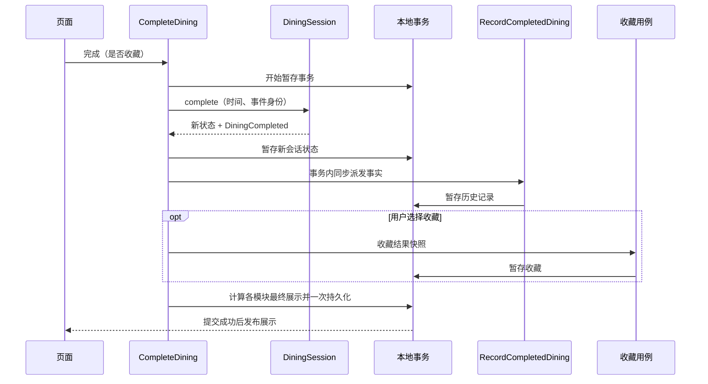

# 参考 library 示例的 DDD 重设计方案

日期：2026-10-25。状态：设计提案，尚未实施。本文描述目标设计，不替代其他文档对当前实现的说明。

本次范围：完整设计与差异分析，重点是领域模型和领域事件。业务代码、界面、存储版本和 WebSocket 协议均未修改。

## 1. 结论与设计依据

保留 Catalog / Dining 两个限界上下文，在 Dining 内区分核心用餐模型、历史查询、收藏和多人协作。重点改进“谁做业务决定、谁拥有事实、谁处理事实”，而不是继续增加目录层级。

建议分两条线演进：

1. 单人用餐：让 DiningSession 一次完成结算决策，返回新状态与 DiningCompleted 事实；历史订阅该事实，收藏继续由用户显式发起。通过同步事务保持当前的原子保存与失败重试体验。
2. 多人用餐：从服务端 RoomService 提取 Room 聚合，保护权限、版本、数量和结束规则。连接、凭证、请求去重和消息广播留在应用与基础设施层。客户端 Room 模块仍作为远端能力适配器。

不引入消息中间件、事件溯源或微服务。示例也允许先采用立即一致性，以及在没有必要事件时使用显式应用服务协调。

### 从示例源码提炼的原则

| 示例证据（均为本地 Java 示例项目相对路径） | 实际思想 | 本项目对应决策 |
| --- | --- | --- |
| README.md：Project structure and architecture | 上下文各自选择架构；复杂 Lending 使用六边形，Catalogue 使用简单架构 | Session / 服务端 Room 建立行为模型；Collection 保持 CRUD |
| docs/design-level.md | 从命令、规则、事实、读模型发现设计 | 先列业务场景，再决定事件与聚合 |
| lending/patron/model/Patron.java | 聚合返回成功事实或业务拒绝，不自己访问框架 | Session / Room 返回显式 Decision |
| lending/patron/model/PlacingOnHoldPolicy.java | 可组合、会变化的业务规则使用 Policy | 优先提取房主授权、接管判定等真实规则，不把每个 if 都变成类 |
| lending/patron/model/Patrons.java 与 infrastructure/PatronsDatabaseRepository.java | 仓储可以接收事实，转换存储并发布事件 | 借鉴事实驱动协作；本项目首版保留状态仓储，避免同时建立两套状态更新逻辑 |
| lending/book/application/PatronEventsHandler.java | 一个聚合的事实触发其他模型的反应 | DiningCompleted 驱动历史记录保存 |
| commons/events/DomainEvent.java、DomainEvents.java | 事件有身份、聚合身份与发生时间；发布能力可替换 | 采用明确事件信封，事务内同步派发 |
| lending/patronprofile 与 lending/dailysheet | 读模型按查询目的组织 | History 逐步成为记录与统计查询模块，无需整个列表聚合 |
| src/test/groovy 下领域、应用、基础设施、架构测试 | 用业务例子和边界测试保护设计 | 复用现有回归，并补充决策、事件和回滚例子 |

表中 Java 包路径统一省略 `src/main/java/io/pillopl/library/`。示例中的状态类型、多策略和仓储发布模式各有业务背景，本项目不要求逐项照搬。

## 2. 现状与差异

| 方面 | 当前实现 | 目标与理由 |
| --- | --- | --- |
| 业务边界 | Catalog / Dining 已分离，Dining 下有 session、history、collection、completion、room | 保留；页面数、数据库表数不决定上下文数量 |
| 应用契约 | Input 内部 Request / Response、Symbol Token、Reader / Writer / Output | 保留作为兼容边界；它们属于本项目约定，并非 DDD 必需形式 |
| Session | 已保护活动状态、覆盖、选菜、分店草稿、轮次、金额；变更返回新对象 | 增加明确的完成行为与 Decision，避免完成事实只能从外部多个调用推断 |
| 完成流程 | prepare → SaveRecord → 可选 CollectReceipt → CloseDining，由应用协调 | CompleteDining 调用聚合完成，再在同一事务处理 DiningCompleted；保留可选收藏的显式命令 |
| 历史 | DiningHistory 管理整个本地列表的保存、删除、统计 | 逐步改为按记录 ID 的写入端口和独立查询；列表无跨记录不变量，不需要作为写聚合 |
| 收藏 | 已是独立 CRUD，用例保存/删除后展示 | 保留；收藏不应成为所有完成事件的自动副作用 |
| 多人服务端 | service.ts 同时处理协议、身份、房间规则、轮次、收据、广播、过期 | 提取 Room 聚合及纯业务判定；保留服务端权威 |
| 事件 | 有协议消息和 AfterCommit 展示回调，无显式业务事件 | 业务事件、网络消息、展示通知分开；仅新增有消费者的业务事实 |
| 数据契约 | restaurant-catalog 与 room-protocol 放在 utils，部分业务类型与传输类型混用 | 按所有权明确菜单快照、领域状态、存储 DTO、协议 DTO，由适配器转换 |
| 架构守卫 | check-architecture 只扫描 src，限定应用目录和公开 Input | 实施时扩展到 server，增加事件契约和处理器约定，不直接放开内部类型 |

当前实现已经有较好的框架隔离和本地事务。重设计的收益应体现在模型表达和服务端可测试性，而不是再次移动全部文件。

## 3. 业务语言、边界与所有权

| 概念 | 所有者 | 规则和含义 |
| --- | --- | --- |
| 餐厅目录、菜单、估值 | Catalog | 管理自定义数据与合法性；估值不是实际消费金额 |
| 用餐菜单快照 | Dining.Session / 服务端 Room 各自持有 | 开始时固定；后续 Catalog 编辑不改变正在进行的用餐 |
| 当前用餐 Session | Dining.Session | 一次个人用餐身份，当前餐厅、分店草稿、门票和状态 |
| 餐厅草稿 Draft | Session 或 Room 内部值 | 待选与已提交轮次；切换餐厅不丢失其他草稿 |
| 用餐结果 Result | 产生它的聚合 | 不可变业务快照，包含来源 ID；不因查询而生成新身份 |
| 历史记录 Record | Dining.History | 完成结果的本地保留记录，删除不影响收藏 |
| 收藏小票 Receipt | Dining.Collection | 用户保存的快照；可以在未完成时保存，不等于完成事实 |
| 房间 Room | 服务端 Dining.Room | 多人共享身份、成员、房主、版本、草稿与结束结果 |
| 客户端房间视图 | 客户端 Room 适配器与 Presenter | 展示服务端快照，不另建可决定多人事实的客户端聚合 |

“多人”标签不能让单人 Session 和服务器 Room 同时成为同一份共享状态的权威。保留现有兼容字段，内部模型按真实来源区分。

History 与 Collection 是 Dining 内部模块。多人服务端是独立部署和一致性边界；暂时没有足够证据把它定义为第三个限界上下文。

## 4. 目标领域模型

### 4.1 DiningSession

聚合根继续使用会话 ID。内部持有 TicketPrice、固定 DiningMenuSnapshot、当前餐厅 ID 与 Draft 集合。Draft 包含 DiningSelection 与 DiningRound；它们不独立加载、保存或发布跨模块事件。

建议行为：begin、selectRestaurant、changeSelection、commitRound、changeTicketPrice、complete、discardEmpty。保留查询 preview，查询不产生事件，也不关闭会话。

`complete(context)` 的业务决定：

- 只结算当前餐厅，含最后一轮有效待选；其他餐厅草稿不进入结果。
- 当前餐厅无有效用餐时返回 NoChange，保持当前接口的未完成结果。
- 成功返回空的当前会话状态和 DiningCompleted；最终结果包含待选轮次的时间及完整明细。
- 完成后其他餐厅草稿随整个会话关闭而清除，与当前行为一致。
- `discardEmpty` 必须检查所有餐厅均无草稿，并核对期望会话 ID。它不是“完成用餐”。
- 显式确认覆盖可开始新会话；被覆盖会话不应生成完成记录。

金额继续用整数分计算。TicketPrice 负责有限正数和分精度；多人现有一千万元上限由 Room 的票价约束承担，不擅自改变单人规则。轮次恢复保留已存金额，不能使用最新菜单价格重算旧结果。

不急于把 active / empty 拆成多种状态类。当前状态少，联合类型或内部状态字段已足够；只有编译期能显著排除非法行为时才引入状态类型。

### 4.2 Room

服务端 Room 聚合持有房间身份、固定菜单、成员业务信息、房主 ID、revision、各店草稿与已结束结果。成员不是独立聚合，因为成员资格、房主和房间结束需要一起判断。

Room 不持有 WebSocket、Peer、随机凭证或请求缓存。连接注册表把 socket 数量转换为 memberOnline / memberOffline 命令；聚合只知道成员是否在线、离线时间和加入顺序。多连接中最后一个连接断开才产生离线转换。

保留以下业务规则：

- 普通成员可更新自己的昵称、增减菜品；房主才可提交轮次、改门票、转让房主或结束。
- 菜品增减使用增量合并，单品上限 10000；其他需确认版本的操作按现有语义检查 expectedRevision，昵称仍保留当前例外。
- 当前实现中 rename 不检查 expectedRevision；设计迁移时不得顺手改变这个协议行为。
- 新成员不能加入已结束房间，最多 50 位成员；已存在成员可以恢复结束结果，结果中的参与者昵称保持冻结。
- 房主离线满 60 秒后，按加入顺序选择在线成员接管。应用层传入 now，聚合不自行读取系统时间。
- 无在线成员满 30 分钟、结束满 24 小时的清理，由应用定时扫描选择候选，再调用纯过期判定并移除仓储数据。
- 结束只保留当前餐厅结果；未提交的有效选择进入最后一轮，收据包含离线成员的昵称。

应用层负责身份认证、entryKey / token、幂等请求与同步串行执行；聚合负责“已认证的 actor 能否做这件事”。服务总房间数 5000 是服务容量约束，不属于单个 Room 的不变量。

首版采用“加载副本 → 聚合决定 → 替换内存状态 → 缓存响应 → 广播”，保证业务拒绝不留下部分修改。发送失败不能回滚已经接受的命令，重试通过请求缓存或 sync 恢复结果。服务重启仍清空临时房间，不承诺持久化。

### 4.3 History 与 Collection

History 的每条记录以来源结果 ID 幂等保存，统计由记录列表查询计算。可以先保留 DiningHistory 外观，逐步改为 RecordWriter.upsert、RecordReader.findAll、RecordDeleter.delete；变更期间保证旧 public Input 不变。

删除历史后用户主动再次导入同一多人结果，沿用当前可重新保存的行为；不新增永久的“已消费事件 ID”阻止用户导入。事件重投去重和用户再次执行导入是两种语义。

Collection 不订阅 DiningCompleted 自动收藏。完成时的可选收藏、用餐中的保存小票、多人结果收藏，都通过明确的用户命令调用其简单写入能力；同来源 ID 更新已有收藏，删除与历史独立。

## 5. 命令、事实与消费者

以下是业务发现清单。首批仅实施带有实际消费者的 DiningCompleted、RoomDiningEnded；其他候选事实随消费者需求引入。

| 命令 | 决策者 | 成功事实或结果 | 消费者 / 处理方式 |
| --- | --- | --- | --- |
| BeginSession | Session | 新会话；候选 DiningStarted | 首版直接保存并投影，无独立事件消费者 |
| ChangeSelection | Session / Room | 新待选；候选 SelectionChanged | 首版返回状态并更新视图 / 广播 |
| CommitRound | Session / Room | 新轮次或 NoChange；候选 RoundCommitted | 无有效待选时不生成轮次或事件 |
| CompleteDining | Session | DiningCompleted | History 同步保存记录；应用层处理可选收藏 |
| SaveDiningReceipt | 应用协调 Collection | 收藏成功 | 不生成 DiningCompleted，不改历史、草稿或活动状态 |
| EndRoomDining | 服务端 Room | RoomDiningEnded | 服务端适配器生成协议结束快照，客户端显式导入本地 |
| SaveRoomResult | 本地应用协调 | 本地历史/可选收藏更新 | 不重复宣称本地 Session 完成，不关闭个人会话 |
| TransferHost / 接管检查 | Room | 房主变更；候选 RoomHostChanged | 首版返回变化描述用于现有广播 |
| DiscardEmptySession / 确认覆盖 | Session | 丢弃 / 替换结果 | 不产生完成事实、不生成历史 |
| DeleteRecord / DeleteReceipt | 对应应用用例 | 删除成功或 NoChange | 各自重建读视图，不传播到另一个列表 |

领域事件表达已成立的事实；RoomMessage 是协议 DTO，Store.present 是展示投递。三者不能用同一个通用 Event 类替代。

### 5.1 决策与事件契约草案

下列为设计示意，尚未进入源码。具体字段在实施第一阶段通过场景测试固定。

```ts
type Decision<S, E, R> =
    | {kind: 'accepted'; state: S; events: readonly E[]; result: R}
    | {kind: 'rejected'; reason: {code: string; message: string}}
    | {kind: 'noChange'; result: R}

type DiningCompleted = Readonly<{
    type: 'dining.completed'
    schemaVersion: 1
    eventId: string
    aggregateId: string
    occurredAt: string
    correlationId: string
    result: CompletedDining // 自包含的深只读事实 DTO，不引用可变聚合
}>
```

成功事实由模型的成功分支构造；应用层提供 eventId、命令关联 ID 和时间。模型不调用 UUID、Date.now 或框架。迁移时适配器把 rejected / noChange 映射为当前 Input.Response 和错误提示，避免一次改动所有页面。

业务拒绝如无权限、版本冲突、无效票价通过 Decision 表达；存储失败、连接故障继续作为技术异常处理。空轮次和重复完成是 NoChange。没有审计消费者时，不为每次拒绝新增持久化的失败事件。

事件只带消费所需结果和标识，不带完整目录、其他餐厅草稿、成员 token 或 socket。TypeScript readonly 只提供编译期保护；发布边界必须生成独立 DTO，每个处理器接收独立副本，避免共享引用污染其他处理器及响应。

事件 ID 在同一次事务重投时保持稳定。新一轮失败重试可以有新事件 ID，记录仍以来源结果 ID 去重。多人采用独立来源事件契约与版本；协议 v2 继续由适配器生成，不直接把内部事件结构发到网络。

### 5.2 模块公开面

公开 Input 保留在现有 public.ts。另设明确的 `events.ts` 仅导出本模块拥有的事件 DTO，不导出模型、仓储或内部辅助类型。Session 的 CompletedDining 事件结果类型独立于 History 的存储类型。

History 应用处理器可导入 Session 的公开事件契约，并映射为自己的 Record。依赖方向固定为 History → Session.events，Session 不引用 History。Composition 负责注册处理器。Collection 不产生对 Session 的事件依赖。

实施时扩展架构守卫：允许有目的的事件契约依赖和 application/handler，禁止跨模块模型导入、事件文件中的平台依赖、事件订阅环以及领域对总线实现的依赖。当前守卫不允许这些目录和导出，因此不能只新增事件文件而不更新规则与测试。

## 6. 事务、派发与一致性

### 本地完成流程



关键限制：

1. 所有业务事件处理器在当前事务内部同步执行；任何处理器或最终存储失败，都丢弃状态、历史、收藏与待发布展示。
2. 处理器加入当前事务，不再次开启 LocalDiningDatabase.transaction；现有实现不支持嵌套事务。
3. 事件总线只负责类型路由与有限同步派发，禁止持有下次事务的残留队列。需要处理器的事件缺少注册应在装配验证中失败。
4. History 写入必须在提交前完成。现有 AfterCommit 继续只承担展示发布，不能用它保存历史，否则会出现会话已关闭但记录保存失败。
5. 事务内暂存的新状态只能被该事务读到。事件顺序采用命令内的明确顺序；首版不允许处理器递归产生其他业务事件。
6. 提交后展示通知异常无法撤销存储，应按“已提交、投影需重载”处理；不能提示业务未完成并重新执行。保留该项作为实施时需要补齐的恢复用例。
7. 单人当前每次选菜仍直接保存状态并投影；不为无消费者的事件把所有用例包装成总线流程。

这里采用状态持久化加同步事件协作，事件不是恢复状态的唯一数据源。它与示例的 repository.publish(event) 有意不同：现有状态仓储与 version 4 快照已能可靠恢复，首版不值得增加事件到存储模型的第二套映射。

### 多人到本地的边界

RoomDiningEnded 在服务端成为事实后，服务端生成当前协议快照。客户端收到结束结果，仍通过 SaveRoomResult 的幂等导入更新本地历史与可选收藏。服务端完成和各客户端本地导入不构成一个分布式事务，离线客户端恢复后可导入。

服务端幂等键保持成员 ID + requestId，create / join 继续保留 entryKey 恢复路径。Room.revision 仍是客户端乐观并发确认的依据，不能用 eventId 替代。广播失败由缓存响应、sync 和 resume 恢复，不承诺消息恰好投递一次。

如果以后引入持久化和可靠外部订阅，再将状态与 outbox 一起提交，由发布器发送，消费者按 eventId 去重。当前方案不提前实现这一设施。

## 7. 查询、适配与目标结构

Session 与 Room 是写模型；DiningView、RoomView、历史列表与统计、小票展示是读模型。首版读模型继续从已保存状态生成，不要求新建物化表或通过事件维护统计增量。这样既能完整重建，也避免历史删除后统计漂移。

```text
src/contexts/catalog/                   # 保留现有目录查询与编辑
src/contexts/dining/
  session/
    model/                             # Session、Draft、Selection、Round、TicketPrice
    events.ts                          # 完成事实及其自包含结果契约
    application/{port,interactor}/
    infrastructure/
  history/
    application/{port,interactor,handler}/ # RecordCompletedDining + 查询/删除
    infrastructure/
  collection/                          # 精简 CRUD
  completion/                          # 用户意图、事务、事件派发、可选收藏协调
  room/                                # 客户端远端适配，非权威 Room 模型
src/infrastructure/
  persistence/                         # v4 快照、迁移、切片仓储基础
  transaction/                         # 当前事务与 AfterCommit
  events/                              # 同步派发实现，由组合根装配
src/presentation/                      # 无框架展示契约
src/ui/                                # 页面、Pinia、平台与组合根

server/src/
  dining/room/
    model/                             # 权威 Room、Member、Draft、业务拒绝
    events.ts                          # RoomDiningEnded
    application/                       # 命令协调、请求幂等、认证端口
    infrastructure/                    # 内存仓储、连接注册、协议映射
  service.ts                           # 保留现有外观作为迁移入口
  index.ts                             # WebSocket、限流、定时器与组合根
```

类型按所有权拆分：Catalog 编辑格式 → Dining 菜单快照；Room 聚合结果 → room-protocol v2；领域记录 → SnapshotDocument v4；领域/查询结果 → ViewModel。领域模型不直接使用 RoomRequest 或 RoomMessage。

目录名不是验收标准。Catalog 不因为使用简单 CRUD 就必须删掉现有端口；应用层 Input 内部类与 Symbol 也无需为模仿 Java 而替换。

## 8. 分阶段迁移与验收

| 阶段 | 工作 | 完成条件 |
| --- | --- | --- |
| 0：固定行为 | 给关键场景建立基线，确认本方案中的既有规则 | 当前测试通过；对存在歧义的规则有明确例子 |
| 1：单人模型 | 提取 Draft / TicketPrice 的实际职责，新增 complete + Decision | 原有 preview、待选、跨店切换、金额与恢复不变；完成决策可纯测试 |
| 2：完成事件 | 新增 DiningCompleted、同步派发、History 处理器；接入 CompleteDining | 任一失败仍全量回滚；收藏是显式命令；公开 Input 和存储 v4 不变 |
| 3：多人模型 | 先保持 RoomService 外观，再把业务规则移入 Room，提取连接注册与协议映射 | 原服务端测试及真实 WebSocket 测试通过；无网络环境即可测试 Room |
| 4：查询和边界 | 精简历史写模型、明确事件/DTO 所有权、扩展 server 架构守卫 | 历史统计与独立删除不变，跨层与跨模块非法依赖被拒绝 |

每阶段独立可合并、可通过版本控制回退，不并行维护新旧写路径。持久化格式和协议如果确需变更，另开迁移设计；本方案首版没有这一需求。

### 业务例子与测试分层

| 层级 | 必须覆盖的例子 |
| --- | --- |
| Session 领域 | 未开始拒绝选菜；显式覆盖；减到零；空轮次 NoChange；当前店结算包含待选；其他店不计入；完整清理草稿；预览不产生事件 |
| 金额与恢复 | 0.1 + 0.2 按分正确；非法/非有限票价拒绝；旧轮次价值保持；同名明细保留当前合并语义 |
| 完成与事件 | 完成仅产生一次事实；重复完成 NoChange；事件独立快照；记录处理器缺失装配失败；不选择收藏不调用收藏 |
| 本地事务 | History、Collection、状态暂存或最终保存失败均回滚；重试一条记录；处理器不嵌套事务；提交后展示异常可重载 |
| History / Collection | 幂等 upsert；独立删除；删除后主动再次导入允许恢复；用餐中保存小票不完成、不写历史 |
| Room 领域 | 房主权限、版本冲突、增量合并、单品上限、离线接管、结束结果冻结、50 人限制 |
| Room 应用/网络 | 重复请求只执行一次；失败结果也缓存；连接发送失败后 sync 可恢复；最后连接离线；entryKey 恢复；token 不进入广播 |
| 跨进程 | 重连导入不影响个人会话；重复导入无重复历史；离线恢复结束结果；服务重启行为保持 |
| 架构 | 模型无 Vue/Pinia/Node/协议依赖；公开事件无内部类型；处理器依赖方向无环；客户端不决定服务端 Room 状态 |

实施时运行现有 `npm test`、`npm run type-check`、`npm run check:architecture`，以及显式 `npm run server:test`、`npm run server:type-check`。客户端变更后补 H5 和微信小程序构建，并人工走通开始、选菜、切店、保存小票、完成、历史/收藏删除、多人结束与重连。

本次仅检查源码并编写方案，未运行上述实现验收命令，不声称目标模型已经通过测试。

## 9. 设计取舍与待确认业务问题

已确定的首版取舍：保留两个上下文、公开 Input、状态持久化、本地同步原子事务和服务器权威；仅对有实际协作价值的事实引入事件。主要成本是完成流程多出事件契约与注册关系，因此需要装配测试及可追踪的 correlationId。

以下为后续业务演进问题，不阻塞按现有规则重构：

- 跨餐厅完成后清除其他店草稿是否始终符合产品意图？首版沿用当前清除行为。
- 同名不同价菜品目前合并数量并保留首次单价，结果金额另外按轮次计算；若希望小票逐行金额可相加，应另行变更合并键，不能混入架构迁移。
- 是否需要对完成拒绝、覆盖与丢弃保留审计记录？没有需求前不发布这类持久化事件。
- 是否需要服务重启后恢复房间及可靠事件外发？明确需要后再设计持久化、outbox 与恢复协议。

这些问题都不能仅靠 Java 示例的技术结构作决定。
