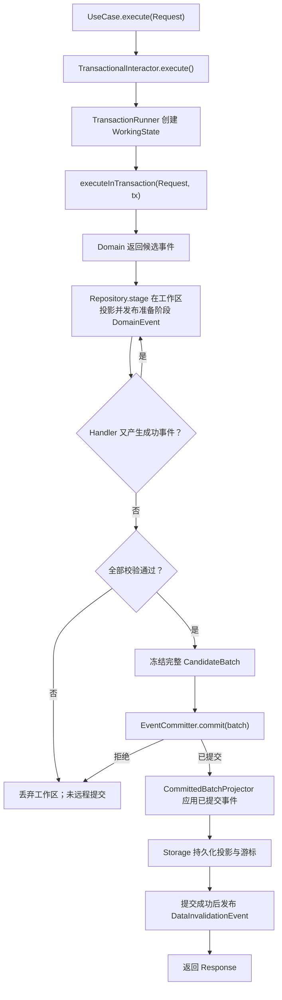

# 自助餐省钱神器 — Domain 与 Application 重构说明书

> 文档状态：目标设计 / 重构实施规范  
> 编制日期：2026-11-01  
> 适用范围：UniApp 客户端的 Domain、Application、跨上下文协调层及它们依赖的事件事务契约  
> 依据：《自助餐省钱神器_DDD战略与战术设计_统一事件批次版.md》以及后续确认的 Domain 显式业务参数、TransactionalInteractor 模板方法方案  
> 优先级：本文只更新 **Domain / Application 的组织与接口形式**；未明确修改的战略业务规则沿用统一设计说明书。本文的示例代码说明接口契约和职责边界，不是可直接编译运行的完整实现。

---

## 1. 重构目标与不变前提

### 1.1 本轮目标

1. 单模块 DDD：一个根 `package.json`，目录按业务上下文、架构层组织；不用按上下文拆分独立 npm 包。
2. Domain 的普通业务方法采用**显式、有业务含义的参数**，不再用笼统的 `Input`、`Command` 或 `Params` 对象封装少量普通参数。
3. Domain 维持**事件产生式模型**：聚合检查业务不变量并返回精确类型的成功/失败事件，不直接修改当前聚合状态，不访问 Repository、Storage、EventBus 或网络。
4. Application 的每个对外业务能力以独立 Port.In UseCase 表达；Request/Response 作为同名 namespace 中的内聚类型，输入校验与业务校验分工明确。
5. 有事务的 Interactor 继承 `TransactionalInteractor`，使用**模板方法**统一事务生命周期；纯查询 Interactor 可以直接实现 UseCase。
6. 一个操作产生的所有成功事件（包括同步 Handler 产生的后续事件）先进入同一个 `WorkingState`，组成**完整有序的候选事件闭包**；准备成功之后再提交一个原子 `EventBatch`。
7. 单人 / 多人复用 Domain、Application 的业务逻辑和本地投影。区别主要是 Local/Remote EventCommitter 的实现，不创建单人的虚拟房间。
8. 单人/多人客户端均使用普通 UniApp Storage 适配器，应用层只看到事务、Repository 和提交契约；不依赖 SQLite。
9. 用依赖检查和测试阻止跨层、跨上下文内部实现的非法依赖。

### 1.2 本轮不改变的业务模型

- `Dining Accounting`：`DiningActivity`、`RestaurantConsumption` 两个独立聚合根；`Round` 为内部实体；`ConsumptionItem`、`DiningResult`、`Money` 为值对象；`ConsumptionCalculator` 为领域服务。
- `Restaurant Catalog`：`Restaurant` 聚合根，`Category`、`Product` 内部实体；目录版本和价格具有独立业务意义。
- `Dining Collaboration`：`DiningRoom` 聚合根，`RoomMember` 内部实体；房间协作授权规则在受信任的客户端 Domain/Application 校验。
- 一次用餐仅有一个整次门票总金额，必须大于零；单次活动可比较多家餐厅；只有显式指定的最终餐厅进入正式结果。
- 每家餐厅最多一个未提交轮次；提交非空轮次后自动产生下一未提交轮次；已提交和未提交均参与实时计算；价格变更影响进行中结果；快照冻结后不追溯改变。
- 服务端不运行业务 Domain，不执行房主或业务规则校验，只做协议约束、版本 CAS、房间事件流原子追加、历史读取与广播。流级版本仅保证并发顺序，不保证不可信客户端事件的业务合法性。
- 不引入请求级幂等去重；未知提交结果不能盲目重新发送写命令。

### 1.3 本轮覆盖旧实现的事项

| 旧代码或建议 | 本轮目标 |
|---|---|
| `increaseProduct(input: IncreaseInput)` 等普通业务方法 | `increaseProduct(roundId, productId, quantity)` 等显式参数 |
| 每个 Interactor 自己调用事务开始和提交 | 继承 `TransactionalInteractor`，只实现 `executeInTransaction` |
| Repository.apply 逐个事件直接提交到远程服务端 | `Repository.stage` 只处理候选工作态；完整批次统一提交 |
| 事件 Handler 在已提交事件回放时继续产生远程业务事件 | 仅准备阶段允许衍生事件；重放阶段只确定性应用已有事实 |
| 跨上下文 UseCase 各自开启独立事务 | 协调器向内部事务用例传递同一个 `TransactionContext` |
| 客户端 SQLite 原生数据库事务 | 普通 Storage + Copy-on-Write/持久化恢复适配器，保证范围要实测 |

---

## 2. 单模块文件结构

### 2.1 项目根结构

```text
buffet/
├── package.json                          # 唯一 npm 模块定义
├── src/
│   ├── contexts/
│   │   ├── accounting/
│   │   ├── catalog/
│   │   └── collaboration/
│   ├── coordination/
│   │   └── application/                  # 无 Domain，只编排跨 BC 业务
│   ├── kernel/
│   │   ├── domain/
│   │   └── application/
│   ├── infrastructure/
│   │   ├── storage/
│   │   ├── event-commit/
│   │   ├── event-sync/
│   │   ├── event-projection/
│   │   └── event-bus/
│   ├── composition/
│   ├── pages/
│   └── stores/
├── protocol/                              # 服务端可共享的传输信封
├── server/                                # 纯事件流服务，不依赖客户端 Domain
└── tests/
    ├── architecture/
    ├── domain/
    ├── application/
    ├── event-prepare/
    ├── event-commit/
    ├── storage/
    └── integration/
```

### 2.2 Accounting 详细文件结构

```text
src/contexts/accounting/
├── domain/
│   ├── aggregate/
│   │   ├── DiningActivity.ts
│   │   └── RestaurantConsumption.ts
│   ├── entity/
│   │   └── Round.ts
│   ├── value-object/
│   │   ├── Money.ts
│   │   ├── ConsumptionItem.ts
│   │   └── DiningResult.ts
│   ├── service/
│   │   └── ConsumptionCalculator.ts
│   ├── event/
│   │   ├── DiningActivityCreated.ts
│   │   ├── TicketPriceChanged.ts
│   │   ├── DiningEnded.ts
│   │   ├── DiningAbandoned.ts
│   │   ├── ProductQuantityIncreased.ts
│   │   ├── ProductQuantityDecreased.ts
│   │   ├── ConsumptionItemRemoved.ts
│   │   ├── RoundSubmitted.ts
│   │   ├── RoundCreated.ts
│   │   └── ConsumptionFinalized.ts
│   └── rejection/                          # 只有确有复用必要时建立
│       ├── QuantityIncreaseRejected.ts
│       ├── RoundSubmitRejected.ts
│       └── DiningEndRejected.ts
├── application/
│   ├── port/
│   │   ├── in/
│   │   │   ├── CreateDiningActivityUseCase.ts
│   │   │   ├── IncreaseProductUseCase.ts
│   │   │   ├── DecreaseProductUseCase.ts
│   │   │   ├── SubmitRoundUseCase.ts
│   │   │   ├── ChangeTicketPriceUseCase.ts
│   │   │   ├── GetConsumptionUseCase.ts
│   │   │   └── GetDiningActivityUseCase.ts
│   │   └── out/
│   │       ├── DiningActivityRepository.ts
│   │       ├── RestaurantConsumptionRepository.ts
│   │       └── ConsumptionQuery.ts
│   ├── use-case/
│   │   ├── CreateDiningActivityInteractor.ts
│   │   ├── IncreaseProductInteractor.ts
│   │   ├── DecreaseProductInteractor.ts
│   │   ├── SubmitRoundInteractor.ts
│   │   ├── ChangeTicketPriceInteractor.ts
│   │   ├── GetConsumptionInteractor.ts
│   │   └── GetDiningActivityInteractor.ts
│   ├── event-handler/
│   │   └── RoundSubmittedHandler.ts
│   └── internal/                            # 被跨 BC 协调器使用的事务内 Port.In
│       └── SubmitRoundInTransactionPort.ts
└── adapter/
    └── persistence/                         # 快照映射、事件投影、Repository 实现
```

**说明**：文件名为建议落地命名，不意味着每个示例事件目前都必须存在。凡是统一业务操作直接产生且无需衍生 Handler 的事件，不需要额外加 Handler 文件；`EndDiningUseCase` 应放在真正拥有跨上下文结束流程的 `coordination` 中，避免 Accounting 偷偷访问 Collaboration 内部 Domain。

### 2.3 Catalog / Collaboration 文件结构

```text
src/contexts/catalog/
├── domain/
│   ├── aggregate/Restaurant.ts
│   ├── entity/Category.ts
│   ├── entity/Product.ts
│   ├── value-object/RestaurantType.ts
│   └── event/
│       ├── RestaurantCreated.ts
│       ├── RestaurantDeleted.ts
│       ├── ProductAdded.ts
│       ├── ProductDeleted.ts
│       ├── ProductPriceChanged.ts
│       └── RestaurantCatalogReplaced.ts
├── application/
│   ├── port/in/                            # 管理餐厅、商品、目录查询的 UseCase
│   ├── port/out/                           # RestaurantRepository、目录查询抽象
│   ├── use-case/                           # 对应 Interactor
│   └── event-handler/                      # 按需建立
└── adapter/

src/contexts/collaboration/
├── domain/
│   ├── aggregate/DiningRoom.ts
│   ├── entity/RoomMember.ts
│   ├── value-object/RoomStatus.ts
│   ├── value-object/RoomCode.ts
│   └── event/
│       ├── RoomCreated.ts
│       ├── MemberJoined.ts
│       ├── MemberLeft.ts
│       ├── HostTransferred.ts
│       ├── RoomEnded.ts
│       └── RoomAbandoned.ts
├── application/
│   ├── port/in/
│   ├── port/out/
│   ├── use-case/
│   └── event-handler/
└── adapter/
```

只把实际存在的业务概念抽为文件，不为了“目录完整”机械生成空类。`MemberDisconnected` 等在线事件只有在权威事实来源与回放语义确定后才引入；不能凭客户端本地断线感知伪造所有成员的可信状态。

### 2.4 Kernel 与 Coordination 文件结构

```text
src/kernel/
├── domain/
│   ├── AggregateRoot.ts
│   ├── DomainEvent.ts
│   └── DomainRejection.ts
└── application/
    ├── UseCase.ts
    ├── TransactionalInteractor.ts
    ├── TransactionRunner.ts
    ├── TransactionContext.ts
    ├── CandidateBatch.ts
    ├── EventCommitter.ts
    ├── DomainEventBus.ts
    ├── DomainEventHandler.ts
    ├── DataInvalidationEvent.ts
    ├── DataInvalidationEventBus.ts
    └── CommittedBatchProjector.ts

src/coordination/application/
├── port/in/
│   ├── CreateMultiplayerDiningUseCase.ts
│   ├── EndMultiplayerDiningUseCase.ts
│   └── SyncRoomRestaurantUseCase.ts
└── use-case/
    ├── CreateMultiplayerDiningInteractor.ts
    ├── EndMultiplayerDiningInteractor.ts
    └── SyncRoomRestaurantInteractor.ts
```

`Kernel` 仅保留**跨上下文真正复用的最小抽象**。每个 TypeScript 文件原则上一个顶层 class 或 interface。UseCase 接口及同名 namespace 内的 Request、Response 是明确例外。

---

## 3. Domain 层设计规范

### 3.1 职责和禁止依赖

Domain 只包含：聚合根、聚合内部实体、值对象、领域服务、成功领域事件、类型化业务拒绝结果和必要的重建契约。

Domain **不应包含**：Interactor、Repository、Port.Out、TransactionContext、EventBus、UniApp API、Storage、HTTP、WebSocket、Prisma、Vue 或 Store。

### 3.2 领域方法的参数规则

**默认使用显式业务参数**：

```typescript
// 推荐：参数独立且具有清晰业务含义
consumption.increaseProduct(roundId, productId, quantity);
consumption.decreaseProduct(roundId, productId, quantity);
consumption.submitRound(roundId);
activity.changeTicketPrice(ticketPrice);
room.transferHost(targetMemberId);
restaurant.changeProductPrice(productId, newPrice);
```

```typescript
// 不推荐：仅为压缩参数个数而声明包装类型
consumption.increaseProduct({ roundId, productId, quantity });
consumption.submitRound({ roundId });
```

允许直接使用 **真正具备业务语义的类型**（例如 `Money`、`DiningResult`、`ProductId`），以及 `reconstitute(snapshot)` 这类基础设施重建的整体快照参数。构造函数初始化不可变快照也可以接受内聚的完整状态对象。对于确实有大量高度内聚且反复使用的参数，应优先提炼 ValueObject，而不是引入无意义的 Input DTO。

### 3.3 聚合根文件的建议结构

每个聚合根文件一般包含以下内容（不强制每个聚合都使用全部成员）：

1. `private constructor(...)`：只允许受控创建与重建。
2. `static create(...)` 或领域工厂：创建时检查业务规则并产生初始化事件；不要创建未提交的权威持久化事实。
3. `static reconstitute(snapshot)`：根据已持久化的确定性状态重建聚合。
4. 只读业务属性 / 查询方法：读取当前聚合状态。
5. 业务方法：显式参数 → 校验不变量 → 返回精确成功事件或失败结果。
6. 私有业务规则辅助方法：只处理纯业务判断，不依赖技术层。

`RestaurantConsumption.ts` 的**结构性示例**：

```typescript
export class RestaurantConsumption {
  private constructor(
    public readonly id: string,
    public readonly activityId: string,
    public readonly restaurantId: string,
    private readonly rounds: readonly Round[]
  ) {}

  static reconstitute(snapshot: RestaurantConsumptionSnapshot): RestaurantConsumption {
    // 校验重建数据并返回新的不可变业务视图
    throw new Error("Implement reconstitution");
  }

  increaseProduct(
    roundId: string,
    productId: string,
    quantity: number
  ): ProductQuantityIncreased | QuantityIncreaseRejected {
    if (!Number.isSafeInteger(quantity) || quantity <= 0) {
      return new QuantityIncreaseRejected("INVALID_QUANTITY");
    }
    if (!this.canEdit(roundId)) {
      return new QuantityIncreaseRejected("ROUND_NOT_EDITABLE");
    }
    return new ProductQuantityIncreased(this.id, roundId, productId, quantity);
  }

  submitRound(roundId: string): RoundSubmitted | RoundSubmitRejected {
    if (!this.canSubmit(roundId)) {
      return new RoundSubmitRejected("ROUND_NOT_SUBMITTABLE");
    }
    return new RoundSubmitted(this.id, roundId);
  }

  private canEdit(roundId: string): boolean {
    // 只读领域检查：轮次存在、未提交等
    throw new Error("Implement business rule");
  }

  private canSubmit(roundId: string): boolean {
    // 只读领域检查：非空且未提交
    throw new Error("Implement business rule");
  }
}
```

**重要**：聚合方法不会在 `increaseProduct` 或 `submitRound` 内修改当前聚合的 `rounds`。Repository 在 `WorkingState` 暂存事件的状态转换之后，下一次加载会从工作区重建新的聚合视图。

`DiningActivity.ts` 的重要方法接口：

```typescript
changeTicketPrice(ticketPrice: Money): TicketPriceChanged | TicketPriceChangeRejected;
end(result: DiningResult): DiningEnded | DiningEndRejected;
abandon(): DiningAbandoned | DiningAbandonRejected;
```

`Restaurant.ts` 的重要方法接口：

```typescript
addProduct(categoryId: string, productId: string, name: string, price: Money): ProductAdded | ProductAddRejected;
deleteProduct(productId: string): ProductDeleted | ProductDeleteRejected;
changeProductPrice(productId: string, price: Money): ProductPriceChanged | ProductPriceChangeRejected;
```

`DiningRoom.ts` 的重要方法接口：

```typescript
join(memberId: string, displayName: string, joinedAt: string): MemberJoined | MemberJoinRejected;
leave(memberId: string): MemberLeft | MemberLeaveRejected;
transferHost(memberId: string): HostTransferred | HostTransferRejected;
end(eligibleMemberIds: readonly string[]): RoomEnded | RoomEndRejected;
```

以上方法签名是**建议的显式参数形状**，真实业务可增加必要的上下文数据，但不应以随意的 `input` 包装掩盖业务参数。涉及时间、随机数、新 ID 的事实应由 Application 取得并显式传入 Domain，或者在确定性事件生成时冻结；回放不再重新生成。

### 3.4 实体、值对象与领域服务

| 文件 | 主要内容 | 方法形态 |
|---|---|---|
| `Round.ts` | 稳定 ID、顺序、状态、消费条目只读视图 | `isEmpty()`、`canEdit()` 等业务查询 |
| `ConsumptionItem.ts` | productId、非负 quantity | 不可变值、业务相等性 |
| `Money.ts` | 最小货币单位、币种、溢出检查 | `add(other)`、`subtract(other)` |
| `DiningResult.ts` | 不可变最终消费快照 | `static create(...)` 验证并冻结明细 |
| `ConsumptionCalculator.ts` | 一致 Catalog 版本下的核算公式 | `calculate(...)`，可接收有业务意义的聚合计算视图 |

### 3.5 领域事件与失败结果

一个事件一个 `.ts` 文件，精确的类名表明已发生事实：`ProductQuantityIncreased`、`RoundSubmitted`、`RoundCreated`。事件负载包含回放需要的稳定 ID 和事实；`schemaVersion` 在传输序列化时明确，不依赖运行时 class 名的变化。

```typescript
export class ProductQuantityIncreased extends DomainEvent {
  constructor(
    public readonly consumptionId: string,
    public readonly roundId: string,
    public readonly productId: string,
    public readonly quantity: number
  ) { super(); }
}
```

拒绝类型如 `QuantityIncreaseRejected` 可继承 `DomainRejection`（或保留原统一文档既有的失败事件基类），但**禁止**进入候选成功事件批次、EventStore 或本地权威投影。Interactor 收到拒绝结果后转为 `BusinessRuleError` 等异常。

---

## 4. Application 层设计规范

### 4.1 Port.In：一项业务能力一个文件

`IncreaseProductUseCase.ts`：

```typescript
export interface IncreaseProductUseCase extends UseCase<
  IncreaseProductUseCase.Request,
  IncreaseProductUseCase.Response
> {}

export namespace IncreaseProductUseCase {
  export class Request extends UseCase.Request {
    constructor(
      public readonly consumptionId: string,
      public readonly roundId: string,
      public readonly productId: string,
      public readonly quantity: number
    ) {
      super();
      if (!consumptionId.trim() || !roundId.trim() || !productId.trim()) {
        throw new InvalidRequestError("INVALID_ID");
      }
      if (!Number.isSafeInteger(quantity) || quantity <= 0) {
        throw new InvalidRequestError("INVALID_QUANTITY");
      }
    }
  }

  export class Response extends UseCase.Response {
    constructor(public readonly consumptionId: string) { super(); }
  }
}
```

- Request 校验基础输入形态，不复制全部聚合业务规则。
- Response 仅表达成功结果，可由完全映射的不可变 DTO 构造；不得向 UI 泄漏 Domain 聚合引用。
- 失败通过异常或既定类型化拒绝转异常，不在 Response 中嵌套成功/失败状态判别联合。

### 4.2 Port.Out：接口层抽象

```typescript
export interface RestaurantConsumptionRepository {
  findById(id: string, tx: TransactionContext): Promise<RestaurantConsumption>;
  stage(event: DomainEvent, tx: TransactionContext): Promise<RestaurantConsumption>;
}
```

- Repository 的 `findById` 在准备阶段必须优先读取本事务 `WorkingState`（读己之写）。
- `stage` 是**准备中的事件应用**，不意味着 Storage 持久化，也不逐事件发送到服务器。
- 持久化数据的 Mapper、序列化细节和 Storage 键名位于 Adapter/Infrastructure，不在 Application Port.Out。
- 查询需求可拆为专用 `ConsumptionQuery`，避免将所有读取功能挤进写 Repository。

### 4.3 `TransactionalInteractor`：模板方法基类

文件：`src/kernel/application/TransactionalInteractor.ts`

```typescript
export abstract class TransactionalInteractor<
  TRequest extends UseCase.Request,
  TResponse extends UseCase.Response
> implements UseCase<TRequest, TResponse> {
  protected constructor(private readonly transactions: TransactionRunner) {}

  execute(request: TRequest): Promise<TResponse> {
    return this.transactions.run(tx => this.executeInTransaction(request, tx));
  }

  protected abstract executeInTransaction(
    request: TRequest,
    tx: TransactionContext
  ): Promise<TResponse>;
}
```

**模板固定行为**：创建/恢复事务上下文 → 调用具体 Interactor 工作方法 → 同步收集完整候选事件闭包 → 提交 EventBatch → 成功投影至本地 Storage → 提交后发布 DataInvalidationEvent → 返回成功 Response。

**子类扩展点**：仅 `executeInTransaction(request, tx)`，只关心业务编排。`TransactionRunner` 实现事务协议，基类不处理具体 Storage、WebSocket 和回滚语句。

TypeScript 没有 `final` 修饰符；代码规范要求子类不得覆写 `execute()`，可由 ESLint/架构测试专项检查。

### 4.4 具体 Interactor 示例

文件：`accounting/application/use-case/IncreaseProductInteractor.ts`

```typescript
export class IncreaseProductInteractor extends TransactionalInteractor<
  IncreaseProductUseCase.Request,
  IncreaseProductUseCase.Response
> implements IncreaseProductUseCase {
  constructor(
    transactions: TransactionRunner,
    private readonly repository: RestaurantConsumptionRepository
  ) { super(transactions); }

  protected async executeInTransaction(
    request: IncreaseProductUseCase.Request,
    tx: TransactionContext
  ): Promise<IncreaseProductUseCase.Response> {
    const consumption = await this.repository.findById(request.consumptionId, tx);
    const result = consumption.increaseProduct(
      request.roundId,
      request.productId,
      request.quantity
    );
    if (result instanceof QuantityIncreaseRejected) {
      throw new BusinessRuleError(result.reason);
    }
    await this.repository.stage(result, tx);
    return new IncreaseProductUseCase.Response(consumption.id);
  }
}
```

细节约束：此处的 Response 是在工作方法中先构造；`TransactionalInteractor.execute()` 必须直到事务的事件提交与本地投影完成后才返回。若远程已提交但投影失败，抛出明确的“远程已提交、待本地同步”技术错误，不能解释为操作被服务端撤销。

### 4.5 不需要事务的查询 Interactor

```typescript
export class GetConsumptionInteractor implements GetConsumptionUseCase {
  constructor(private readonly query: ConsumptionQuery) {}

  async execute(
    request: GetConsumptionUseCase.Request
  ): Promise<GetConsumptionUseCase.Response> {
    const view = await this.query.getById(request.consumptionId);
    return new GetConsumptionUseCase.Response(view);
  }
}
```

当查询需要读取**一致的最终结果视图**时，可由应用层显式选择只读一致性边界；不要把所有普通查询强行包装为写事务。

### 4.6 DomainEventHandler：同步准备阶段产生事件

文件：`accounting/application/event-handler/RoundSubmittedHandler.ts`

```typescript
export class RoundSubmittedHandler implements DomainEventHandler<RoundSubmitted> {
  constructor(private readonly repository: RestaurantConsumptionRepository) {}

  async handle(event: RoundSubmitted, tx: TransactionContext): Promise<void> {
    const consumption = await this.repository.findById(event.consumptionId, tx);
    const nextEvent = consumption.createNextRound();
    if (nextEvent instanceof RoundCreationRejected) {
      throw new BusinessRuleError(nextEvent.reason);
    }
    await this.repository.stage(nextEvent, tx);
  }
}
```

这里 `createNextRound()` 是**建议新增的领域方法**，其返回事件应携带事先确定的 `roundId`，不得在投影时随机生成。若生成下一轮本来是提交轮次的固定不变量，也可以由聚合一次性返回两个事件，避免无意义的 Handler；无论哪种实现，都必须将 E1 和 E2 放在同一个 CandidateBatch 中。

Handler 只在 `PREPARE` 阶段生成候选事件；`PROJECT_COMMITTED` 阶段不能重跑产生远程候选事件的 Handler。重放根据日志中的 `RoundSubmitted` 和 `RoundCreated` 确定性修改持久化投影。

### 4.7 嵌套事务与跨上下文执行

UniApp 多端不能假设 Node.js 的 `AsyncLocalStorage` 可用。因此**禁止依赖隐式全局事务变量**，内部业务协调要显式复用一个 `TransactionContext`。

推荐两级用例契约：

1. **外部 Port.In**：`execute(request)`，供 UI/Store/普通调用者使用；通过 `TransactionalInteractor` 开启唯一的顶层事务。
2. **内部事务 Port.In**：`executeIn(request, tx)`，供 `coordination/application` 或具备资格的同事务编排者使用；仅在已存在的事务中暂存事件，不单独执行 Commit。

例如 `SubmitRoundInTransactionPort.ts`：

```typescript
export interface SubmitRoundInTransactionPort {
  executeIn(
    request: SubmitRoundUseCase.Request,
    tx: TransactionContext
  ): Promise<SubmitRoundUseCase.Response>;
}
```

具体实现可以采用一个共享业务执行方法，在公开 `execute()` 模板和内部 `executeIn()` 中调用；禁止通过 `coordination` 直接访问 `SubmitRoundInteractor` 的私有 Repository。内部 Port 是公开的应用协作接口，不是跨 BC 导入内部 Domain 的后门。

**一条硬性规则**：最外层 UseCase 执行时，所有 `executeIn(..., tx)`、`Repository.stage(..., tx)`、DomainEventHandler 都加入同一个候选批次，只允许最外层 `TransactionRunner` 提交一次。

---

## 5. 事件事务接口和阶段职责

### 5.1 建议的核心契约

```typescript
export interface TransactionRunner {
  run<T>(work: (tx: TransactionContext) => Promise<T>): Promise<T>;
}

export interface TransactionContext {
  readonly phase: "PREPARE" | "PROJECT_COMMITTED";
  stage(event: DomainEvent): Promise<void>;
  addInvalidation(event: DataInvalidationEvent): void;
}

export interface EventCommitter {
  commit(batch: CandidateBatch): Promise<CommittedBatch>;
}
```

`TransactionContext` 除以上公共成员外，还应封装对 WorkingState 的聚合读写、事件闭包收集、版本基线、暂存失效事件和事件数量限制；不要把内部可变 `Map` 暴露给 UI 或 Domain。

### 5.2 精确阶段顺序



`Repository.stage` 可以通过 DomainEventBus 触发同步 Handler；所有 Handler 必须 `await`，不能在事务内进行无法回滚的 HTTP 调用、定时任务或 UI 副作用。相同事务内的再次加载应看到此前事件的暂存效果（读己之写）。事件闭包收集完成后冻结，不再追加。

### 5.3 单人/多人只有事件提交实现不同

| 步骤 | 单人 | 多人 |
|---|---|---|
| 业务命令、Domain 规则 | 相同 | 相同 |
| Interactor / WorkingState | 相同 | 相同 |
| 事件收集及 Handler | 相同 | 相同 |
| EventCommitter | `LocalEventCommitter` | `RemoteEventCommitter` |
| 权威版本顺序 | 本地活动事件流 | 服务端房间事件流 CAS |
| 应用已提交事件 | 本地 Projector | 相同 Projector + 远程同步器 |
| 本地数据存储 | UniApp Storage | 相同，按房间隔离 |
| 数据失效事件 | 本地提交后 | 本地提交后 |

**单人**：在 Storage 发布点把本地事件链和业务投影作为同一可恢复的版本一起提交，尽量不产生“日志已提交但投影未提交”的窗口。

**多人**：服务端先以一个数据库事务 CAS 追加完整批次，返回具有服务端事件版本的已提交批次；然后客户端再以一个本地 Storage 事务应用。两者不是跨设备原子事务。远程已提交但本地应用失败时必须保留服务器事实，并使用流回放修复，不能反向删除已提交日志。

### 5.4 提交失败的行为矩阵

| 失败时刻 | 是否已写服务端 | 客户端行为 |
|---|---|---|
| Domain 拒绝、准备阶段 Handler 失败 | 否 | 丢弃全部 WorkingState，业务错误 |
| 服务端 `expectedVersion` 不匹配 | 否 | 丢弃旧批次、补齐事件、基于原始命令重新计算 |
| 服务端批量插入途中失败 | 否（事务整体回滚） | 本次失败，可按确知结果处理 |
| 服务端成功、本地 Storage 提交失败 | 是 | 进入同步待恢复状态，不重新发原候选批次 |
| 服务端提交后响应丢失 | 未知 | 读取权威历史核实，不盲目重试 |
| 本地 DataInvalidation 监听失败 | 已提交 | 保留提交，隔离通知错误并可刷新查询 |
| 客户端崩溃重启 | 依真实提交结果 | 恢复有效本地快照和游标、按服务器事件流补齐 |

服务端“事件合法”仅指协议、大小、流存在、版本 CAS 等**基础设施要求**；它不能根据版本号证明房主权限、商品有效性或余额数量等领域规则合法。

### 5.5 普通 Storage 的事务保证边界

`uni.setStorage` 不提供跨 key ACID 事务。推荐先在内存 WorkingState 准备，再以 Copy-on-Write 状态版本 + Commit Manifest 发布已提交视图，保存投影状态和应用游标的一致版本；在微信小程序等目标设备测试异常退出与恢复。

**声明限制**：双版本写入和校验并不天然等于崩溃原子提交；如果目标平台无法保证所需的提交点安全性，应采用回放修复、单活动快照隔离，或调整存储布局和保证范围，不能声称拥有数据库级 ACID。事件体积与 Storage 单 key/总容量限制也要纳入测试。

---

## 6. 各层依赖和文件内内容约束

| 层/目录 | 允许放置 | 禁止放置 |
|---|---|---|
| `domain/aggregate/` | 聚合不变量、显式参数业务方法、重建 | Repository、EventBus、Storage、HTTP |
| `domain/entity/` | 内部实体状态与业务查询 | 独立跨聚合提交 |
| `domain/value-object/` | 不可变值和纯业务运算 | UI DTO、API 传输格式 |
| `domain/service/` | 纯领域计算 | 数据库读取、网络请求 |
| `domain/event/` | 稳定事实事件类 | 提交协议和服务器版本 CAS |
| `application/port/in/` | 用例接口、Request/Response | 直接暴露可变聚合 |
| `application/port/out/` | Repository、Query 等抽象 | Storage 具体调用 |
| `application/use-case/` | Interactor 业务编排 | 手写局部提交事务/网络直连 |
| `application/event-handler/` | 同步准备阶段衍生事件协调 | 回放时再产生权威候选事件 |
| `coordination/application/` | 跨 BC 公共 Port.In 编排 | 直接修改他域聚合 |
| `kernel/application/` | 通用模板、事务与批次契约 | 特定房间业务规则 |
| `infrastructure/` | Storage、提交器、同步器、投影器、总线具体实现 | 重新决定核心业务规则 |

**命名建议**：`IncreaseProductUseCase`（Port.In）、`IncreaseProductInteractor`（实现）、`RestaurantConsumptionRepository`（Port.Out）、`StorageRestaurantConsumptionRepository`（Adapter）、`RoundSubmittedHandler`（事件处理器）、`TransactionalInteractor`（事务模板）。每个文件原则上只定义一个顶层 class/interface；只有内聚的 namespace Request/Response 可与 UseCase 同文件。

**领域版本不混用**：`roomStreamVersion`（服务端流 CAS）、`aggregateVersion`（聚合状态版本）、`schemaVersion`（事件数据格式）各司其职。一个跨聚合批次内可包含多个事件，房间流版本每条递增，而不是每个聚合都无条件递增。

---

## 7. 重构实施步骤

### 阶段 0：冻结规则和现有回归测试

- [ ] 将统一设计文档的战略业务不变量作为当前基线。
- [ ] 保存现有用例、领域事件、仓储和跨上下文处理器的列表。
- [ ] 标记 Domain 直接修改当前状态、隐式调用 Repository、直接发送网络或 Storage 的代码。
- [ ] 标记所有 `Input` 包装型领域方法及其调用处。
- [ ] 标记每个 Interactor 自行管理事务边界的位置。

### 阶段 1：重整 Domain 文件与业务方法

- [ ] 按三个 Context 将聚合、实体、值对象、领域服务、成功事件、拒绝类型归档。
- [ ] 将简单 `input` 参数改为显式参数，不滥用原始字符串替代 Money 等有意义的值对象。
- [ ] 保持领域方法只生成事件，不修改当前聚合状态。
- [ ] 事件 payload 可确定性重放，消除回放依赖时间、随机数和实时价格的代码。
- [ ] 将业务拒绝从成功事件批次中严格排除。

### 阶段 2：重构 Application Port.In/Out

- [ ] 每项业务能力独立 UseCase 文件，Request/Response 用同名 namespace，Request 做基础输入校验。
- [ ] 把事务具体实现从 Interactor 中移除。
- [ ] Repository Port.Out 区分 `findById` 与 `stage`；从同一事务 WorkingState 读取最新暂存状态。
- [ ] 增加只读 Query 抽象，不将具体 Storage 对象暴露到 UI。

### 阶段 3：引入 `TransactionalInteractor`

- [ ] 在 `kernel/application` 定义 `TransactionalInteractor` 模板方法。
- [ ] 将现有写 Interactor 迁移为 `executeInTransaction(request, tx)`。
- [ ] 无事务查询 Interactor 保持直接实现 UseCase。
- [ ] 通过单元测试确认 execute 仅开启一次最外层事务、异常统一退出、成功按正确顺序执行 Commit 和通知。
- [ ] 定义跨 BC 内部事务 Port.In，保证嵌套调用只共享 `tx`，绝不各自提交。

### 阶段 4：事件闭包与提交器

- [ ] 实现 WorkingState、CandidateBatch、事件数量/循环保护。
- [ ] 将 DomainEventHandler 迁移为 PREPARE 阶段同步 `await` 的候选事件生产者。
- [ ] 阶段结束前冻结事件闭包；失败时不发送服务端。
- [ ] 将单人持久化接入 LocalEventCommitter、多人接入 RemoteEventCommitter。
- [ ] 本地已提交投影与 Sync Cursor 一致更新；失效事件只在本地提交后发。

### 阶段 5：统一 Storage 与故障恢复

- [ ] 提取 UniApp Storage 的读写、工作区、Copy-on-Write、Commit Manifest 接口。
- [ ] 为微信小程序和 App 真机测试单 key 限制、总容量、异常退出、重启恢复、故障注入。
- [ ] 多人模式实现完整批次历史回放、乱序/重复事件恢复、版本缺口补齐。
- [ ] 实现远程已提交而本地失败的 `SYNC_PENDING` 状态；实现远程结果不明时的历史核查。

### 阶段 6：架构测试与旧代码清理

- [ ] 通过 dependency-cruiser/ESLint 禁止 Domain 引入外层、跨 BC 内部导入、服务端依赖 Domain。
- [ ] 清理旧的服务器业务 Interactor/业务 Repository、客户端 SQLite 适配、多包 Contracts/Core。
- [ ] 清理逐事件远程写入、回放产生新候选事件和重复事务开始的路径。
- [ ] 回归所有战略业务规则，检查单人/多人在相同事件事实下得到相同投影。

---

## 8. 验收测试清单

### 8.1 Domain 单元测试

- [ ] 显式参数对正确和错误输入都有预期的成功事件 / 拒绝结果。
- [ ] 调用领域业务方法前后，原聚合快照不发生变化。
- [ ] `RestaurantConsumption` 只有未提交轮次可用户编辑；数量不得小于零，减少不足拒绝。
- [ ] 提交非空轮次有效、提交空轮次拒绝、已提交轮次不可用户修改。
- [ ] `DiningActivity` 票价始终大于零、结束不可逆、最终结果不可变。
- [ ] 不同目录版本的价格不得混合进一个最终结果；缺失商品价格不得按零解释。

### 8.2 Application / 模板方法测试

- [ ] `TransactionalInteractor.execute()` 调用 `TransactionRunner.run()` 且只调用一次。
- [ ] `executeInTransaction()` 只处理业务编排，按需调用 Repository/Domain。
- [ ] 子 Interactor 抛业务错误时不执行 EventCommitter。
- [ ] 协调器的跨 BC 内部调用使用同一 `TransactionContext`，不进行内层 Commit。
- [ ] Response 不含可变 Domain 对象；错误与成功返回语义分离。
- [ ] 只读 Interactor 不启动无必要的写事务。

### 8.3 候选事件闭包与事务测试

- [ ] `RoundSubmitted → RoundCreated` 在同一批次中有序收集。
- [ ] E1/E2 暂存后 E3 失败，整个 WorkingState 被丢弃，服务端没有收到事件。
- [ ] E1 暂存后 E2 从 Repository 读取到 E1 更新过的 WorkingState。
- [ ] 事件 Handler 异步执行被正确 await；异常可阻止任何远程提交。
- [ ] 检测事件处理循环与超额事件数量。
- [ ] `PROJECT_COMMITTED` 回放不会生成新的远程候选事件。
- [ ] 只有提交成功后发布 DataInvalidationEvent，通知失败不反向回滚远程日志。

### 8.4 EventStore / Storage / 多人同步测试

- [ ] 多事件批次在服务端同一事务内成功或整体回滚，版本连续。
- [ ] 两客户端使用相同房间版本并发提交，最多一个成功。
- [ ] `VERSION_CONFLICT` 后重新基于最新聚合执行原始命令，而非重发旧事件。
- [ ] 本地投影提交失败不推进可信游标；恢复后按完整批次回放。
- [ ] 服务端已提交后，本地 Storage 回滚不会请求服务器删除已提交事件。
- [ ] 未知远程提交结果不会自动重复发送非幂等命令。
- [ ] 同一批次重复通知、乱序通知以及跨页读取不会出现部分投影。
- [ ] 新客户端仅从事件链即可重建房间业务状态所需事实；缺失的外部目录版本有明确同步来源。
- [ ] 小程序 / App 真机能够在测试的存储容量与故障场景下达到声明的恢复保证。

### 8.5 架构测试

- [ ] Domain 不引用 Application、Adapter、Infrastructure、UI 或平台 API。
- [ ] Application 不依赖具体 Storage、HTTP/WebSocket 客户端。
- [ ] Coordination 只使用各 Context 公共 Port.In/DTO/内部事务 Port，而不导入私有 Domain/Adapter。
- [ ] 服务端只引用 `protocol` 与 `server/*`，不导入客户端业务 Domain。
- [ ] 依赖图无不允许的跨层循环；`TransactionalInteractor.execute()` 不被写用例覆写。

---

## 9. 明确的限制与待决事项

1. **Storage 一致性保证**：普通 Storage 的跨键/崩溃原子性不是平台原生保证；Copy-on-Write 和恢复实现需要真实设备故障测试，不可用“事务”命名替代验证。
2. **协作在线与房主自动交接**：纯中继服务端不验证业务权限，也不能仅凭事件版本号证明某个客户端提交的成员或房主事件真实。原有“服务端确认在线”的战略语义与本架构的信任模型冲突，尚需业务明确接受弱保证或重新设计可靠在线事实来源。
3. **服务端事件链保留**：新用户要从版本 1 完整回放，就必须在可加入期间保留必要历史；流清理与 10 分钟回收的协同边界仍需落实。
4. **目录同步/消费清理**：公共目录更新和私人目录副本同步需要版本传播与可解释的有效价；如采取传播窗口，应保留 `ReconciliationPending` 等可恢复事实，完成结果前必须对账。
5. **同步 Handler 与显式编排的取舍**：只有跨业务确需扩展/订阅的衍生行为用 Handler。一个聚合内始终配套的固定后置事件可由聚合一次产生有序事件集合，避免过度事件总线化。
6. **内部事务 Port 的暴露边界**：它是 Application 层协作接口，不应作为 Page/Store 可直接调用的公开入口，也不能允许外部随意传入伪造的事务上下文。

---

## 10. 完成定义（Definition of Done）

满足以下条件才视为本轮重构完成：

- Domain 的常规业务方法统一显式参数；业务方法只返回事件或拒绝结果，不修改状态、不开事务、不发事件。
- 各 BC 的 Domain/Application 文件结构清晰，一个 TypeScript 文件原则上一个顶层类或接口。
- 写 Interactor 统一基于 `TransactionalInteractor` 模板方法；只读 Interactor 不被迫继承事务基类。
- 所有同步衍生事件在同一 WorkingState 中准备为完整 CandidateBatch，一次提交；失败前无远程部分提交。
- 单人和多人共用领域行为、Interactor、事件投影、失效事件通知；区别仅限于提交策略和同步恢复基础设施。
- 服务端仅管理房间权威事件链、连续版本、CAS、原子批次和广播；客户端承担全部领域业务判定，其信任限制被明确记录。
- 远程已提交而本地 Storage 失败时通过追赶恢复，不回滚权威日志；同步游标与本地投影具有可验证的恢复一致性。
- 架构测试、领域测试、应用层测试和故障测试全部通过；已标识的弱信任与小程序 Storage 限制不被误写为已解决。

> **最终设计准则**：Domain 负责纯业务决策和事件产生；Application Interactor 负责业务编排；TransactionalInteractor 固定事务执行模板；Repository 负责候选事件在工作区的状态应用和聚合重建；EventCommitter 决定本地或远程权威批次提交；已提交事件的本地投影与 DataInvalidationEvent 通知由统一事务/同步机制完成。
